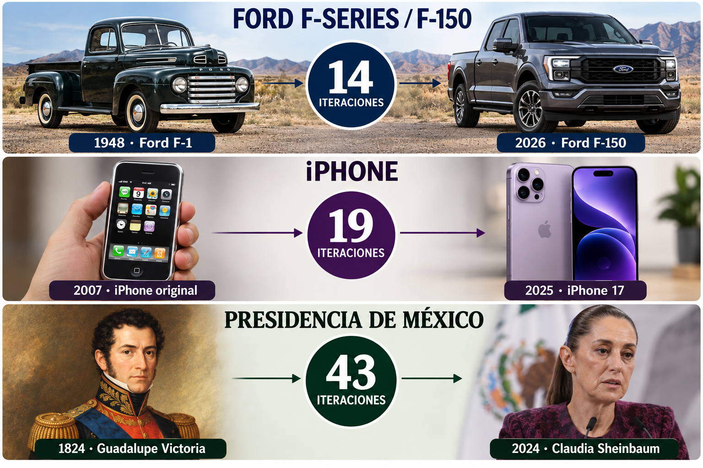
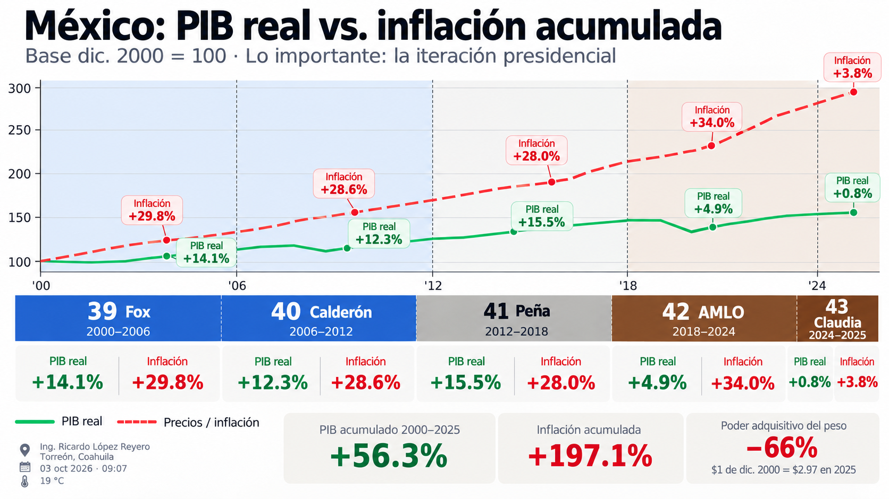

# El Fin de la Democracia: Gracias Claudia

_Ing. Ricardo López Reyero · 2026-10-03 · escrito a mano, sin IA_

El Fin de la Democracia: Gracias Claudia

_43 presidentes para llegar al actual_

El Sistema con el operamos produce el resultado. En el caso de un sistema equilibrado enfocado produce mejoras constantes con el tiempo, en el caso de un sistema no en balance produce resultados cada vez peores.

Considero que el sistema democratico fue un buena idea en su momento hoy con Claudia Sheinbaund demostramos que la democracia no es el sistema correcto para el ciudadano mexicano, de 130'000,000 millones de Méxicanos, por sistema democratico seleccionamos a la iteración #43 con un 59.7% de lo votos que en teoría tendría que ser lo mejor que el país tiene para dar, pero obvio el caso no es así.

Lo que te pone a razonar que es realmente la democracia y las conclusiones es un sistema que da la ilusión de poder a las personas. Yo no cree un partido político, yo no seleccione el candidato que ese partido propone, yo si selecciono por quien quiero dirija el país de los candidatos que primero tenían que estar alineados al partido y luego a quien creo el partido y no a mis intereses. Así que los que llegan no son los mejores alineados a mis intereses, son los mejor alineados a los intereses el creador del partido y del partido, NO MIOS. Pero sin embargo la ilusión es hermosa.

Hoy despúes de 43 iteraciones y 200 años les enseño los resultados.

_Resultados económicos de México de los últimos presidentes_

Algo casi poético: el partido actual quería tener todo el poder para poder hacer una transformación. Hoy tienen todo el poder y no lo están haciendo, porque esto demuestra que el concepto de la democracia está equivocado desde el origen.

Hoy la señora Claudia tiene todo el poder que podría necesitar para ser la mejor iteración que hemos tenido y esta teniendo los peores resultados.

Recordemos que sus iteraciones anteriores no tenían acceso a la tecnología, a la energía, al talento, a la inteligencia artificial, a los recursos que hoy sí tenemos acceso a ellos.

La democracia es un sistema que, si somos listos, deberíamos agradecer todo lo que nos ayudo en el pasado como sociedad. Pero entre más rápido evolucionemos el sistema, más rápido mejoraremos como país.

Y quiero agradecer a la Dra. Presidenta Claudia Sheinbaum por lo desastroso que ha sido su presidencia, porque gracias a eso dejé por completo de creer en la democracia.

Tendríamos que estar hoy, después de 43 presidentes, en una sociedad capitalista, con un sistema de salud increíble, de educación de primer mundo, de transporte, que todo funcione, y no es así. Para nada tiene la culpa el pendejo que llego al poder, la culpa la tiene el sistema. Si cambias el sistema de selección, llega la gente correcta con los intereses alineados al puesto correcto y causa un cambio positivo.

Si nos ponemos a analizar, el único objetivo que tendrá que tener el presidente es:

- mejorar la economía

- mejorar los sistemas internos con los que trabajamos

- mejorar la calidad de gente que entra a trabajar

- seguridad, salud y educación al máximo posible en las posibilidades del presidente

Cualquier otro interés, lo desalinea, pero hoy sí tenemos la peor desalineación que había visto yo desde que tengo uso de razón.

Y el sistema tendría que ser tan evolucionado que, si acaso llegara a colarse una persona con intereses desalineados como los que hoy vemos, el mismo sistema sea capaz de sacarla lo más rápido posible, todo lo contrario a protegerla, por que el individuo afecta al sistema completo.

Conclusión.

El sistema democratico en México hoy ya no nos funciona en lo más mínimo, esta obsoleto y desactualizado.

Solución: Actualización del proceso de selección de gobernantes.

Atte. Ing. Ricardo López Reyero

Torreón, Coahuila, México. Sábado 3 de octubre 2026, 18°. 9:35 am.
