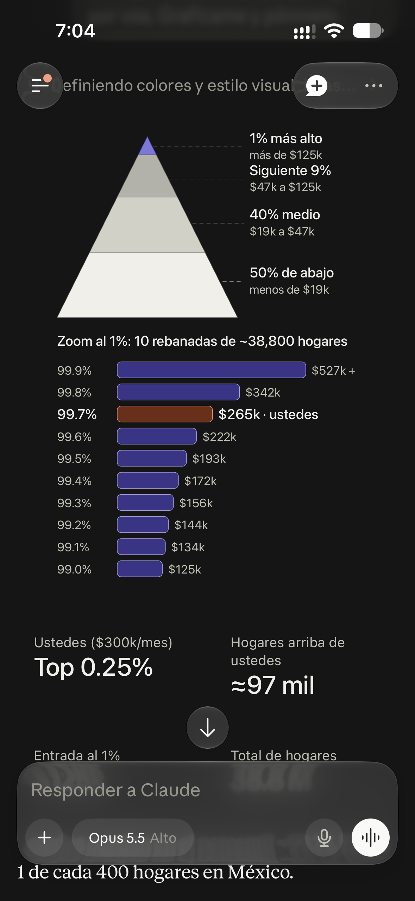

# Estar en el 1% más rico en México no es como esperas

_Ing. Ricardo López Reyero · 2026-09-27 · escrito a mano, sin IA_

Estar en el 1% más rico en México no es como esperas

Llevabamos varios días discutiendo por cosas relacionadas el dinero entre mi esposa y yo.

Cuando decido llevar la conversación por preguntar a la IA, de que % de la población estamos si ganamos $250,000 MXN al mes.

(Borré 2 veces todo por no querer escribirlo, pero si quiero)

_Estar en el 1% más rico en México no es como esperas_

Y pedi que fuera más especifico y estamos el 99.7% osea somos el 0.3%!!! Quede completamnete sorprendido de esto y dese que estuviera mal y volví a pedir que revisara completamente la información y dijo que era correcto.

Trabajas y trabajas para ir mejorando la calidad de vida, pero el ritmo es sumamente lento en este páis, y creeme que no estamos sobrados, con la inflación que hay se va comiendo el poder de compra.

Busco ser lo más real que puedo, para dejar super claro el punto, fue súper dificil llegar, mucha mucha suerte tambíen, pero no tendría por que ser así de complicado.

Hacer una empresa es complejo en México, viajar es complejo pagando casetas, el sector salud un caos y la seguridad igual. Se te va 30% en impuestos ó más, pero no estás comodo con lo que mal que esta el sector salud y pagas gastos médicos, luego seguros, y tasas de crédito de tarjetas de 40% anual, es un sistema que no te deja disfrutar del capitalismo.

Si tienes algunos lujos como alberca, pero no creas que hay una gran diferencia en la calidad de vida, vivimos en un país hermoso, con mucho potencial y lo correcto debería de ser crecer la economía de todos pero tambien hacer más eficientes los servicios del gobierno para que realmente el dinero se lo queden los ciudadanos y no tenga que ir a suplir servicios por su deficiencia.

Si escogemos dirigentes de México que quieran que todos crezacamos en las económías personales, empresariales.

No creas que esta padre hoy, espero en un futuro cambie, pero no es ni de cerca lo que hubiera imaginado.

Esto que escribo me pone en una perspectiva diferente que no había visto lo afortunado que me ha tocado vivir en México.

Nos merecemos mucho mucho más de lo que hoy tenemos y lo tendremos en a medida en las que escojamos empresarios para que dirijan el páis y no póliticos resentidos que no supieron hacer empresa (por que es extremadamente complejo en el sistema actual)

Al simplificar las cosas el ciudadano puede crecer su economía sin tener que depender de la suerte y tanto esfuerzo.

He creado unas 8 empresas, y solo 1 me funciono como quería, pero por que tuve la voluntad de no parar y soy intenso, pero no hace sentido que sea tan complicada la vida.

Imagino decenas de formas más simples en la que podría operar el gobierno para que los ciudadanos mejoren su economía de forma eficiente y sin tanto efuerzo como en el actual sistema en el que operamos México.

Ing, Ricardo López Reyero

26 de Septiembre 2026, 7:22 pm, Torreón, Coahuila, México, 31°
