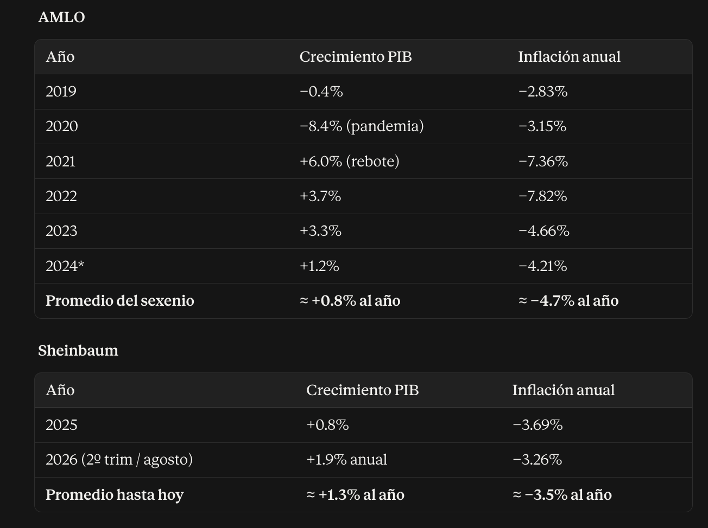

# La presidenta más estúpida de todos los tiempos en México

_Ing. Ricardo López Reyero · 2026-09-27 · escrito a mano, sin IA_

Hoy tenemos a la presidenta más estupida de la historia y quisiera probar esto que estoy diciendo.

Claudia Sheinbaun se le debería de hacer un monumento por que tan egocentrica ha sido con el país. Cientos de muertes diarias por violencia, pero tambien por falta de medicina, pero tambien por la falta de mantemiento en la infrastructura del país.

Tiene todo el poder, lo que siempre quisieron y hoy lo tienen, pero con todo ese control Mexico no esta avanzado al contrario.

_Crecimiento PIB, Inflación anual, AMLO y Sheinbaum_

Con esto lo que quiero decir es como es posible que de 127'000,000 mexicanos tengamos una que no tienen idea de que hacer y tiene todo el poder!!

Es mujer y es ingeniera. Esto habla de que tiene todo para ser una gran presidenta, pero entonces por que no lo es?

El problema viene de fondo, estudio en la UNAM, fumando marihuana y acompañando a AMLO a Minitines póliticos. Esto es la base de ella. No es culpa, simpelmete es la realidad. Como le podemos pedir que crezca y dirija el país.

Esto entonces evidencia que en la democracia se metes inutiles y luego hacienden hasta dirigir toda una ecónomia, pero no tienen la menor idea de como hacerlo.

Y repito la culpa nunca es del idiota, es 100% del sistema que se uso para seleccionarlo. <-- Esto es sumamente importante que quede claro.

El problema no es de esfuerzo, es de sistema.

El sistema operativo en el que hoy esta trabajando México es obsoleto completamente, la democracia fue un buena prueba que nos dío como prueba contundente de que no funciona con Claudia Sheinbaun. Así que por eso podemos estar agradecidos con ella.

Juro que en algún punto tuve Fe en que podría estar equivocado yo y que Claudia funcionara, pero es imposible por el transfondo de como fue seleccionada, por sistema llega corrupta y con los intereses completamente desalineados.

No se cuentos vivos esten deacuerdo con esto que escribo, pero se que los 70,000 almas, mexicanos, que hoy estan o desaperidos ó asesinados desde que ella tomo el cargo.

Cada dia que pasa en el cargo, es un insulto a México.

Ing. Ricardo López Reyero

26 de Septiembre 2026, 6:57 PM

Torreón, Coahuila, México 31°
