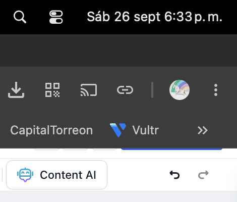

# Bibliotecas en las prisiones

_Ing. Ricardo López Reyero · 2026-09-27 · escrito a mano, sin IA_

Bibliotecas en las prisiones

Si alguien esta en la carcél significa claramente que algún pedazo de información para entender las reglas de la vida, de lo espiritual y de lo físico en la ciudad, páis, en el que estes viviendo.

El sistema te debió de haber dado esa información y no te la dio, y luego el sistema te encierra. Hace más sentido dar la información de qué sí se puede, qué no se puede, y que la gente sepa exactamente lo que necesita no hacer y sí hacer.

Las cárceles deberían de tener las mayores bibliotecas de la ciudad, porque, a fin de cuentas, tienes un grupo de personas con mucho tiempo mental libre que pudieran estar creando valor si acaso tuvieran pensamientos nuevos que los reten Y saldrían completamente reformados con un propósito y con una perspectiva diferente de la vida.

Si los tienes todos los prisioneros ahí con hormonas y sin nada que hacer, pues no hace mucho sentido. Deberán estar estudiando, trabajando, ejercitándose y formando valor, creando valor para la sociedad de alguna forma.

Ing. Ricardo López Reyero

26 Septiembre, 2026, 6:33 pm

_Las prisiones pueden ser centros de desarrollo personal._
