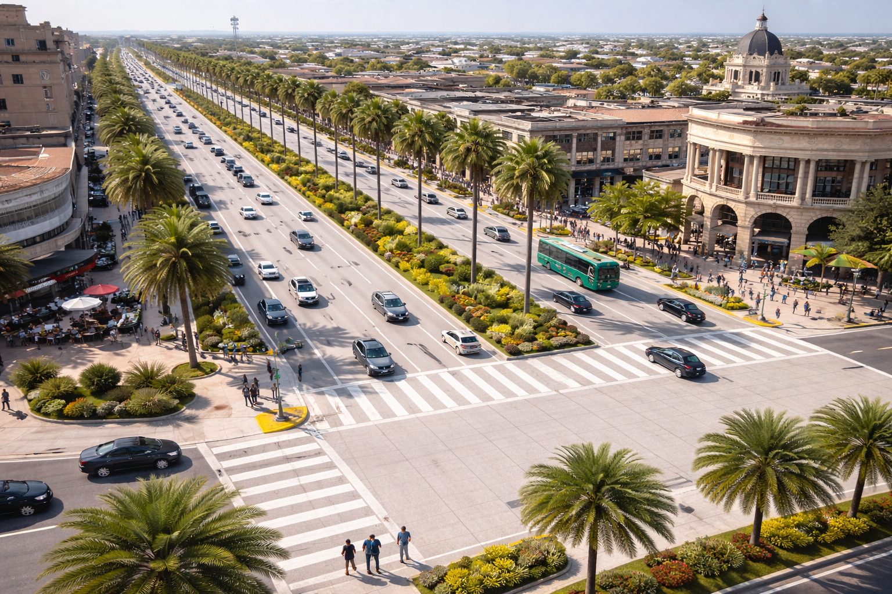
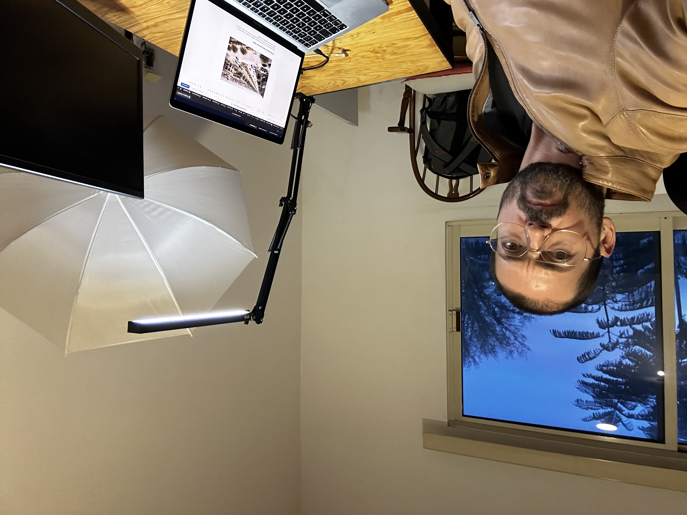

# El pavimento ideal para las calles Formula V1

_Ing. Ricardo López Reyero · 2026-01-11 · escrito a mano, sin IA_

**El pavimento ideal para las calles**

De las cosas que solo una instrucción cambia por completo una ciudad es con que continuar pavimentando con lo de siempre ó con el mejor pavimento hecho para una ciudad, que reduce el ruido, es fresco, dura decádas y se ve bonito.

**El mejor “todo terreno” para Torreón**: es el que más se acerca a _no calentarse tanto + durar muchos años + verse bien_.

- Se calienta menos que asfalto por ser más claro (mayor reflectancia).

- Puede diseñarse para vidas largas (en carreteras se usan criterios de décadas).  
**Dónde usarlo:** vialidades principales, carriles de alto tráfico, cruceros, zonas de frenado/paradas (donde el asfalto sufre más).

✅ **Si solo puedes elegir uno para Torreón: Concreto hidráulico claro.**

Nos merecemos lo mejor, por eso aportamos dinero al gobierno, para que nos de este tipo de materiales que nos beneficia a todos.

**Formúla del pavimento**

Hice 3 iteraciones para llegar a esta formúla, jamás me quedo con la primera. Esta formúla esta hecha para tener las mejores especificaciones para las ciudades y tambíen se puede usar para las carreteras pero con más grosor.

Son buenas para el ser humano y los animales, silencia las calles por que absorve sonido, cuando llueve deja pasar el agua para no crear charcos, puedes caminar descalzo de nuevo, por que disipa el calor.

Este es el primer pavimento hecho para el camión más grande pero de igual forma para caminar junto con tu familia y mascota.

## Fórmula optimizada (estructura) + especificación de “superficie cool” (lo que te garantiza confort)

### 1) Concreto estructural (para autos, pesado, años)

**TORREÓN-PCC MAX (1 m³, condición SSD)**

- Cementantes totales: **340 kg/m³**

- Cemento Portland: **204 kg**

- Escoria (GGBFS/slag): **136 kg** (40%)

- Agua: **136 L** → **w/cm = 0.40 (máximo)**

- Arena: **750 kg**

- Grava 19 mm: **1,050 kg**

- Microfibra PP: **0.9 kg/m³** (control de fisura plástica en calor)

- Aditivos: HRWR (policarboxilato) + retardante (según proveedor, sin subir agua)

- Curado: **membrana blanca** (ideal base agua/low-VOC)

### 2) Superficie obligatoria “descalzo y mascotas”

**COOL-SURFACE (aplicar en zonas peatonales/pet)**

- Recubrimiento/sellador con **NIR reflectivo** (cool pigments) y, si quieres, **microesferas huecas** como filler reflectivo.

- **Requisito contractual de desempeño:**

- **SRI mínimo** por ASTM E1980 (con reflectancia medida).

- Probar en panel piloto y exigir que el sistema mantenga SRI tras ensuciamiento/limpieza (porque baja con manchas).

### 3) “Zona ultra confort” (si de verdad quieres que sea caminable en calor fuerte)

En áreas donde quieres _sí o sí_ tolerancia al calor (plazas/juegos/dog park):

- **Topping water-retentive/permeable** (evaporativo), porque es el mecanismo más efectivo cuando hay humedad.

### 3) Clave real para que salga barato a escala (más que el material)

- **Plantas cerca** (asfalto o concreto) para que el flete no te mate.

- **2–4 “trenes” de pavimentación** (no uno): uno no da para “millones” constante por mes porque la preparación de base, logística y frentes te frenan.

- **Reciclaje en sitio** (fresado/RAP, estabilización de base) para ahorrar material nuevo.

- **Operación nocturna + 2 turnos** para rendimiento sostenido.

- **Calidad mínima firme** (QA/QC) para evitar retrabajos (lo más caro es rehacer).

**Implementación perfecta**

Busque pedir el material para que vaya una plantilla quitando y otra poniendo de forma simetrica y avancen a buen ritmo.

## Flotilla mínima para un “tren ancho” (3 carriles ≈ 10.5 m)

### 1) **Equipo de seguridad y control (siempre primero)**

- **1 camioneta con flecha luminosa** (arrow board)

- **Conos, barreras y señalamiento temporal**

- **1–2 torres de iluminación** (si trabajan de noche)

> Sin esto, el tren se frena o se vuelve peligroso.

---

## 2) Tren A: **QUITAR (Fresado + limpieza)**

**Objetivo:** dejar el piso listo y limpio para pegar la carpeta nueva.

- **1 fresadora en frío (cold milling machine)**

- **8–12 camiones de volteo** (para que la fresadora no se pare)

- **1 barredora mecánica** (barre el material suelto)

- **1 barredora aspiradora / de vacío** (limpieza fina, clave para buena adherencia)

- **1 cargador frontal** (apoyos, limpieza, cargar material)

- **1 retroexcavadora** _(solo si harán bacheo profundo)_

> Regla simple: **si la fresadora se detiene por falta de camiones, pierdes productividad.**

---

## 3) Tren B: **PONER (Riego + carpeta + compactación)**

**Objetivo:** colocar mezcla continua y compactar en caliente.

- **1 camión distribuidor de emulsión** (riego de liga “tack coat”)

- **1 vehículo de transferencia (MTV)** _(muy recomendado)_  
_(evita segregación y paros del paver; mejora calidad)_

- **1 extendedora de asfalto (paver)** con regla para 9–10.5 m  
_(si no alcanza el ancho, se hace en 2 pasadas planificadas)_

- **Compactación (para el ancho completo):**

- **2 rodillos tándem vibratorios**

- **1 rodillo neumático**

- **1 rodillo tándem estático** (acabado)

- **10–16 camiones de volteo** (para alimentar paver sin cortes)

> Regla simple: **si el paver se queda sin mezcla, se notan juntas frías y baja la calidad.**

---

## 4) Control de calidad (para que “salga bien” siempre)

- **1 equipo de topografía (nivel/estación total o GPS)** (espesores y pendientes)

- **1 termómetro IR** (control de temperatura de mezcla y compactación)

- **1 densímetro nuclear o equipo equivalente** (control de compactación)

- **1 camioneta de supervisión/QA**

> Esto evita retrabajos (lo más caro).

**Tamaño de planta**

Dame el tamaño de la planta para en 15 años terminar de cambiar torreón al nuevo pavimento

[Pensado durante 2m 58s]([object Object])

Para dimensionar la planta **con números reales**, tomé 2 datos locales de IMPLAN Torreón:

- **Mancha/área urbana:** 15,288.8 hectáreas (≈ **152,888,000 m²**).

- En fraccionamientos 2014–2024, las **“nuevas vialidades”** suman 2,535,221.62 m² dentro de una **superficie urbanizada** de 10,207,939.66 m² → eso da **≈ 24.8%** del suelo como vialidades.

### 1) ¿Cuánta superficie hay que “cambiar” en Torreón?

152,888,000 m² (urbano) × 24.8% ≈ **37.97 millones de m²** de vialidades a intervenir.

Si quieres terminar en **15 años**:

- **≈ 2.53 millones m²/año**

- **≈ 211,000 m²/mes**

_(Dato de referencia: hoy SIMV reporta del orden de **700,000 m²/año** rehabilitados, así que el plan 15 años implica subir el ritmo aprox. 3–4×)._

---

## 2) Tamaño (capacidad) de la planta necesaria

Para pavimento asfáltico tipo **fresado + carpeta nueva** (lo más productivo), la capacidad depende del **espesor promedio**:

- Si el promedio fuera **4 cm** → necesitas ~**95 t/h** (en un turno de 8 h, 26 días/mes)

- Si el promedio fuera **5 cm** → ~**120 t/h**

- Si el promedio fuera **6 cm** → ~**143 t/h**

### Recomendación “para que sí se cumpla” (sin irte sobrado)

➡️ **Planta de 160–200 toneladas por hora (TPH)**

Porque te da colchón para:

- días de lluvia/paros,

- mantenimiento,

- picos de obra,

- mezcla con RAP/WMA,

- y no depender de operar perfecto 100% del tiempo.

---

## 3) Tamaño físico del sitio (para que opere bien y barato)

Para una planta **160–200 TPH** rentable (con acopios grandes y buena logística):

- **Predio recomendado:** **3 a 5 hectáreas** (cómodo y sin choques de camiones)

---

## 4) Qué debe traer esa planta (lo mínimo “bien armado”)

- **6 tolvas frías** (agregados)

- **Baghouse/filtro de mangas** (polvos)

- **Silos de mezcla caliente: 3–4** (para no parar por logística)

- **Sistema WMA** (templada) para ventana de compactación y menos combustible

- **RAP 30–40%** (para bajar costo/ton y subir margen)

Con eso, una sola planta **160–200 TPH** puede sostener el plan de “terminar Torreón en 15 años” a ritmo promedio (y con margen operativo).

PD: Imagina poder caminar 2X más comodo por un buen pavimento.

Atte. Ing. Ricardo López Reyero

Sábado 10 de Enero, 2026, Torreón, Coahuila, México. 13º
