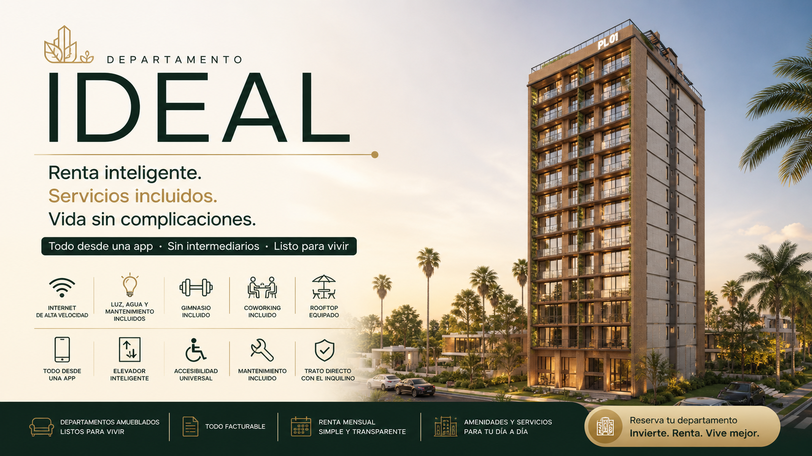
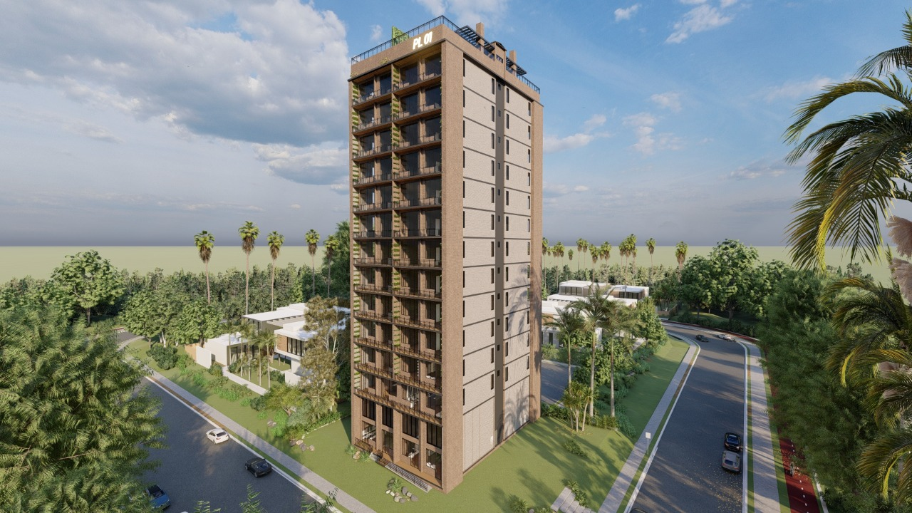

# El Departamento ideal White Paper

_Ing. Ricardo López Reyero · 2026-05-05 · escrito a mano, sin IA_

El Departamento ideal White Paper

**El Departamento ideal**

[https://presentaciones.ricardolopezreyero.com/el_departamento_ideal](https://presentaciones.ricardolopezreyero.com/el_departamento_ideal)

**El problema: **Cada arquitecto y desarrollador innovan desde cero cada vez que van a construir, esto eleva los costos de desarrollar, luego venden a terceros y estos rentan a los inquilinos, es un proceso ineficiente y costoso.  
  
**Solución: **Tratar los departamentos como se desarrolla software siempre mejorando y eficientando costos, trato directo con los inquilinos finales.

Podemos hacer que las personas tengan una calidad de vida mejor si pensamos por ellos y optimizamos cada parte del departamento y del edificio.  
  
Objetivo Principal  
Que los inquilinos tengan una calidad de vida por el menor precio de renta posible.  
  
  
Objetivo númerico  
Los números deben de dar una utilidad del 25% con una ocupación al 85%, no más que esto.  
  
4 tipos de edificios: 44, 88, 132, 176, departamentos  
  
Departamento ideal 44  
• 44 departamentos, del #1 al #44, exactamente el mismo tamaño y distribución,  
• Que los elevadores lleguen al cuarto.  
• Que se puedan subir paquetes ó comida directo al departamento, sin que la persona tenga que bajar.  
• Que el elevador te diga cuanto tiempo para abrirse, causa mucho estrés no saber cuanto tienes que esperar.  
• Poder pedir el elevador desde varios puntos del departamento y con voz.  
• El precio de renta es exactamente el mismo no importa que tengas en el cuarto multi uso.  
• Completamente amueblados, con accesorios esenciales de la cocina.  
• Totalmente hecho para personas con discapacidad, visual, motriz, auditiva.  
• Cada área y cada piso debe de tener su aislante de sonido y térmico.  
• 1 vez cada 11 días le toca el rooftop a un departamento, no excepciones, esto viene incluido en el precio.  
• Internet de alta velocidad, luz, agua, mantenimiento, gym, oficinas incluidas en el precio de renta.  
• Esconder el número de piso y departamento a los repartidores.  
• Todos los demás servicios se pueden pagar en el momento de la reserva o con cargo a la mensualidad.  
• 3.33 metros de altura los departamentos  
• Todo es facturable.  
• Posicionamiento, una cara al amanecer y una cara al atardecer.  
  
Negocio  
Crédito al 4% en USA, Cobro del 8% a los inquilinos + rentas de los negocios internos.  
Crédito al 8% en MX, cobro del 12% a los inquilinos + rentas de los negocios internos.  
Renta siempre por mes iniciando el día primero y terminando el último del mes.  
  
Digital  
Aplicación: Que absolutamente todo se controle de la aplicación y que puedas dar accesos a amigos y familiares y quitarlos, sistema de tickets para mantenimientos.  
Página: Con modelo 3D, que se pueda pagar ahí mismo y este ligado a la aplicación.  
Proveedores: Que sea pública la lista para que se vaya mejorando con el tiempo y reduciendo de precio.  
  
Arquitecto sugerido  
[https://www.dna-barcelona.com/projects-dna-barcelona-architects/](https://www.dna-barcelona.com/projects-dna-barcelona-architects/)  
Gran Via de les, Corts Catalanes 794, 08013 Barcelona, Spain, +34 935397566 [info@dna-barcelona.com](mailto:info@dna-barcelona.com)  
Tipo de diseño: Mexicano fresa ó Jose Gonzalez  
  
Constructora  
[http://en.broad.com/ProductShow-76.aspx](http://en.broad.com/ProductShow-76.aspx) +86-731-84086266  
Tiempo de ensamble máximo 2 días  
  
Crédito  
[https://www.dd3.mx/](https://www.dd3.mx/)  
Como se construye súper rápido y es para rentar solo se necesita un solo crédito en vez de 3.  
Tasa de máximo 7.5% a 30 años. Entre más baja la tasa más barata la renta, siempre buscar la mejor tasa posible.  
  
Tiempo de construcción  
1 semana preparación terreno  
  
1 semana excavación  
1 semana de cimientos  
1 semana estacionamiento  
1 semana de estructura metalica  
1 semana contrucción amenidades y departamentos  
.5 semana conexciones  
.5 semana acabados  
.5 semana muebles  
1 semana pruebas  
Total Aprox 7.5 semanas de inicio a fin  
Objetivo: Reducir los tiempos tanto como sea posible <- Ideal 4 semanas totales.  
  
Orden y nombre de pisos  
Rooftoop equipado  
Parque  
11  
10  
9  
8  
7  
6  
5  
4  
3  
2  
1  
Amenidades (Gym | Work Space | Cines)  
Recepción 1.5 altura, tienda básicos, bussines center  
-1 Estacionamiento A (1-5)  
-2 Estacionamiento B (6-10)  
-3 Estacionamiento C Visitas  
  
  
Conclusiones  
Debemos de hacer lo máximo posible por bajar el precio de construcción y equipamiento para este ahorro transladarlo directo a los inquilinos y que tengan la mayor calidad de vida al menor costo posible.  
  
Se debe de evitar intermediarios al máximo posible por que solo incrementan el precio final.  
  
Los servicios deben de estar incluidos para dar una libertad total de movimiento a los inquilinos y como los paga el edificio vamos a buscar economía de escala y eficientarlos tanto como sea posible.

El mantenimiento debe de estar incluido, a fin de cuentas el edificio no es de los inquilinos, **ellos pagan libertad no problemas.**

[Video: 69f965694378192c4eb3f372.mp4](imagenes/69f965694378192c4eb3f372.mp4)

[https://presentaciones.ricardolopezreyero.com/el_departamento_ideal](https://presentaciones.ricardolopezreyero.com/el_departamento_ideal)

Es una gran idea, le falta la ejecución. No ha llegado la persona correcta para adoptar este proyecto.

Esta idea es sumamente antigua en mi conciencia, pero escribo este escrito:

Lunes 4 de Mayo 2026, 10:28 Pm, Torreón, Coahuila, México. 24°

Ing. Ricardo López Reyero
