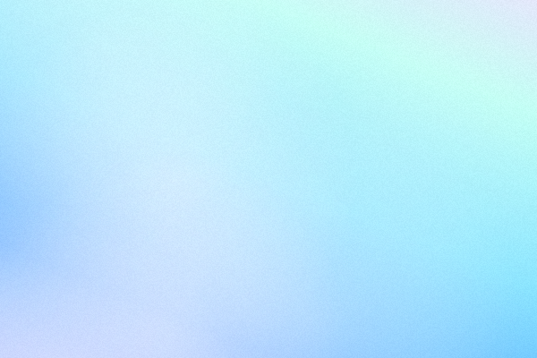

# 0 redes sociales por 1,171 días

_Ing. Ricardo López Reyero · 2026-04-23 · escrito a mano, sin IA_

**0 redes sociales por 1,171 días**

20.01.2023 a 05.04.2026 = 1,171 días sin redes sociales

Al momento de escribir esto llevo más de 38 meses de desintoxicación de redes sociales.

De plano con Instagram me declare perdedor, me conocía perfecto lo que me tenía que poner para mantenerme haciendo scroll infinito por decenas de minutos por sesión.

Antes, 45 minutos diarios en instagram, 20 minutos tiktok. De diario y sin mucho problema estos números.

Solo quiero relatar lo que se siente por si alguna vez te lo haz preguntado.

Estas palabras que escribo muy probablemente no existirían, por lo borroso que estaban los pensamientos, al ver tantos videos por minuto con tanta publicidad cuando quería concentrarme en algo brincaba sin mucho control al siguiente pensamiento y al que sigue, sin parar, la concentración era mucho más compleja de lograr.

El estar viendo lo mejor de las vidas de las personas la verdad me daba un poco de envidia, aún que sabía que solo pones los mejores 30 segundos del día por que exacto eso hacía yo, en vez de estar disfrutando el día completo estaba expectante de que podría compartir en redes.

Hoy la linea de pensamientos relacionados y continuos es lo normal, la atención la puedo tener por horas en lo que Yo conscientemente decido que es lo más importante para mí vida. Puedo ver a 10 años de distancia fácilmente pero saber que tengo que hacer hoy para esa visión sea realidad.

Estoy experimentando claridad y paz, gracias a no saber que hace todo el mundo. Disfruto el día a día de forma más presente sin la constante ganas de guardar todo para publicarlo. (podría cambiar esta parte, pero hoy es lo que es)

Todavía me acuerdo de los 2 primeros días con 0 redes, me sobraba tiempo al final del día.

45 minutos al día (es muy posible que sea más) x 365 días en un año / 60 minutos para dar horas = 273 horas extra al año de vista de pantalla, pero al menos 547 horas de pensamiento sobre lo que viste. La realidad sería algo más como 45 min al día = 820 horas al año de distracción.

A mí se me hizo un monton de tiempo no enfocado en mejorar mí vida que no estaba dispuesto a dar.

Al quitar el ruido que causaban en mí cabeza, pude ver por fin mí vida de forma mucho más clara, tuve tiempo para hacerme preguntas importantes y tiempo para responderlas.

Es hermoso poder escribir el pensamiento, antes esta habilidad estaba dormida por la cantidad de ruido que tenía.

Agradezco la desición de apagar esa parte de mí vida digital para ganar claridad.

Domingo 5 de Abril 2026, Torreón, Coahuila, México, 21°

Ing. Ricardo López Reyero
