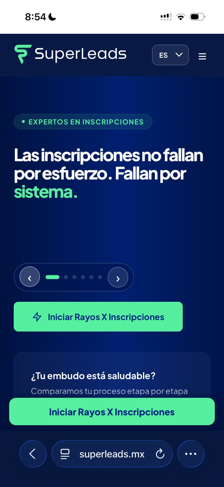

# Enfoque para agregar valor

_Ing. Ricardo López Reyero · 2026-04-23 · escrito a mano, sin IA_

**Enfoque para agregar valor**

Hace tiempo tiempo perseguía ideas sin detenerme en una y madurarla. Para colmo eran ideas en diferentes nichos. Agregando poco valor en cada emprendimiento, batallando para pagar la nómina, quebrando y cambiando de uno al que sigue, sabiendo que algún día encontraría el negocio exacto en el que me pudiera enfocar.

Estando en [IngenieriaDigital.mx](http://IngenieriaDigital.mx) una consultora digital en la hice +130 páginas para diferentes negocios leí un libro 📘 The Road Less Stupid — Keith J. Cunningham (2017) gran gran libro, me hizo enojarme tanto conmigo que lo castigue 6 meses, pero eso que me dijo era justo lo que necesitaba, pero el punto es que te dice que te sientes 50 minutos a responder la pregunta más importante que te puedas formular en ese momento. Y que no pares de escribir hasta que termine el tiempo, al principio va ser simple pero a medida que pasa el tiempo se va ir complicando y es parte del proceso, pero no puedes parar de estar concentrado y seguir buscando la respuestas de diferentes angulos, los primeros 20 minutos simple, siguientes 20 min complicados, últimos 10 complejos. Al final encierras de todas ls respuestas la que más te hace sentido y no paras hasta hacerla realidad.

Con esto dicho hay mucha gente el mundo con un talento increible, con unas ganas de ser más, con ganas de impactar más, pero que no se han sentado a hacerle las preguntas correctas por estar entretenido con el mundo exterior. Es importante dar un espacio para nosotros mismos, que queremos, a donde vamos, como le hacemos y hacer preguntas y contestarlas uno mismo, sin ayuda de nadie más que en la confianza propia.

¿A que nicho me debo de enfocar que tenga la máxima rentabilidad y longevidad?

22 de febrero 2022. Ing. Ricardo López Reyero, Torreón, Coahuila, México

22 de febrero 2022 a 19 de marzo 2026 = 1486 días de enfoque hasta llegar a este punto que no será el final, pero vamos con mucha dirección.

Claridad total del problema, de la solución, del nicho, del impacto.

Toma tiempo, mucho más tiempo del que crees, pero eventualmente con mejoras constantes en el producto, en la empresa, pero sobre todo en uno mismo.

Hay que decir una cantidad de NO's a proyectos y distracciones que unos duelen y otros les haces luto, pero al final te da espacio para poder agregar valor a los clientes y a la empresa.

Pd. Muchas fechas en este escrito.

Ing. Ricardo López Reyero, Torreón, Coahuila, México, 19 de marzo 2026, 20º
