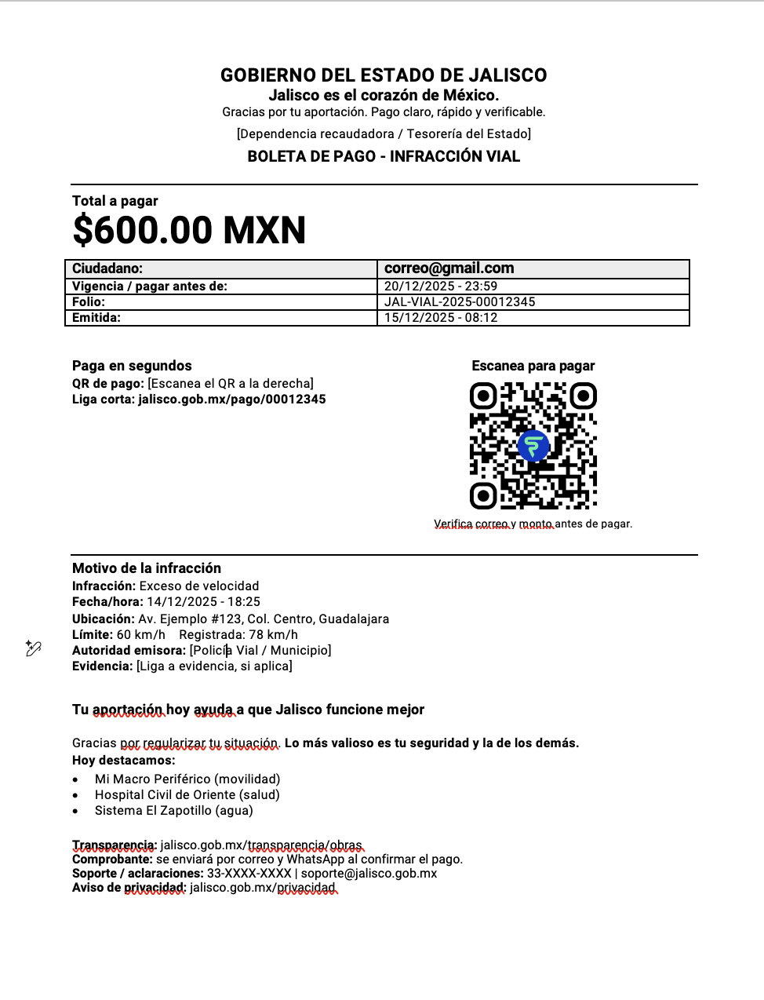
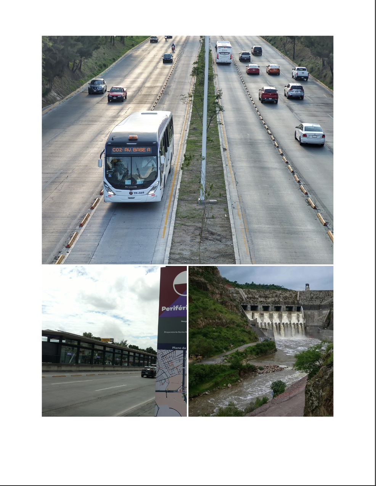

# Cobranza de impuestos 2.0

_Ing. Ricardo López Reyero · 2026-04-23 · escrito a mano, sin IA_

**Cobranza de impuestos 2.0**

La forma de cobrar hoy impuestos es como de la era feudal, antigúa, ruda, sucia, despota, cuando debería de ser un honor pagarlos, gracias a ellos se construye la infrastructura en la que hoy vivimos, pero el ángulo actual de cobranza no es el mejor, propongo un formato mucho mejor para todos.

Le podemos llamar impuestos ó le podemos llamar Aportaciones, que a fin de cuentas es lo que es.

Los tránsitos, los departamentos de cobranza tendrían que ver al ciudadano como donador y tratarlo como tal. El gobierno busca que su donadores tengan más y más dinero para que sus aportaciones suban y suban. El ciudadanos quiere aportar más y más al gobierno por que gracias a él hay movilidad y seguridad (luego tocaremos el tema) y gracias a esto tu puedes vender y comprar con lo que mejora tú vida.

Damos por hecho la calle por la que pasamos, la electricidad que llega a nuestras casas y oficiinas, damos por el hecho los hospitales, colegios, policias, bomberos, puentes, túneles que nos permiten tener una mejor calidad de vida y que sin el gobierno no los tendríamos.

El acto de pagar impuestos se va dar, pero en ningún momento tiene por que ser doloroso como lo que hoy es, puede ser un acto de contribución de forma en la que ambas partes salen beneficiadas de este intercambio.

El pagar tiene que ser simple y transparente para que sea una transacción rápida, no hay necesidad de hacer algo tortuoso.

El exíto del país depende en gran medida de la alineación de sus partes. Ciudadano + Gobierno.

El objetivo del gobierno debe ser proveer la plataforma para que sus aportadores | ciudadanos | donantes | clientes crezcán económicamente de la forma más eficiente posible para luego recaudar más.

El pensar en mantener a la población con bajo ingreso es pensar con escaces y no debemos tener gobernantes con este perfil, hay abundancia para todos si las personas correctas están en los puestos correctos buscando lo mejor para todos.

4 de enero 2026, 2:51 am, Torreón, Coahuila, México. 10º Grados.

Ing. Ricardo López Reyero
