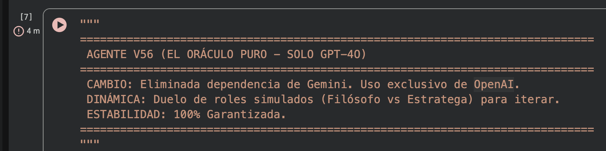
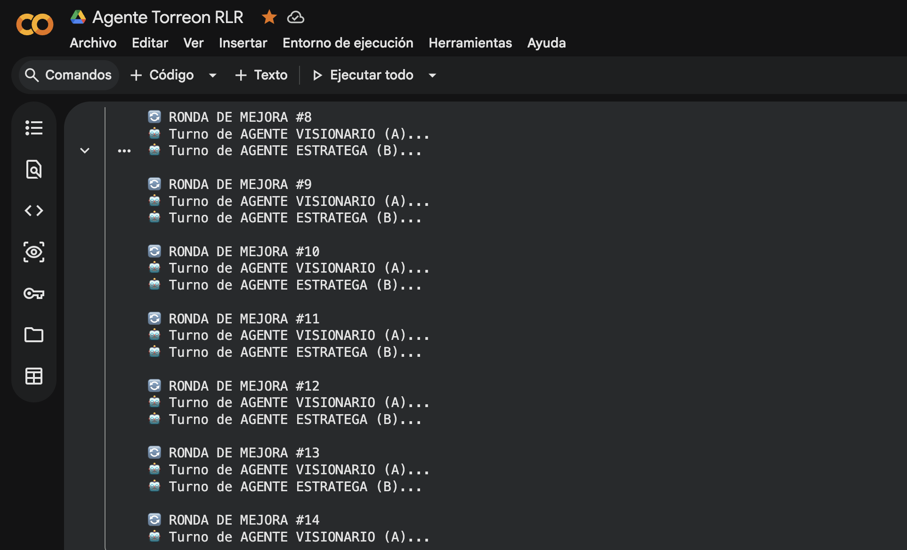

# Crédito al Trabajo Formal

_Ing. Ricardo López Reyero · 2026-04-23 · escrito a mano, sin IA_

Semilla: **¿Que pregunta sería la más inteligente que te podría hacer para agregar valor a México?**

Agente Metacognitivo (que itera, que puede estar en bucle)

14 rondas de mejoras con 2 agentes en cada una.

La pregunta final:

“Si solo pudiéramos lanzar un experimento nacional en los próximos 12 meses para reducir desigualdad de forma medible, ¿cuál sería (dónde, con quién y cómo), qué indicador principal probaría que funcionó, y qué diseño institucional lo haría resistente a cambios políticos para poder escalarlo? En México, cual sería tu respuesta

## Experimento: “Crédito al Trabajo Formal” (tipo EITC mexicano) para subir ingresos y empujar formalización

**Idea central:** en un país donde la **informalidad ronda ~54.8%** (ENOE, 2º trimestre 2025), atacar desigualdad rápido pasa por **subir el ingreso neto** del trabajador de bajos ingresos y **bajar el costo de formalizar** para microempleadores.

### 1) ¿Dónde, con quién y cómo?

**Dónde (piloto 12 meses):**

- 60–100 municipios de alta pobreza e informalidad en **Chiapas/Oaxaca/Guerrero** (o mix con 1 estado del norte para comparar), con **municipios control** similares.

**Con quién (implementación realista):**

- **SAT + IMSS** (pago y verificación), **STPS** (vinculación laboral), **Gobiernos estatales/municipales** (ventanillas y difusión), e **INEGI** como evaluador/medición independiente.

**Cómo (intervención concreta):**

- **Crédito reembolsable mensual** depositado directo al trabajador **formal** (registrado en IMSS) con salario bajo/medio-bajo.

- Se calcula con una fórmula simple: a menor ingreso, mayor complemento (con “fase de salida” para no castigar aumentos).

- **Subsidio temporal** a cuotas IMSS para **microempresas** que formalicen por primera vez (para quitar el “dolor” del primer paso).

- **Inscripción automática y “cero trámites”**: si el patrón registra al trabajador y timbra nómina, el sistema activa el complemento sin solicitudes discrecionales.

- **Bono extra** para madres/padres con niños pequeños (opcional) para aumentar participación laboral femenina (sin crear otro programa aparte).

> Resultado esperado en 12 meses: **más ingreso disponible** en hogares pobres y **más empleo formal** (menos vulnerabilidad).

---

### 2) Indicador principal (uno) que probaría que funcionó

**Indicador principal:**  
**Aumento del ingreso disponible mensual (mediana) del 40% inferior de hogares** en municipios piloto vs. control, medido con **encuesta independiente pre/post** + verificación con datos administrativos (IMSS/nómina).

Esto es directo: si sube _de verdad_ el ingreso disponible del 40% inferior, **bajó desigualdad en lo que importa** (capacidad de consumo y ahorro), sin depender de que salga ENIGH justo ese año (aunque ENIGH existe y sirve para validar en ciclo posterior).

---

### 3) Diseño institucional para que resista cambios políticos y pueda escalar

Para “blindarlo”:

- **Derecho automático, no discrecional:** reglas por fórmula (ingreso/IMSS), sin padrones manipulables.

- **Evaluación y medición con autonomía técnica:** anclarlo en **INEGI** (más aún porque se aprobó transferirle funciones que hacía CONEVAL).

- **Pre-registro público** del experimento (qué se medirá, cómo, cuándo) + **datos abiertos** (anonimizados) + tablero mensual.

- **Ley y presupuesto multianual con gatillo de escala:** si el indicador principal supera un umbral (p. ej. +X% ingreso disponible del 40% inferior **y** +Y puntos de formalidad), se activa expansión automática a más municipios en el siguiente presupuesto.

- **Consejo de gobernanza mixto:** SAT/IMSS/INEGI + academia + sector empresarial + sociedad civil con sesiones públicas y minutas.

---

Si tuviera que resumirlo en una frase:  
**“Un complemento de ingreso al trabajo formal, pagado automático y evaluado de forma independiente, para que el crecimiento llegue primero a los de abajo y además se reduzca la informalidad.”**

Sábado 17 de Enero 2026, 1:05am, Torreón, Coahuila, México, 12º

Ing. Ricardo López Reyero
