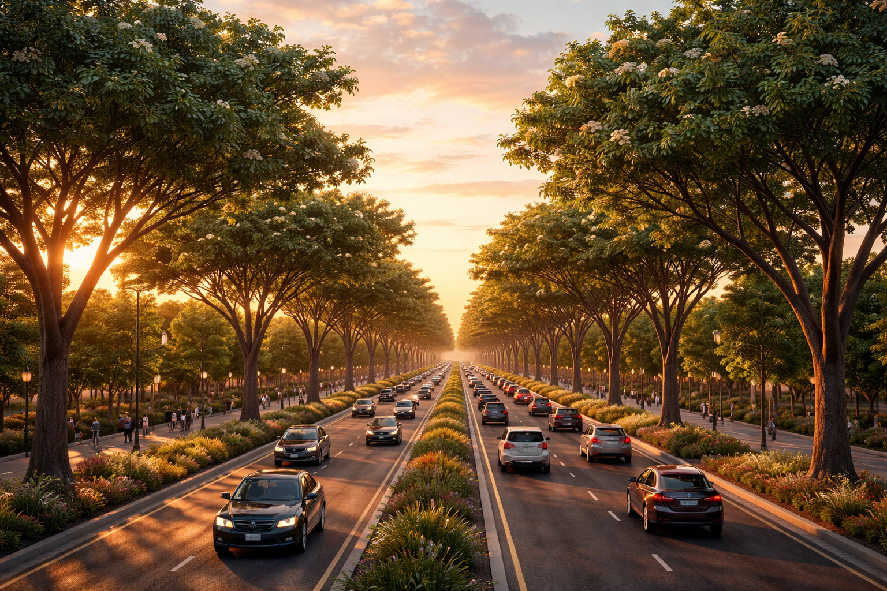
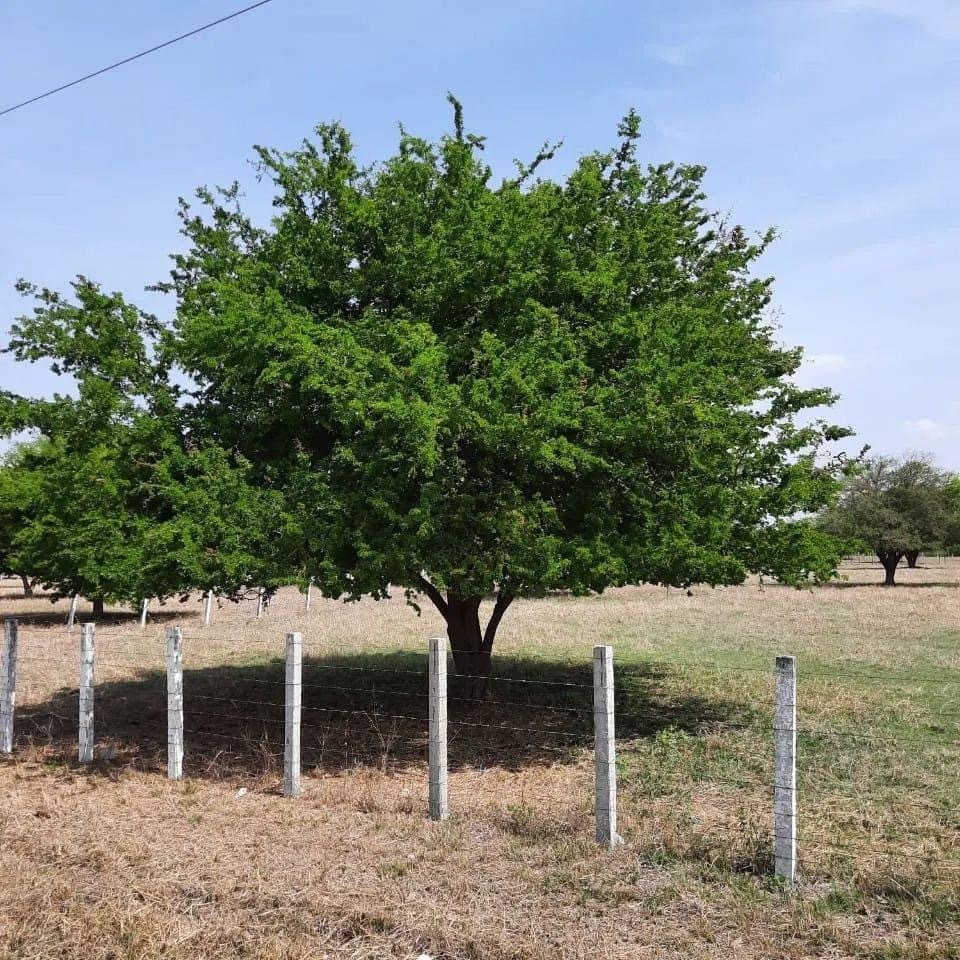
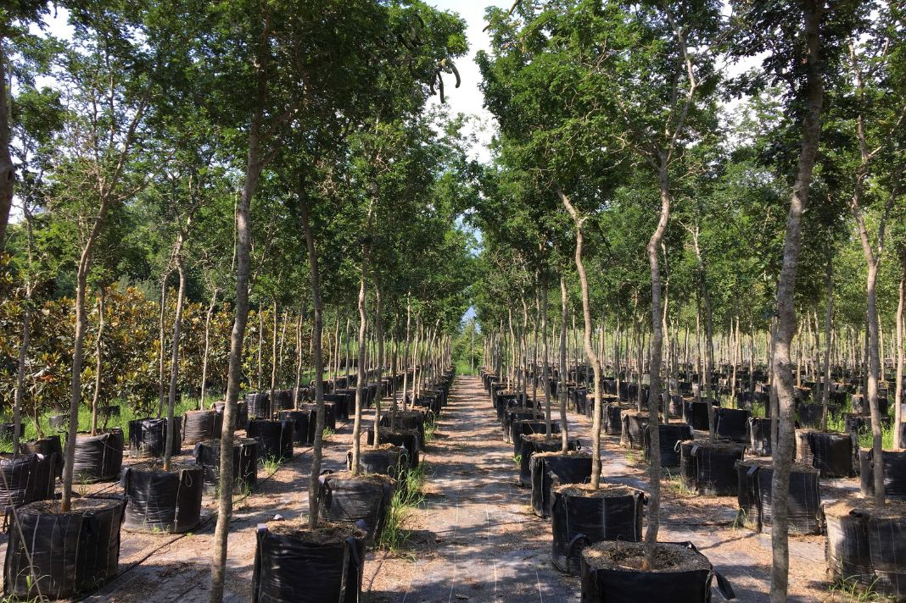
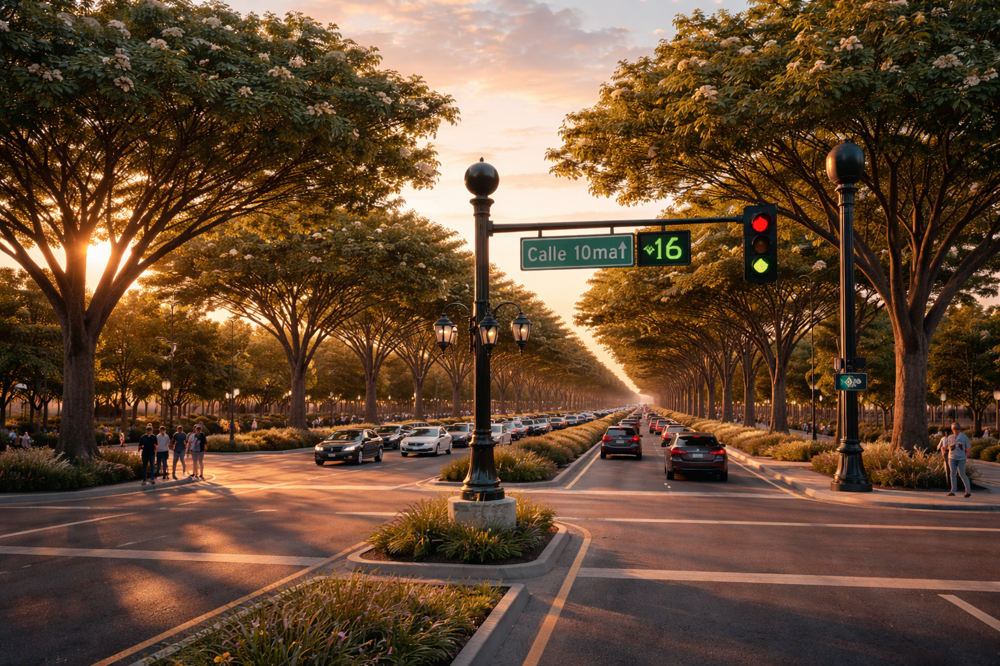

# Miles de árboles nuevos en la ciudad Torreon

_Ing. Ricardo López Reyero · 2026-04-23 · escrito a mano, sin IA_

**Miles de árboles nuevos en la ciudad Torreon**

Al agregarle a la ciudad miles de arboles el ciudadanos va tener una mejor calidad de vida por las siguientes razones:

1.- Va estar más verde la ciudad

2.- Va mejorar mucho la vista

3.- Mucho más sombra para caminar

4.- Más consumo de CO2 = Menos contaminación

El estado hace su parte, pero el ciudadano tambíen. No hace sentido ser pasivo en este punto, cada arból sembrado mejora la vista la ciudad al innstante de sembrarlo y con el tiempo mejorara mucho más.

Busque el mejor arból para Torreón.

Que tire poca hoja, consuma poca agua, se buena sombra, tenga tronco alto para que no este estorbando.

Dime que arbol es el más correcto para una ciudad como Torreón de vista al 2100 que tenga mucha vida. Dame 2 opciones y el por que de cada una.

Si le das forma desde el principio logras formas como las siguiente

Ebenopsis ebano

[https://en.wikipedia.org/wiki/Ebenopsis_ebano](https://en.wikipedia.org/wiki/Ebenopsis_ebano)

Semaforo + Árbol

Ing. Ricardo López Reyero

6:24 pm, Domingo 4 de Enero 2026, Torreón, Coahuila, México, 24º Grados
