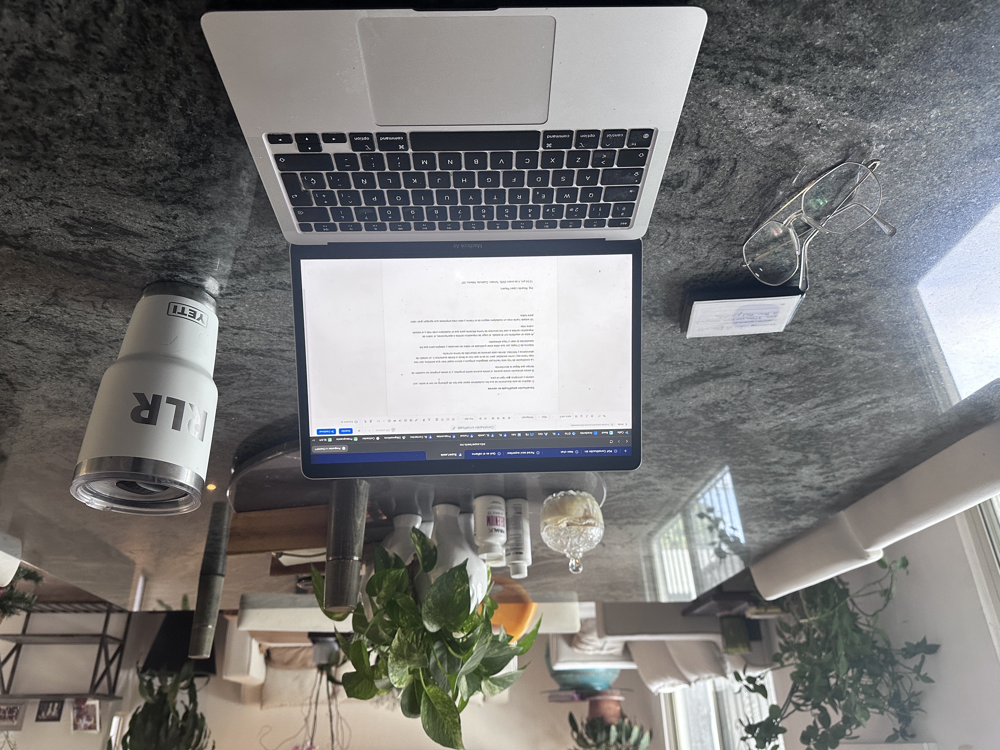

# Constitución simplificada en valores

_Ing. Ricardo López Reyero · 2026-04-23 · escrito a mano, sin IA_

**Constitución simplificada en valores**

El objetivo de este documento es que los ciudadanos sepan que tipo de gobierno es con el están, sus valores y principios que rigen el país.

Si existe alineación existe avance, si existe avance existe progreso, y si existe progreso es cuestión de tiempo que llegue la abundancia.

La constitución de hoy esta hecha por abogados antiguos y estuvo súper bien que existiera, eso nos trajo hasta aquí como sociedad, pero no es lo que nos va llevar a donde queremos ir, un estado de abundancia y felicidad, donde cada persona se desarrolle de forma correcta.

Máximo de 2 hojas, por que debe estar publicada en todos las escuelas y colegios para que los estudiantes la vean y haya alineación.

Al estar en equilibrio con el estado, el pago de impuestos cambia a aportaciones, el cobro de impuestos cambia a usar los recursos de forma eficiente para que el ciudadano cree más y el estado cobre más.

Un estado fuerte crea un ciudadano seguro de si mismo y esto crea empresas que agregan gran valor para todos.

Antes de leer la propuesta te invito a que veas la actual, no te digo que la leas pero al menos vela, te dejo el archivo: [Constitución Mexicana 1.0](https://storage.googleapis.com/msgsndr/oJZ21k8uxJN71kkkhwF9/media/695ac3b4edb8a27f2bd39d91.pdf)

[Propuesta de constitución de México 2.0.](https://edu.superleads.mx/v2/preview/GdRTc8RSknnhj1hSEk29/post-preview/new-blog-post-8271)

---

## 🇲🇽 Valores y principios que rigen a México

_(Una visión clara para vivir bien y construir el país juntos)_

La Constitución de México no solo organiza el poder.  
Define **cómo convivimos**, **qué valoramos** y **qué tipo de país queremos ser**.

Estos son los principios que nos unen.

---

### 1. **La dignidad humana es el centro de todo**

Cada persona vale por el simple hecho de existir.  
El Estado y la sociedad existen para **proteger la vida, la dignidad y el bienestar**.

👉 Nadie es menos.  
👉 Nadie sobra.

---

### 2. **Estado y ciudadanía son aliados**

México no se construye solo desde el gobierno ni solo desde la gente.

👉 **El Estado y los ciudadanos trabajan juntos**.  
👉 Ambos tienen derechos **y responsabilidades**.

---

### 3. **Buscamos la abundancia compartida**

México busca abundancia en todos los sentidos:

- Económica

- Mental

- Física

- Social

- Energética

👉 La abundancia no es exceso: es equilibrio y bienestar para todos.

---

### 4. **La ley es igual para todos**

No hay ciudadanos superiores ni inferiores.

👉 La ley protege a todos por igual.  
👉 El poder existe para servir, no para abusar.

---

### 5. **La libertad es un valor fundamental**

Cada persona es libre de:

- Pensar

- Expresarse

- Crear

- Elegir su camino de vida

👉 La libertad crece cuando se ejerce con responsabilidad.

---

### 6. **La salud es un bien común**

Somos una sociedad que **cuida su salud y la de los demás**.

👉 El Estado facilita el acceso a la salud.  
👉 Las personas participan activamente en su autocuidado.

La salud no es solo curar, es **vivir mejor todos los días**.

---

### 7. **Buscamos una alimentación correcta y consciente**

La alimentación es base de la vida.

👉 Promovemos comida real, nutritiva y accesible.  
👉 Cuidamos lo que producimos y lo que consumimos.  
👉 Protegemos nuestra biodiversidad y tradiciones alimentarias.

---

### 8. **El ejercicio y el movimiento son parte de la vida**

El cuerpo necesita moverse para estar sano.

👉 Promovemos el ejercicio como hábito cotidiano.  
👉 El movimiento fortalece la mente, el carácter y la comunidad.

Una sociedad activa es una sociedad más sana y más fuerte.

---

### 9. **Educación para la sabiduría y el crecimiento continuo**

La educación no es solo memorizar hechos del pasado con ideas del pasado.

👉 Enseñamos a **pensar**, no solo a repetir.  
👉 Fomentamos la **auto-reflexión**, la curiosidad y el criterio propio.  
👉 Promovemos el **aprendizaje continuo durante toda la vida**.

El objetivo es formar personas conscientes, no solo informadas.

---

### 10. **Invertimos en ciencia, tecnología y una vida mejor**

Somos una sociedad a la que **le gusta vivir bien**.

👉 Por eso invertimos **de forma fuerte y decidida en tecnología**.  
👉 La tecnología mejora la salud, el trabajo, la educación y la calidad de vida.

Invertir en tecnología es invertir en bienestar.

---

### 11. **Investigación, desarrollo y longevidad**

El conocimiento es una inversión estratégica.

👉 Impulsamos la investigación científica.  
👉 Buscamos vidas más largas, sanas y productivas.  
👉 La ciencia está al servicio de la gente.

---

### 12. **El trabajo y la empresa crean prosperidad**

El trabajo digno y la iniciativa privada construyen país.

👉 Se fomenta el emprendimiento responsable.  
👉 La prosperidad genera bienestar colectivo.

---

### 13. **El coraje de mejorar lo que puede mejorar**

Somos una sociedad con **coraje**.

👉 Coraje para cuestionar.  
👉 Coraje para cambiar lo que no funciona.  
👉 Coraje para mejorar sin miedo.

El progreso requiere valentía.

---

### 14. **La confianza en uno mismo es una base fundamental**

Una sociedad fuerte confía en sí misma.

👉 Fomentamos la **confianza personal**, la autoestima y la responsabilidad individual.  
👉 Personas que confían en sí mismas construyen mejores comunidades.

---

### 15. **Protegemos a quien más lo necesita**

La justicia busca equilibrio.

👉 Protegemos especialmente a niños, mujeres, personas mayores, personas con discapacidad y comunidades vulnerables.

---

### 16. **México es diverso y eso nos fortalece**

Nuestra diversidad cultural, social e indígena es una riqueza.

👉 Respetar la diferencia nos hace más fuertes.

---

### 17. **Cuidamos el planeta y nuestra energía**

El futuro depende de nuestras decisiones de hoy.

👉 Buscamos **100% energía renovable**.  
👉 Incrementamos la **producción y el consumo responsable de energía**.  
👉 Cuidamos la naturaleza para las siguientes generaciones.

---

### 18. **La honestidad sostiene al Estado**

El poder público debe ejercerse con:

- Honestidad

- Transparencia

- Responsabilidad

👉 La corrupción rompe la confianza social.

---

### 19. **La paz y la seguridad protegen la vida**

La seguridad existe para cuidar personas.

👉 La paz permite el desarrollo y la abundancia.

---

### 🧭 Nuestra visión compartida

**México es una comunidad donde Estado y ciudadanía, con confianza, coraje y responsabilidad, trabajan juntos para crear abundancia, salud, conocimiento, energía limpia y bienestar, honrando la dignidad humana y construyendo un futuro mejor para todos.**

---

Arriba México, Arriba los mexicanos,

Ing. Ricardo López Reyero

12:54 pm, 4 de enero 2026, Torreón, Coahuila, México, 23º
