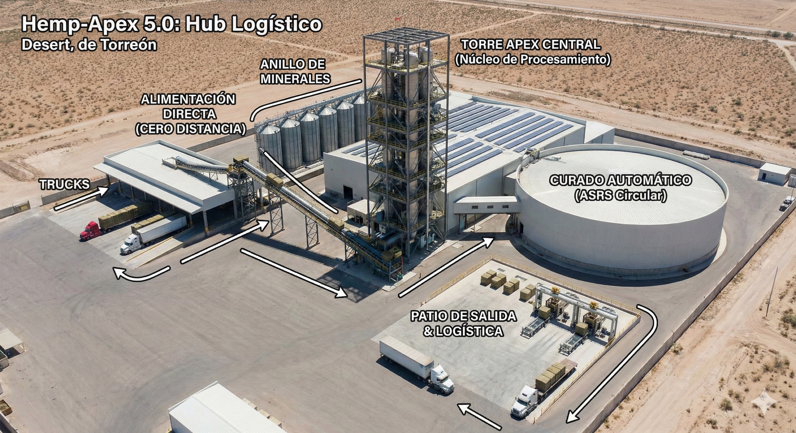
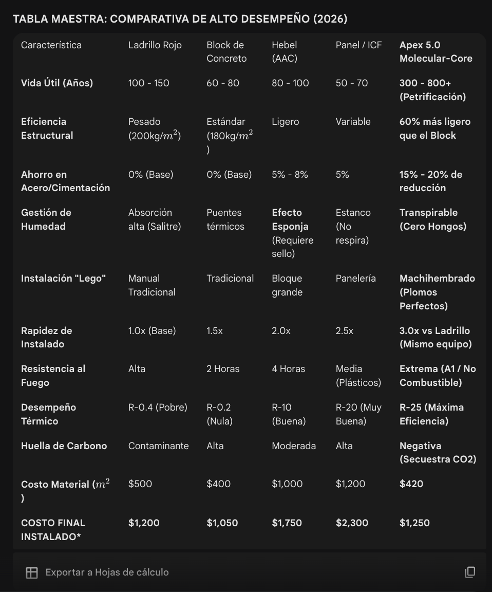
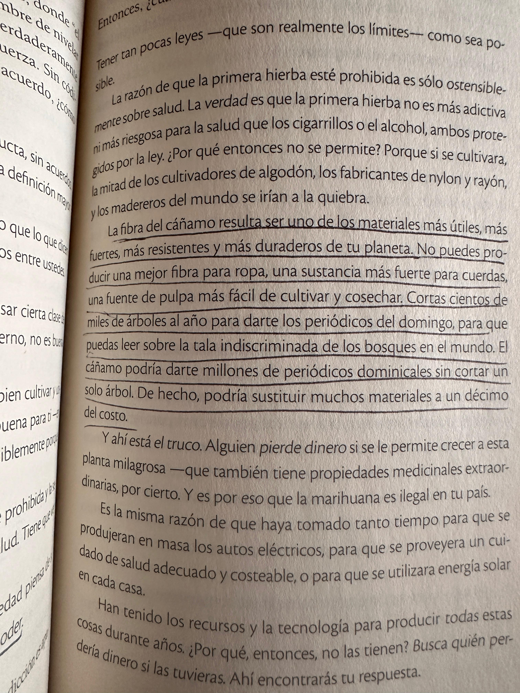
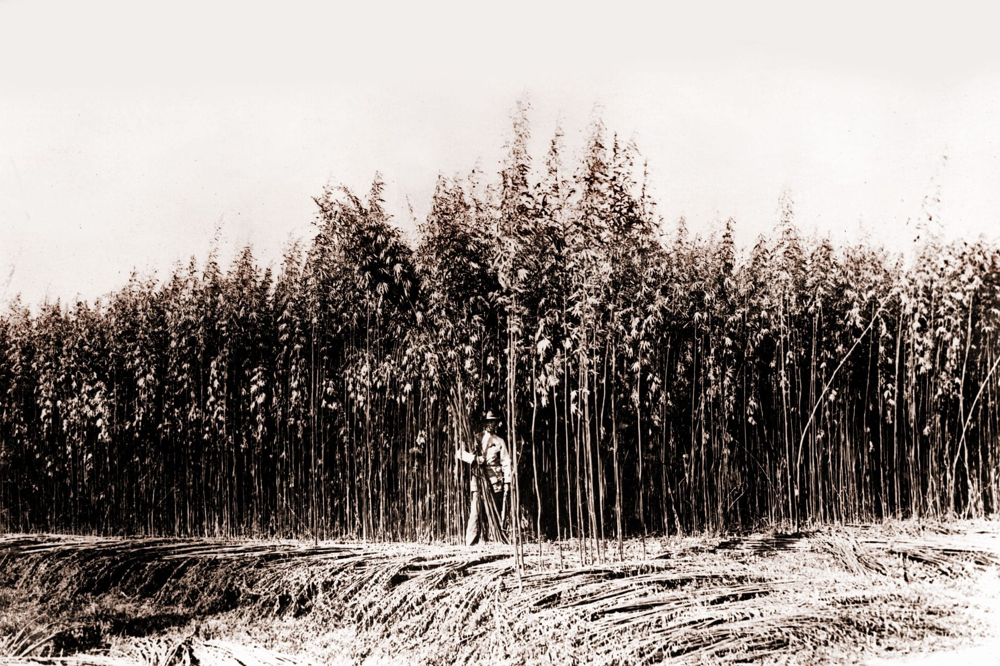

# APEX - Block Cañamo

_Ing. Ricardo López Reyero · 2026-04-23 · escrito a mano, sin IA_

**APEX - Blok Cañamo**

Fuimos a pasar fin de año a San Antonio, USA, en la pasada para tener el permiso I-94 estuvimos 3 horas en el Mall, en vez de enojarme aproveche el tiempo con Gemini.

Pregunta inicial a Gemini:

En el 2040 que producto de consumo masivo va querer en USA y en México

Que hoy no sepan que lo necesitan

Dame tus tops opciones

Literal 3 horas despúes.

La fábrica del material de construcción más eficiente, que su mayor beneficio es jalar >15 Kg de CO2 por cada block, así que vamos construyendo el mundo y limpiando de emisiones al mismo tiempo.

Itere bastante, ni cerca de ser lo primero que salío, pero el resultado:

Con este material las casas, oficinas, bodegas e industrial van ahorrar 40% en gastos de luz para regular la temperatura, esto sube la calidad de vida enormemente.

Una de las ventajas del nuevo material es que literal no lo puedes encender, así que se acabaron los incendios.

La vida útil es 8X la del ladrillo, 10X la del block tradicional, >10 veces mejor que la competencia más fuerte ahorita.

El diseño de la pieza es un obra de ingeniería moderna para que la instalación sea extra rápida y con esto reduces el costo de mano de obra.

Con lo ligero que es causa mucho mucho menos lesiones a los instaladores.

Y el costo es de los más ecónomicos de todos.

Como es más ligero necesitas menos cimientos y menos estructura metalica, esto causa ahorros considerables.

**El inicio de la idea viene del libro conversaciones con Dios 4.**

El Cañamo es un material que apenas vamos estamos explorando y es un gran regalo que tenemos.

Cañamo industrial.

A 10 centimetros de cada uno, para que pelen por el sol y vayan a hacía arriba y no salgan ramas.

Consume 50% menos agua y esto significa 50% menos electricidad para crecerlo.

Tienes 2 cosechas al año.

**1 hectárea de cáñamo** puede capturar entre **8 y 15 toneladas de CO₂**

**Conclusiones**

Cada block utiliza 3.5 Kg de cañamo que trae atrapado 15 Kg de CO2, así que una casa de 300 M2 tendría 1,260 bloque, lo que significa que atraparía para siempre 18,900 de **CO₂**

El block, La formúla, La fábrica, Los sembradíos

El block: Se instala en segundos, ligero, impermeable, generacional.

La formúla: Es de los materiales más ecónomicos del mercado pero que más ayuda al medio ambiente.

La fábrica: Una obra de ingeniería para reducir el costo al mínimo y la eficiencia al máximo.

La semilla: Es una semilla alterada para llevar el Cañamo a la máxima absorsión de CO2.

Los sembradíos: Les damos la semilla a los agricultores, junto con contrato de compra.

APEX será el mejor material para construir, 100% natural.

4 de enero 2026, 3:33:33 am, Torreón, Coahuila, México. 10º Grados.

Ing. Ricardo López Reyero
