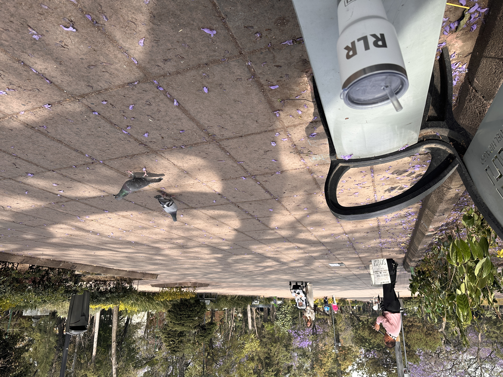

# Un milagro consiente y visible

_Ing. Ricardo López Reyero · 2026-02-24 · escrito a mano, sin IA_

**Un milagro consiente y visible**

Hace algunos meses fui a CDMX a levantar capital para un proyecto que se llamaba INT, un sistema que sellaba transacciones y guardaba un registro semi privado.

Fui a unas oficinas en Masaryk en un Penthouse, luego a comer en un restaurante con la cuenta pagada, la cuenta era $12,000 MXN y yo tenía $2,000 MXN en mi cuenta de banco y estaba pidiendo $200,000 USD por el 10% de la empresa (los valía completamente).

Al final del viaje de 2 días pagado por mí papá el vuelo por que en ese punto no tenía en la cuenta ese dinero pero si tenía un montón de fé en mí y en el proyecto. Agradecido eternamente por este acto de generosidad de padre a hijo. Muchas gracias.

Al final del viaje tuve tiempo de caminar por el parque de Homero de inicio a fin, viendo las jacarandas caer en el piso y adornando aún más la hermosa vista de este gran gran parque.

Camine hasta que me sente en una banca en medio del parque frente a una iglesia a presenciar mí respiración y agradecer lo privilegiado que soy al estar en CDMX con salud, pidiendo dinero para un proyecto hace unos meses no exitía y había sido creado completamente usando la imaginación, estaba en un hilo de agradecimiento cuando llega un señor y se pone cerca de mí y empieza a tocar la flauta y se sentía cada nota como un mensaje de agradecimiento y sentí una conexión muy profundo con todo, interiormente experimente un estado de extrema gratitud.

Despues de unas canciones me pare y di algunos pasos hasta el señor, le agradecí por tocar la flauta y le pedí su número de cuenta a la cúal transfería $1500 MXN desde el amor del momento, me quede con $500 MXN para el transporte de regreso al aeropuerto de regreso a Torreón y sabiendo que el dinero fluye.

Una vez hecha la transferencia le enseñe la pantalla y su cara se transformo, se vío un cambio interno y externo, con un nudo en la garganta me dijo en la mañana rece y pedí un milagro para poder completar la colegiatura de mí hijo necesitaba $1,200 MXN y tú me los diste. Muchas gracias y le dije muchas gracias a tí por creer.

Lloramos y nos abrazamos por unos momentos.

Todos y cada uno de nosotros estamos haciendo milagros todo el tiempo, lo que cambia es la conciencia que tengas ó no de ellos.

PD. No me dieron el dinero, cerre la idea y fue lo mejor que me pudo haber pasado.

PD. Foto y video fue antes de lo que pasó

[Video: 699e1ff52837e815f045bc3b.mov](imagenes/699e1ff52837e815f045bc3b.mov)

Ing. Ricardo López Reyero

24 de febrero 2026, Torreón, Coah. México. 25º
