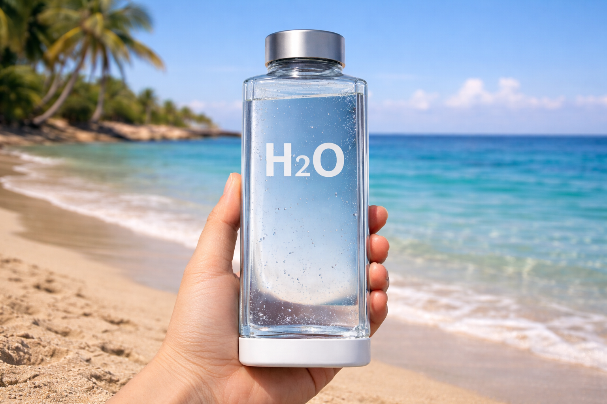

# El inicio del fin de la botella de plástico

_Ing. Ricardo López Reyero · 2026-01-11 · escrito a mano, sin IA_

El inicio del fin de la botella de plástico

Agua natural 2.0

La forma en la que consumimos agua embotellada significa definitivo que es un formato que llego para quedarse, pero no tiene que ser platico, puede ser vidrio y a todos nos beneficia.

El agua dura fría más tiempo, sería mucho más económica, 100% reciclable, bonita.

La botella actual es un desperdicio enorme y lo entiendo, se llama evolución, primero encontramos el formato y luego mejoramos la entrega.

La botella que propongo para la evolución del plástico:

Se pone una planta que desinfecte cada vez para que se pueda volver a usar.

La planta paga $3 MNX (buscar un buen número para que sea negocio para todos) por cada vez que recibe una botella para desinfectar en forma de agradecimiento, de esta forma crear una economía de reciclaje (un poco forzado jajaj pero que más da) que nos conviene a todos.

El agua de hoy cuesta demasiado a mí forma de ver las cosas, pero es por la ineficiencia de las compañías cada una buscando beneficio único y no en conjunto. Podría costar $10-12. 25% para el que transporta de ida, 25% para que el transporta de regreso, 25% para la planta limpiadora y 25% por el liquido.

Absolutamente a todos nos conviene tomar de esta botella por que en automatico ayudas a 3 a 4 personas de forma directa. Se crea un circulo virtuoso para todos. Agrega que si vas a tomar aún que sea una botella extra de agua vas a tener una vida mucho más saludable, vale toda la pena tener el mejor sistema de distribución de agua posible para todos.

Propongo que se venda +20% más costoso en donde hay mejor ecónomía de la ciudad y -20% en donde van arrancando. Esta es una forma de apoyar y unir a la sociedad al mismo tiempo, por que el impacto es inmediato y diario.

En donde se venden, deben de tener siempre por regla botellas muy frías, frías, al tiempo. La temperatura importa para mucha gente así que esta botella en la parte de abajo tiene el material del Yeti para ayudar a conservar la temperatura un poco más de tiempo.

Es bonita a la vista.

Como se paga por llevarla a la planta, este es el inicio del fin de ver botellas de plástico sucio en las calles y terrenos, limpiemos el mundo tomando H20.

PD. Lo úniforme en el material y en el sistema, no limita la creatividad de las personas, pueden hacer todo tipo de diseños únicos ó similares en las botellas.

Atte. Ing. Ricardo López Reyero

6:59 pm. Sábado 10 de enero 2026, Torreón, Coahuila, México. 12º
