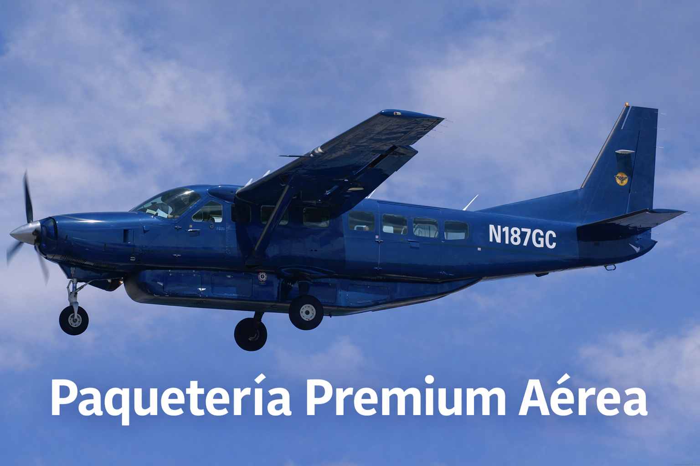

# Idea: Paquetería Premium Aérea en México

_Ing. Ricardo López Reyero · 2026-01-10 · escrito a mano, sin IA_

### 🚀 Idea de negocio: “Paquetería Premium Aérea” desde Querétaro (AIQ)

Estoy construyendo un modelo para operar **envíos urgentes nocturnos** en México usando un **avión carguero** tipo **Cessna 208B Grand Caravan**, con base en **Querétaro (AIQ)**.

La lógica es simple:

- Los grandes jugadores (DHL y Mercado Libre) mueven toneladas todos los días.

- Hay picos, rutas específicas y urgencias donde **pagar por velocidad** (y por garantizar capacidad) hace sentido.

- Un avión dedicado te permite **late cut-off → entrega temprano** en corredores industriales.

---

## ✈️ Ruta inicial (triángulo nocturno)

**AIQ → Monterrey (MTY) → Guadalajara (GDL) → AIQ**

✅ Esto es rentable porque puedes vender **3 piernas por noche** y evitar vuelos vacíos.

---

## 📦 Capacidad y operación

- **Capacidad vendible:** ~**1.5 toneladas por pierna**

- **Operación ideal:** **6 noches por semana**

- **Objetivo comercial:** que **DHL + Mercado Libre** “sumen” el volumen para llenar cada tramo (take-or-pay).

---

## 💰 Números clave (lo que importa de verdad)

### Inversión estimada

- Avión + importación/inspección: **~USD $1.45M**

### Punto de equilibrio (para no perder)

- Con 6 noches/sem, el negocio empieza a cuajar si cobras cerca de **$1.25/kg** con ~**1.3 t por pierna**.

### Payback (recuperar el 100% de la inversión)

Si quiero recuperar el 100% en **24 meses**, tengo dos caminos “lógicos” para los clientes:

✅ **Opción A (lleno):**

- **1.5 t por pierna** a **$1.60/kg**

✅ **Opción B (casi lleno):**

- **1.3 t por pierna** a **$1.84/kg**

En ambos casos, la idea es que el contrato sea **take-or-pay** (mínimo garantizado), con ajuste por combustible.

---

## 🤝 ¿Por qué DHL y Mercado Libre sí lo considerarían?

Porque no les estás pidiendo “todo su volumen”, sino:

- **capacidad dedicada** para rutas específicas,

- **respaldo en picos** (Buen Fin, Navidad),

- **mejorar tiempos** cuando la red terrestre ya no alcanza,

- y **un costo por kg predecible** con SLA.

---

## 🎯 Qué sigue

1. Encontrar un **Caravan carguero** (ideal ya convertido tipo Cargomaster).

1. Conseguir **2 cartas de intención** con mínimos garantizados (volumen + tarifa).

1. Con eso, cerrar la compra y arrancar con el triángulo AIQ–MTY–GDL.

---
