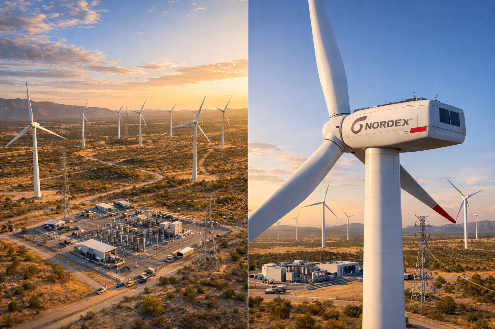

# Idea: Mega Parque Energía y Viento

_Ing. Ricardo López Reyero · 2026-01-10 · escrito a mano, sin IA_

**Mega Parque Energía y Viento**

Entre más energía tiene el hombre más rapido evoluciona, así que el consumo tiende a subir siempre.

Por lo mismo la generación tiene que ser una prioridad para la evolución de la especie.

Hoy la forma más eficiente es energía eolica, nunca se acaba, el retorno es eficiente.

La propuesta es 100 turbinas perfectamente distribuidas a la altura de 148 metros cada una, generando energía todo el año.

Se pone una planta en cada ciudad que quiere acelerar su crecimiento.

Con el escenario que veníamos usando (100 turbinas Nordex, **700 MW**, **44% CF**, torre **148 m**):

### Supuestos simples (para poder darte meses)

- Energía anual: **~2.70 TWh/año**

- Precio de venta (PPA): **70 USD/MWh**

- Costos de operación (OPEX): **~30 MUSD/año**

- Inversión (CAPEX “durable”, listo para décadas): **~1.216 BUSD**

### Resultado: ¿en cuántos meses recuperas?

**Flujo neto anual aproximado**

- Ingreso: 2.70 TWh × 70 = **~189 MUSD/año**

- Menos OPEX: **~30 MUSD/año**

- **Neto:** ~**159 MUSD/año**

**Payback simple**

- 1.216B / 159M = **~7.7 años**  
➡️ **~92 meses** para recuperar inversión.

---

## Rango rápido (depende sobre todo del precio del PPA)

Si todo lo demás igual:

- **A 60 USD/MWh** → **~111 meses**

- **A 70 USD/MWh** → **~92 meses** ✅

- **A 80 USD/MWh** → **~79 meses**
