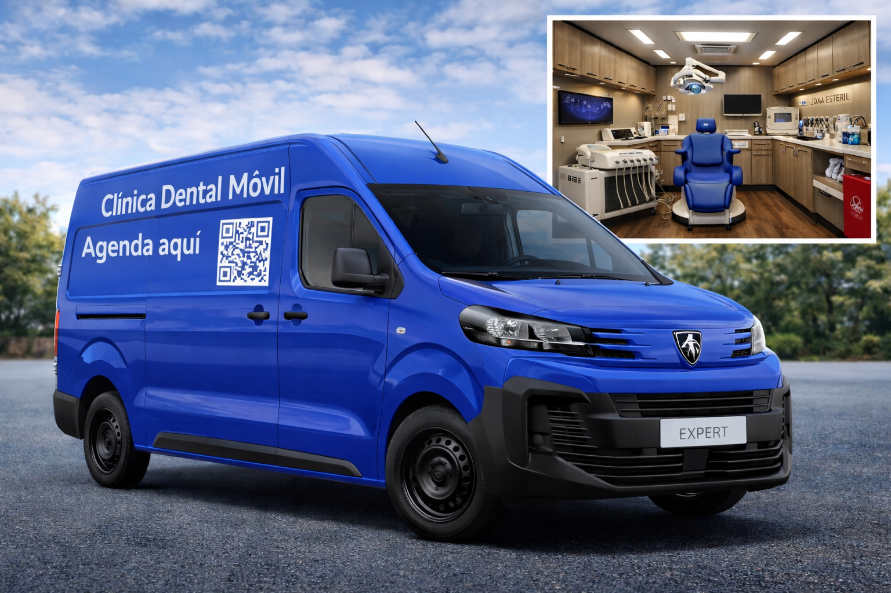
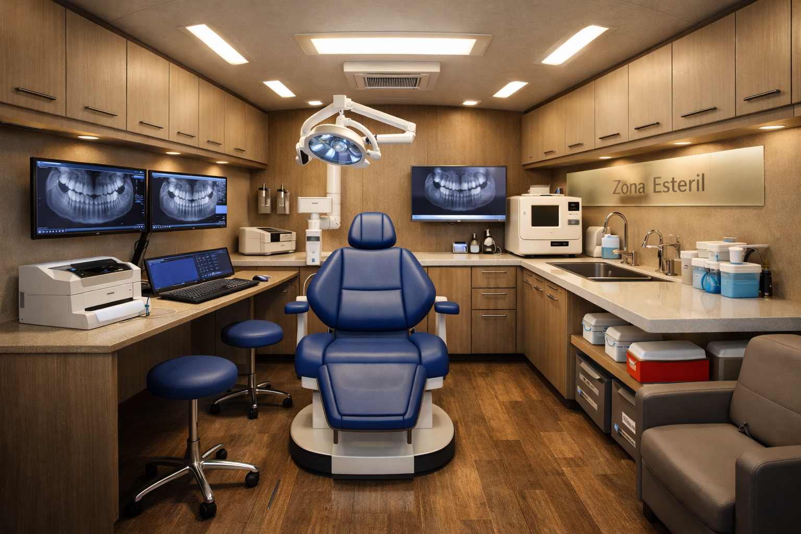

# Idea: Clinica Dental Móvil

_Ing. Ricardo López Reyero · 2026-01-08 · escrito a mano, sin IA_

Clinica Dental Movil

Pregunta 1 a GPT: ¿Cúal es la enfermedad más frecuente del ser humano?

Respuesta: Las caries en la boca

N preguntas y N repuestas despúes.

## H1

**Clínica Dental Móvil**  
**Agenda en 20 segundos. Vamos hasta donde estés.**

## Subheadline

Elige tu cita, paga **$950 de anticipo** para apartar tu horario y el **resto lo pagas en la van** con terminal (incluye **meses sin intereses**).

## Beneficios (bullets)

- ✅ Llegamos a tu casa u oficina

- ✅ Atención premium y profesional

- ✅ Puedes venir con un familiar

- ✅ Pagas fácil: **$950 hoy** + **resto en la van**

- ✅ Terminal con **MSI** disponible

- ✅ Receta impresa si la necesitas

---

## Sección: “1) Elige tu tipo de cita”

**¿Qué necesitas hoy?**  
Selecciona una opción para ver horarios disponibles:

### Opciones de cita (tiles)

**Consulta**  
Para dolor, sensibilidad, diagnóstico o plan de tratamiento.

**Revisión**  
Si ya tuviste tratamiento o quieres checarte rápido.

**Limpieza**  
Profilaxis y revisión general.

**Resina (Caries)**  
Si necesitas tapar una caries (resina). _(El dentista confirma si aplica al llegar.)_

---

## Sección: “2) Anticipo para apartar tu horario”

### Título

**Aparta tu cita con $950**

### Texto corto

Tu anticipo asegura que la van vaya a tu ubicación y protege tu horario.

### Microcopy (debajo del botón de pago)

**Después de pagar, eliges tu horario en el calendario.**

### Nota de pago (simple)

El resto del servicio se paga en la van con terminal.  
**Aceptamos tarjeta y meses sin intereses.**

---

## Sección: “3) ¿Qué pasa después?”

**Así de fácil:**

1. Eliges el tipo de cita

1. Pagas el **anticipo de $950**

1. Seleccionas tu horario en el calendario

1. Te confirmamos ubicación y listo

---

## Sección: Precios (claros y sin confundir)

**Precios del servicio (pago en la van):**

- **Consulta:** $950

- **Revisión:** $950

- **Limpieza:** $950

- **Resina (caries):** se cotiza según el caso (normalmente desde **1 diente**)

**Anticipo:** $950 (se paga aquí para agendar)

> _El anticipo es independiente del tipo de cita. El resto se paga en la van con terminal._

---

## Sección: Confianza (corta)

**Higiene y seguridad primero**  
Equipo profesional, protocolos de limpieza y materiales de calidad.

---

## FAQ (solo 4, muy convertidoras)

**¿El anticipo se descuenta del servicio?**  
No. El anticipo es para apartar el horario y la visita.

**¿Qué pasa si necesito algo más que consulta/limpieza?**  
El dentista te explica opciones y el costo antes de hacerlo.

**¿Puedo pagar en meses sin intereses?**  
Sí, con terminal en la van (sujeto a tu banco).

**¿Puedo ir acompañado?**  
Sí, hay espacio para un familiar.

---

## CTA final (botón grande)

**Agendar ahora (anticipo $950)**

### Microcopy final

Tardarás menos de 1 minuto. Elige tu cita, paga el anticipo y selecciona tu horario.

---

## Texto para el botón secundario (si quieres 2 CTAs)

**Ver horarios disponibles**

4 de enero 2026, 2:51 am, Torreón, Coahuila, México. 10º Grados.

Ing. Ricardo López Reyero
