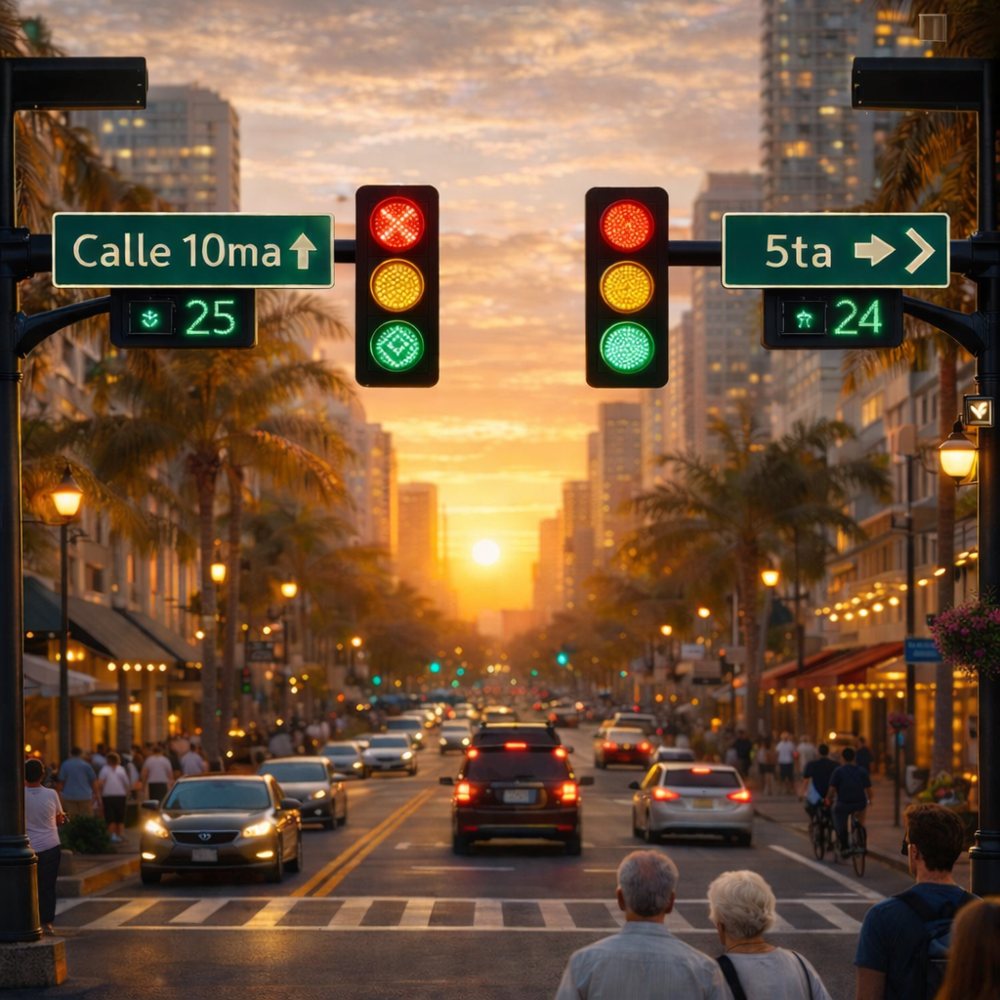
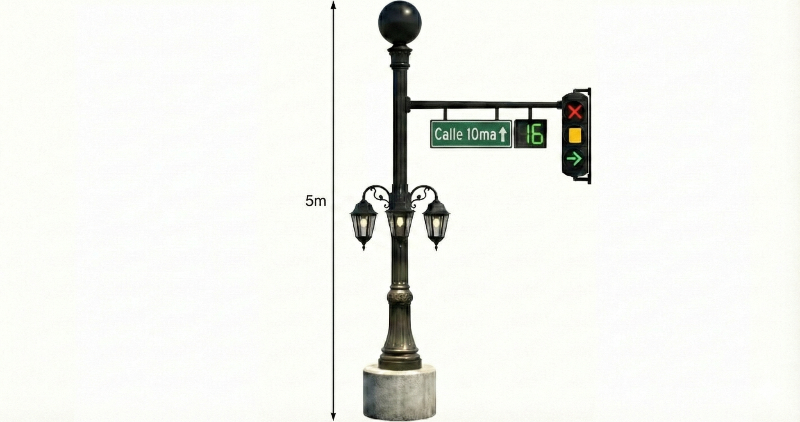

# La sincronización de semafóros

_Ing. Ricardo López Reyero · 2026-01-04 · escrito a mano, sin IA_

**La sincronización de semafóros**

Creo que de las acciones más simples que aumenta mucho el valor de todos es tener los semafóros lo mejor sincronizados, cada minuto ahorrado en el tráfico se va a agregar valor de los demás (trabajar) ó a mejorar la vida de uno mismo.

Así que debe ser prioridad del estado la mejor movilidad posible y todo empieza con lo semafóros.

Ajuste con camáras para que siempre estén optimizados dependiendo de la orientación del tráfico, tiene que buscar reducir el tiempo de translado de los ciudadanos.

Al eficientar la movilidad mejora la eficiencia de la ciudad en todos los aspectos.

Semáforos bonitos, hechos para todos los tipos de ciudadanos, que sea algo bonito de ver.

Si va un carro en la noche solo y no hay más tráfico, tendría que tener 100% de los semaforos en verde para que haga la menor cantidad de tiempo posible.

Kpi principal. Segundos promedio de translado

1 min de ahorro por trayecto x 600,000 habitantes x 2 trayectos al día = 1,200,000 minutos de ahorro / 60 min para convertirlos a horas = 20,000 horas / 12 horas laborables = 1,666 días laborales extras por minuto y por día.

Es de las mejores inversiones que una ciudad puede hacer es ahorrar tiempo de translado.

Ing. Ricardo López Reyero.

2:18 pm, Domingo 4 de Enero 2026, Torreón Coahuila, México, 25º
