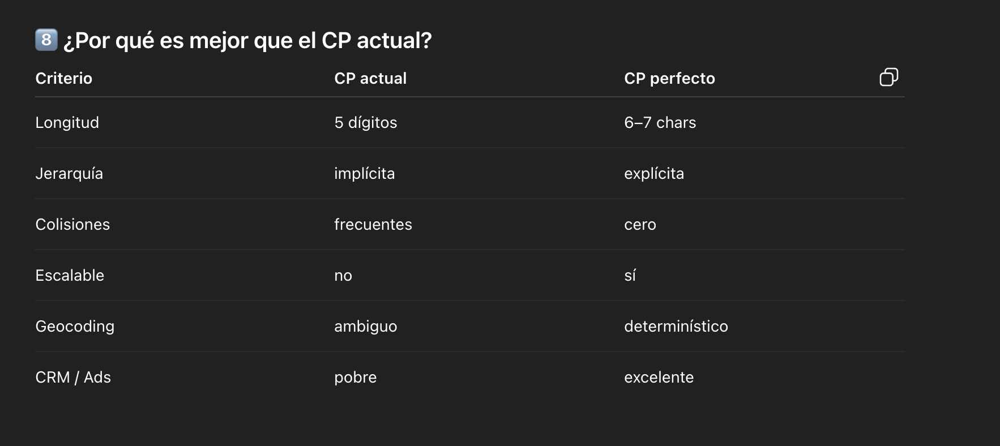
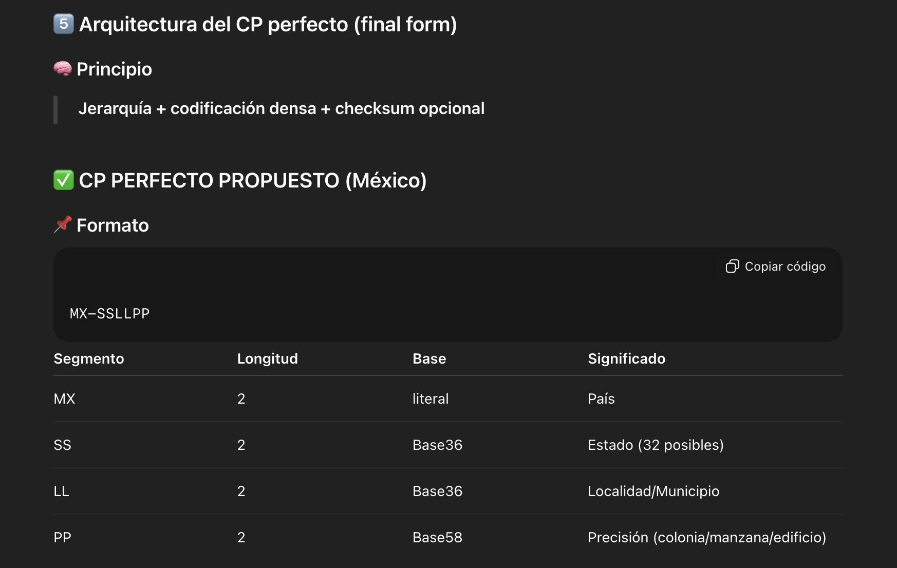

# Simplificación Código Póstal

_Ing. Ricardo López Reyero · 2026-01-04 · escrito a mano, sin IA_

**Simplificación Código Póstal**

El números de envíos va ir subiendo, así que es sumamente importante como país simplificar esto y el primer pilar es un correcto uso de los CP.

Qué este cuidado, un solo CP por colonia y con apellido para llegar a la ubicación exacta.

Ejemplo

CP 27000 DAV41

Buscar que en la menor cantidad de caracteres transmitir la dirección completa, para facilitar el pedido y el envío.

Estamos entrando a una epoca de sistemas de información, es posible simplificar y agilizar.

Si un país ya lo resolvío copiemos.

Ing. Ricardo López Reyero

2:28 pm, Domingo 4 de Enero 2026, Torreón, Coahuila, México,. 25º centígrados.

Actualidad

## 🇲🇽 México

- **≈ 143,000 códigos postales**

- Fuente: SEPOMEX

- Son **5 dígitos**

- Muy granular: colonias, fraccionamientos y zonas rurales pueden tener CP distintos.

---

## 🇺🇸 Estados Unidos

- **≈ 42,000 ZIP Codes**

- Son **5 dígitos** (+4 opcional, pero no cuenta como CP nuevo)

- Menor granularidad que México: un ZIP puede cubrir zonas muy grandes.

---

## 🇯🇵 Japón

- **≈ 120,000 códigos postales**

- Son **7 dígitos**

- Extremadamente precisos; muchos CP corresponden a **una sola calle o edificio grande**.

Mucho mejor la nueva propuesta en todos los sentidos.

Se ve bien para la persona y tambíen para los sistemas.

Súper preciso, con esto los paquetes te van a legar mucho más rápido y con muchos menos errores, esto significa que vas a tener lo que deseas en menos tiempo gracias a una mejora en el CP.

Plática

[https://chatgpt.com/share/e/695b0801-e5ec-800c-8d86-3decc9d5b370](https://chatgpt.com/share/e/695b0801-e5ec-800c-8d86-3decc9d5b370)

---
