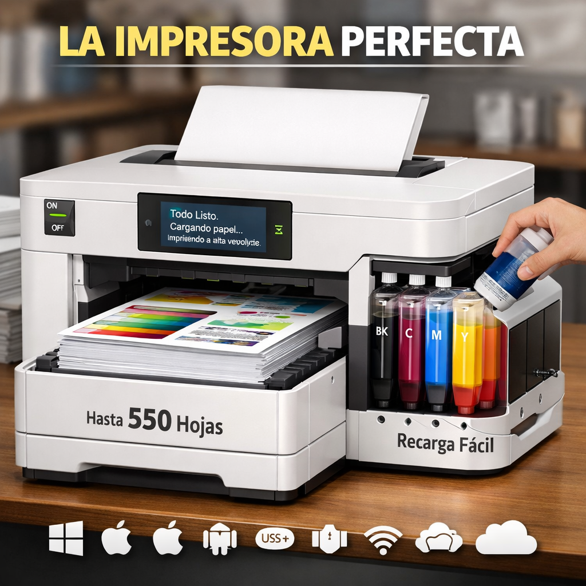

# La impresora perfecta

_Ing. Ricardo López Reyero · 2026-01-04 · escrito a mano, sin IA_

**La impresora perfecta**

Muchas veces he imaginado como sería la impresora que nunca se le atore el papel, que siempre este lista para imprimir y que simplemente imprima!!!

Solo tiene que hacer 1 cosa, pero hacerla siempre bien. Queremos agregar tantas cosas que perdemos de vista lo principal.

Bandeja de papel enorme, espacio para la tinta recargable grande y forma de llenar simple. Se apaga y prende con un switch. Compatibilidad extrema con todo lo que haya y con lo que vaya saliendo.

Con una pequeña pantalla por si hay algún mensaje que quiera dar al usuario, nada de códigos complicamos, dime lo que hace falta en texto simple.

Qué sea rápida de impresión.

Versión a color opcional, lo mismo con los colores tanques grandes fáciles de recargar.

Qué quepan 550 hojas y el rodillo jamás se atore, a prueba de fallas.

Imprimir > Impreso.

Sin nada más en el proceso.

Ing. Ricardo López Reyero

1:44 pm, Domingo 4 de Enero 2026, Torreón, Coahuila, México. 25º Grados
