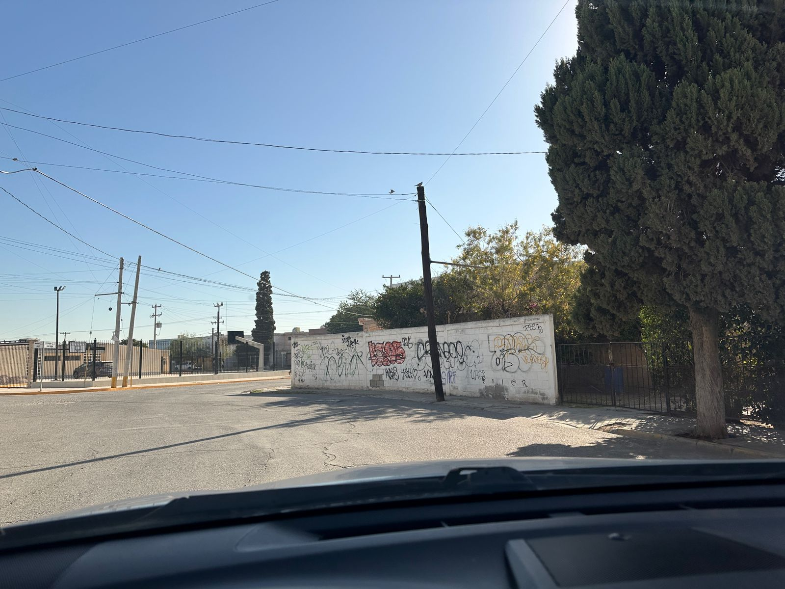
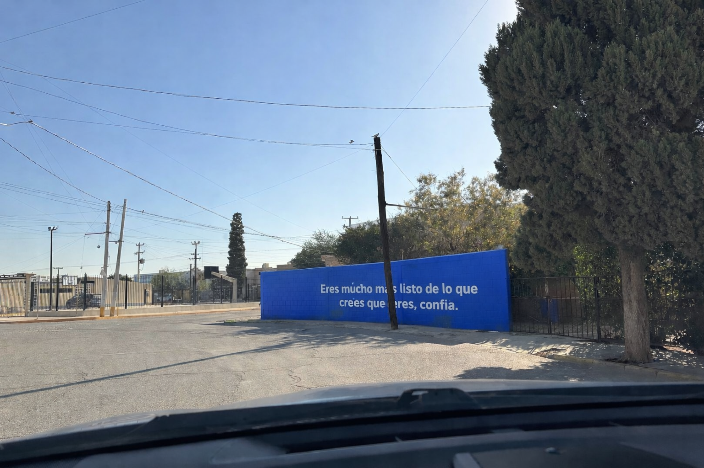
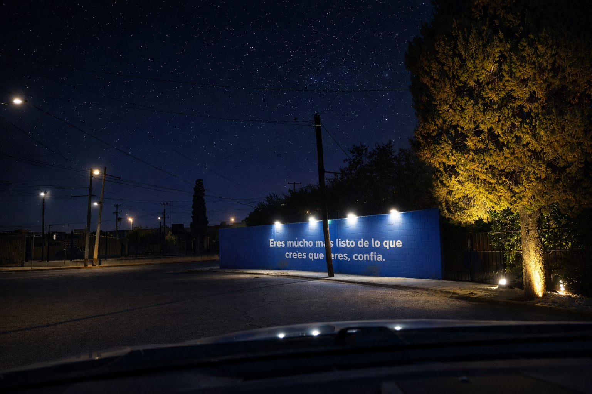

# Ley: Pared Limpia

_Ing. Ricardo López Reyero · 2026-01-04 · escrito a mano, sin IA_

**Ley: Pared Limpia**

Algo que me moleta realmente es ver paredes y paradas de autóbus rayadas. Creo que es un verdadero insulto a la propiedad ajena, si el pintor quiere expresar su arte que lo haga en su casa no en propiedad ajena.

Como sabemos que le gusta pintar por que no usarlo para beneficio de la sociedad y no en contra. Con trabajo por 5 años, garantizado pintando todo lo bandalizado de la ciudad, monumentos y todo lo que pueda mejora la vista al ciudadano.

5 años se servicio comunitario forzado a todo aquél que haya pintado propiedad ajena sin permiso.

Este solo acto nos daría una mejor vista a todos.

Aprovechemos la pintada, para mejorar la vida de todos los que ven la pared.

Y podríamos mejorar más todavía, iluminando el espacio.

4 de enero 2026, 3:47 am, Torreón, Coahuila, México. 9º Grados.

Ing. Ricardo López Reyero
