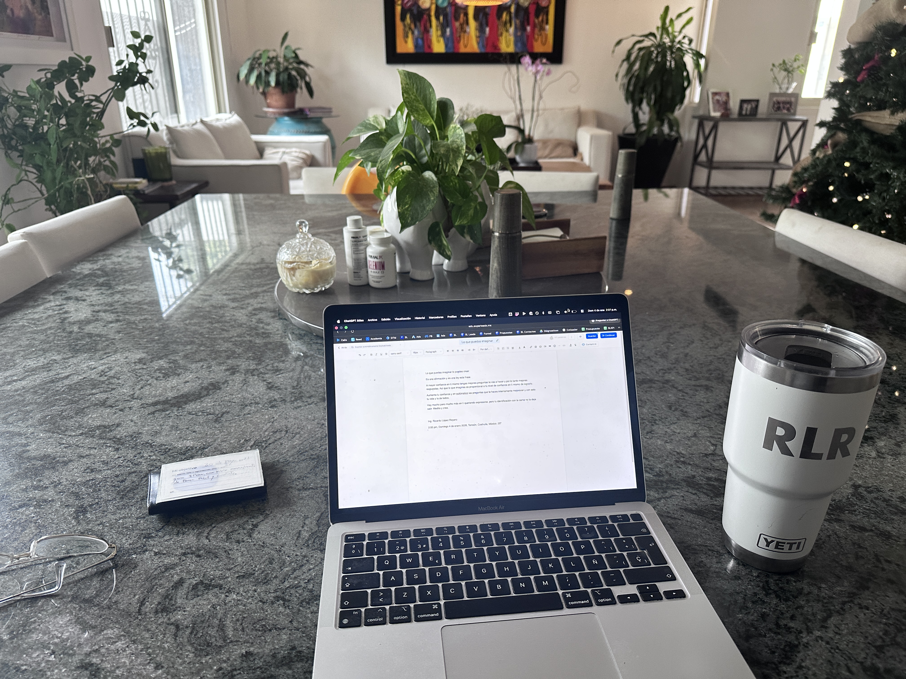

# Lo que puedas imaginar lo puedes crear

_Ing. Ricardo López Reyero · 2026-01-04 · escrito a mano, sin IA_

Lo que puedas imaginar lo puedes crear

Es una afirmación y es una ley esta frase.

A mayor confianza en ti mismo tengas mejores preguntas te vas a hacer y por lo tanto mejores respuestas. Así que lo que imaginas es proporcional a tú nivel de confianza en ti mismo de lograrlo.

Aumenta tu confianza y en autómatico las preguntas que te haces internamente mejoraran y con esto tu vida y la de todos.

Hay mucho pero mucho más en ti queriendo expresarse, pero tu identificación con la carne no la deja salir. Medita y crea.

Ing. Ricardo López Reyero

2:00 pm, Domingo 4 de enero 2026, Torreón, Coahuila, México. 25º

