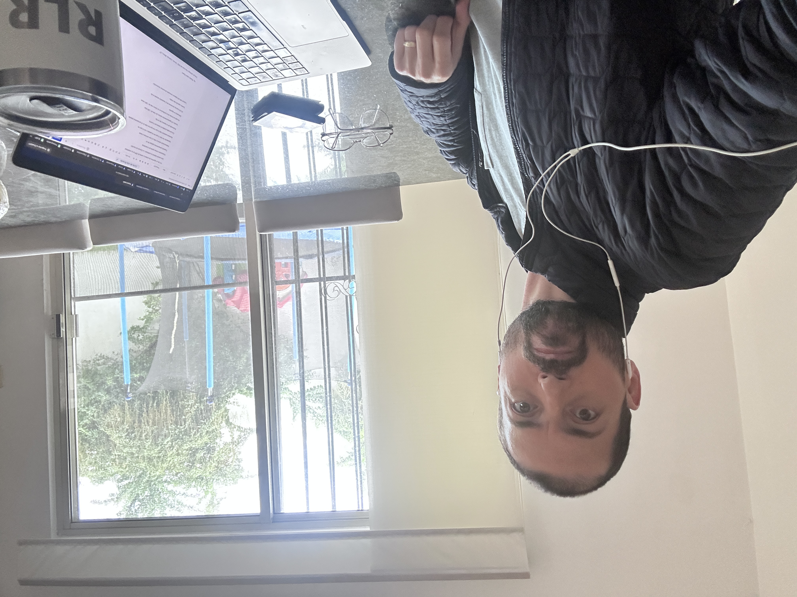

# Corte de vida Ricardo Enero 2026

_Ing. Ricardo López Reyero · 2026-01-04 · escrito a mano, sin IA_

**Corte de vida Ricardo**

40 años

Casado Ana Belén Acosta López

Con una hija Galia López Acosta

Con salud

1.86 metros

86 kilogramos

150 libros leídos

Ingeniero industrial del ITESM

Cerrando una empresa de consultoría digital

Creciendo [SuperLeads.mx](http://SuperLeads.mx) un sistema de admisiones educativas

V12 de un algoritmo de compra y venta de XRP en la volatilidad

Libro escrito todavía no publicado: La Ciencia de Inscribir

Empezando a tomar gusta por la escritura

Trayendo pensamientos atrávez de mí

Reflexionando sobre la vida y lo que venimos a hacer

Agradecido con todo lo que me ha pasado y con lo que no.

Buscando perdonar todo lo que creo que fue malo en mí perspectiva pasada

Con las redes sociales en pausa por lo pronto.

Enamorado de mi esposa y de mi hija.

Escribo >10 agradecimientos diarios, por más de 1,000 días.

He leído la formula de la confianza en mí mismo más de 1,000 veces.

Disfrutando el segundo

10-12% nivel de conciencia de la respiración durante el día

Sueños cada día más nítidos

Leyendo 300-500 páginas mensuales de autores reconocidos

Ing. Ricardo López Reyero

2:44 pm, domingo 4 de enero del 2026, Torreón, Coahuila, México, 25º
