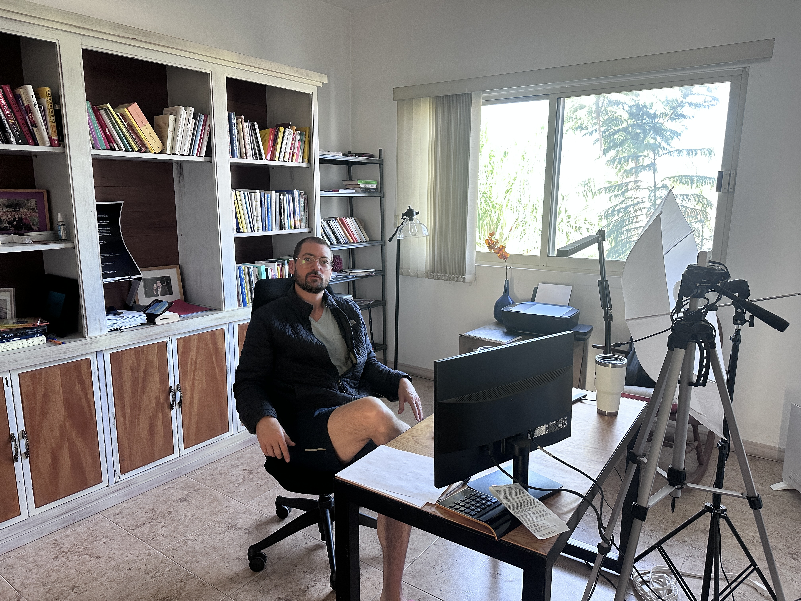

# Inicio de los escritos

_Ing. Ricardo López Reyero · 2026-01-04 · escrito a mano, sin IA_

4 de enero 2026

2:26 am, Torreón, Coahuila, México.

Casa Da Vinci, 10º Grados.

Ricardo López Reyero

Si todos compartieramos nuestros pensamientos libremente avanzaríamos mucho más rápido como sociedad.

Me llegan pensamientos de forma sumamente nítida que quisiera compartir por este medio.

Llegan ideas, preguntas, modelos de negocio, ideas para el gobierno.

He leído al rededor de 150 libros hasta la fecha digo esto, por que tengo influencia de gente muy interesante que me compartieron su conocimiento condensado en unas cuentas páginas.

Me considero ingeniero, esto significa que escribo lo mínimo posible, pero lo necesario para transmitir la idea completa.

Todos los días escribo >10 gratitudes diferentes y esto me hace estar en un estado receptivo que me permite ver las cosas como son, pero también como podrían ser al mismo tiempo.

Si algo de que lo escribo te sirve agarralo, si algo no te sirve continua.

Con mucho cariño y mucha gratitud escribo estas palabras.

Ing. Ricardo López Reyero

40 años. nacido en Torreón el 13 de Septiembre de 1985
