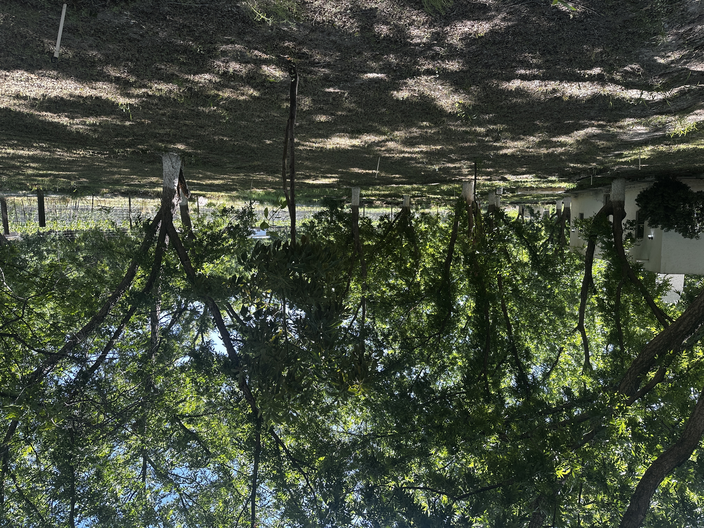

# Meditación para activar creadores

_Ing. Ricardo López Reyero · 2026-07-05 · escrito a mano, sin IA_

_Meditación para activar creadores_

**Meditación para activar creadores**

Hace algún tiempo estaba platicando con mi mamá sobre una nueva ubicación para su negocio. Me decía que no creía que fuera a funcionar.

En ese instante me llegó algo que quería compartirle. Una imagen, una idea, algo que sentí que era más grande que la conversación que estábamos teniendo.

Lo que salió de ahí, lo pulí con mi esposa. Y luego siguió creciendo.

Esto es lo que llegó.

Cierra los ojos.

Respira profundo.

Imagina la vida antes de que tú existieras.

Imagina a tus papás jóvenes, sin ti todavía. Sin saber que ibas a llegar. Están ahí, viviendo su vida, sin ningún pensamiento sobre ti porque todavía no eres ni una posibilidad en su mente.

Ahora trasládate al punto exacto donde a tu mamá le llega por primera vez el deseo de tener un hijo.

No el embarazo. No el médico. No la prueba positiva.

El primer impulso.

Ese instante antes del pensamiento. Esa chispa eléctrica que llega al cerebro y dice: quiero un hijo.

Después llega el pensamiento. Después el sentimiento. Y se queda incrustado en el cuerpo de tu mamá. Y ella se ilusiona. Sabe, sin tener ninguna prueba todavía, que algo viene.

En ese momento no te tiene. Quizás falta mucho tiempo todavía.

Pero en ese instante, tú ya existes.

Como deseo.

Tú fuiste primero un deseo.

Ese deseo se acompañó de fe. De acciones. De un proceso que nadie vio completo desde afuera pero que ocurrió de todas formas.

Y ese deseo se manifestó.

Tú eres la prueba de que absolutamente todo nace primero como deseo, luego se convierte en idea, luego se mueve con fe, y luego aparece en el mundo físico.

Agradezco al creador que me deseó.

Que tuvo fe. Que se movió. Que se inspiró. Que consiguió pareja. Que hizo el acto en el que dos conciencias chocaron para crear el inicio de una nueva.

En ese instante preciso, en ese segundo donde las dos conciencias se encuentran, yo soy jalado del mundo espiritual al mundo físico.

Y empieza mi ascenso en el nivel de conciencia.

Hoy se cierra el círculo y me doy cuenta de que yo fui un deseo. Y que mis deseos se convierten en ideas. Mis ideas en acciones. Mis acciones en el mundo que me rodea.

Respira profundo

No soy espectador de mi vida.

Soy su creador. Soy un creador. Soy el creador.

Abre los ojos y empieza a crear.

Atte. Ing. Ricardo López Reyero

_Parras, Coahuila. Domingo 28 de junio 2026, 9:49 am. 24°._
