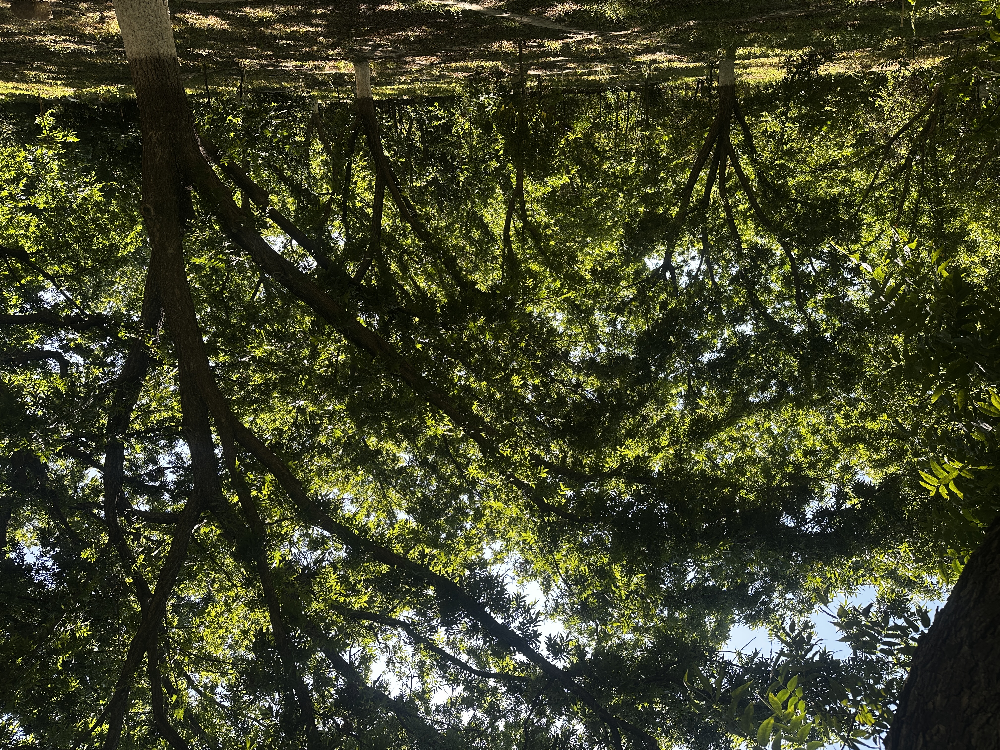

# ¿Qué te estaría gritando la audiencia si te vieras en una película?

_Ing. Ricardo López Reyero · 2026-07-05 · escrito a mano, sin IA_

_Que estaría gritando si me viera en una película_

**¿Qué te estaría gritando la audiencia si te vieras en una película?**

Las personas avanzan dependiendo de la calidad y la profundidad de las preguntas que se hacen.

Una de las mejores que he encontrado viene del autor Sahil Bloom

**_Si estuvieras viendo tu vida en la pantalla de un cine, ¿qué te estaría gritando la audiencia que hicieras?_**

No vayas al sótano. Voltea a la derecha. Dale el beso. Aplica para ese trabajo. Viaja a ese lugar. Escribe el libro.

Eso.

Esa voz que grita desde las butacas eres tú mismo viendo con claridad lo que ya sabes que tienes que hacer.

Algunos ejemplos despertar la curiosidad y encontrar el mío.

Escribe el poema. Toca la canción que siempre quisiste tocar. Agradece más. Haz más ejercicio. Márcale a esa persona que sabes que le tienes que marcar.

Duérmete la siesta. Despierta del sueño en el que estás. Múdate de casa. Cómprate ese jacuzzi. Canta a pleno pulmón.

Siembra un bosque. Transforma el país. Transforma tu casa. Transfórmate a ti.

Haz ese acto sexual que siempre deseaste. Dona esa cantidad de dinero que te hace palpitar el corazón. Haz esa actividad que sabes que tienes que hacer.

Tiene un momento de profundidad real con tu hijo. Con tu pareja. Con tu madre. Con tu padre.

Disfruta más los atardeceres. No sabes cuántos más vas a poder ver. Disfruta más los amaneceres. En algún punto no vas a poder.

Sé mucho más ambicioso de lo que hoy estás siendo. Crea empresa. Sé más persistente. Aumenta tu fe a niveles dignos de ti. Sube la confianza en ti mismo enormemente.

Mejora cómo te ves a ti mismo todos los días.

Enamórate a un nivel sumamente profundo. Haz el amor salvajemente. Ve a ese restaurante que siempre deseaste. Sal de fiesta y disfrútalo cada segundo.

Haz el deporte que siempre quisiste hacer. Forma el equipo que siempre quisiste formar. Crea el grupo de amigos que siempre quisiste crear.

Está más presente en la vida de tus hijos. En tu comunidad.

Da esa larga caminata por el lugar exacto por el que la tienes que dar. Tú sabes exactamente dónde es.

Vive el presente. Disfrútala ahorita.

La audiencia no grita cosas imposibles.

**Grita lo que ya sabes. **Lo que llevas tiempo sabiendo. Lo que has postergado porque creíste que habría un mejor momento después.

No hay después.

La película está corriendo ahora.

Sigue tu instinto. Es mucho más inteligente que tu mente.

_Parras, Coahuila. Domingo 28 de junio 2026, 10:00 am. 24°._

Atte. Ing. Ricardo López Reyero
