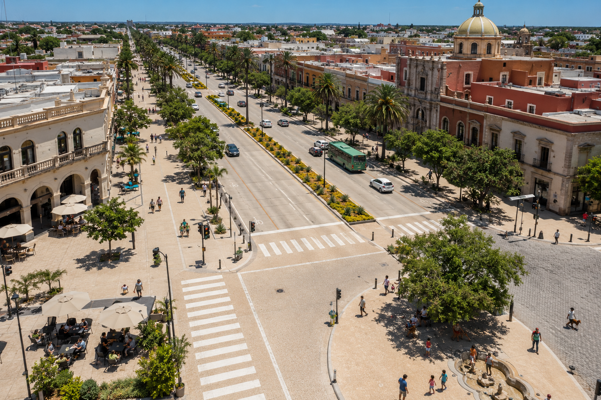

# El pavimento ideal para las calles Formúla V2

_Ing. Ricardo López Reyero · 2026-05-20 · escrito a mano, sin IA_

El pavimento ideal para las calles Formúla V2

Ya hay un escrito de esta idea, pero ahora hay nueva IA y estamos usando lo pasado como base y viendo que tanto podemos mejorar el pavimento.

Hay cosas en la vida que valen toda la pena de mejorar, las calles claro que es uno de esas cosas.

_El pavimento ideal para las calles Formúla V2_

## El pavimento ideal para ciudades calientes: cómo hacer calles que duran 60 años y no queman en verano

Si vives en una ciudad de clima caliente, conoces el problema: el asfalto se pone tan caliente al mediodía que quema los pies de los niños y las patas de las mascotas. El calor sube del piso y obliga a las casas alrededor a gastar más en aire acondicionado. Y a pesar de eso, el pavimento se deshace en 15 años y hay que volverlo a hacer una y otra vez.

Existe una alternativa mejor. Está basada en investigación científica publicada en 2024 y 2025, es viable con tecnología disponible hoy, y puede transformar una ciudad completa. Esta es la explicación completa.

**En una frase:** sustituir el asfalto negro por un sistema mixto de concreto claro de larga duración, adoquín permeable que infiltra el agua de lluvia, y zonas peatonales que se mantienen frescas por evaporación, usando el material correcto para cada tipo de calle.

### Lo que se gana, en números

**Vida útil del pavimento**

- Hoy con asfalto: 13 a 18 años

- Con la propuesta: 50 a 60 años

**Temperatura del piso a las 14:00 horas en verano**

- Hoy con asfalto: hasta 67 °C (suficiente para quemar piel)

- Con la propuesta: hasta 57 °C en la calle, hasta 47 °C en banquetas peatonales

**Encharcamientos por lluvia**

- Hoy con asfalto: frecuentes

- Con la propuesta: casi eliminados en calles secundarias

**Mantenimiento (baches, parches)**

- Hoy con asfalto: constante, todo el año

- Con la propuesta: mínimo durante décadas

**Costo de instalación por metro cuadrado**

- Hoy con asfalto: bajo

- Con la propuesta: 40 a 60% más alto. Nos meremos lo mejor!!! Es nada para el beneficio extra que da.

**Costo total en 30 años (vida útil + mantenimiento)**

- Hoy con asfalto: alto

- Con la propuesta: menor

### 1. El problema que viven las ciudades calientes hoy

Las calles de la mayoría de las ciudades están hechas principalmente de asfalto negro. En climas cálidos y secos esto trae cuatro problemas que afectan a cada familia, todos los días.

**Calor extremo en el piso.** Un día de verano el asfalto puede alcanzar 67 grados centígrados al mediodía. Eso es suficiente para quemar la piel humana en pocos segundos y lastimar las patas de los perros en menos. Las mascotas no pueden salir, los niños no pueden jugar afuera, y el calor que sube del pavimento hace que las casas necesiten más aire acondicionado y suban los recibos de luz.

**Vida útil corta.** El asfalto en climas calientes dura entre 13 y 18 años antes de necesitar reemplazo o reparación mayor. Eso significa que cada calle se vuelve a pavimentar dos o tres veces durante la vida adulta de una persona. Es un ciclo de gasto que nunca termina.

**Reparaciones constantes.** Baches, grietas, hundimientos. El asfalto se ablanda con el calor y se rompe con el peso del tráfico pesado, en particular en cruceros y zonas de frenado. Cada bache es costo público y, peor aún, riesgo de accidente vehicular y para motociclistas.

**No respeta la lluvia.** Cuando llueve fuerte, el agua corre sobre el asfalto y forma encharcamientos en minutos. No infiltra al subsuelo, no recarga el acuífero. En una ciudad árida, mandar esa agua al drenaje es un desperdicio que no se puede permitir.

### 2. Por qué este proyecto importa

**Salud pública.** El calor mata. En 2020 fallecieron 323 personas por causas relacionadas con el calor solo en el condado de Maricopa, Arizona — una región de clima desértico. Bajar la temperatura de las calles entre 5 y 10 grados centígrados es una medida de salud pública directa, especialmente para adultos mayores, niños pequeños y personas que trabajan al aire libre.

**Costo total más bajo a largo plazo.** Aunque el concreto cuesta entre 40 y 60 por ciento más que el asfalto al momento de ponerlo, dura el doble o el triple. Estudios federales de Estados Unidos muestran que las carreteras de concreto duran 2.5 veces más que las de asfalto. Al final de 30 o 40 años, la ciudad gasta menos dinero usando concreto.

**Calles caminables.** Un pavimento que no quema permite que las personas vuelvan a usar las calles para caminar, hacer ejercicio, llevar a los hijos a la escuela a pie, hacer compras a la tienda de la esquina. Eso reduce el uso de carro, mejora la salud pública y fortalece el comercio local.

**Recarga del acuífero.** Las zonas con adoquín permeable infiltran el agua de las lluvias directamente al subsuelo. En una ciudad árida que depende del acuífero para vivir, capturar esa agua de lluvia es una decisión estratégica de largo plazo.

**Imagen y orgullo de ciudad.** Una ciudad con calles claras, frescas, sin baches, sin encharcamientos, es visible desde el primer vistazo. Se convierte en una marca distintiva. Atrae inversión, turismo y residentes.

### 3. La solución: tres pavimentos, tres usos

No existe un solo pavimento perfecto para todo. La clave del programa es usar el material correcto en cada tipo de calle. Proponemos tres tipos.

### A. Para avenidas y bulevares (tráfico pesado)

Concreto hidráulico claro reforzado. Es un concreto especial, de color gris muy claro, hecho con piedra caliza local también clara. Se cuela en losas continuas con maquinaria especializada llamada pavimentadora deslizante. La superficie se texturiza con cepillo de cerdas para dar buen agarre a las llantas y dispersar la luz sin causar reflejos molestos al conductor.

**Vida útil esperada:** 50 a 60 años con mantenimiento mínimo (sellado de juntas cada 8 a 10 años).

### B. Para calles secundarias y residenciales

Adoquín de concreto permeable, conocido técnicamente como PICP (siglas en inglés de Permeable Interlocking Concrete Pavement). Son bloques de concreto que encajan entre sí, con huecos pequeños entre uno y otro rellenos de gravilla fina. El agua de lluvia pasa por esos huecos y se infiltra al subsuelo. Si se daña un adoquín, se quita y se reemplaza solo ese — no hay que romper toda la calle como con el asfalto.

**Vida útil esperada:** 30 a 40 años. Capacidad de carga superior a las losas de concreto convencional.

### C. Para banquetas, plazas, parques y áreas peatonales

Concreto retentivo de agua con vidrio reciclado. Esta es la novedad del programa: un concreto especial publicado en investigación científica de enero de 2025 que absorbe el agua de lluvia (y de riego ocasional) y libera frescura por evaporación durante varios días. Las pruebas muestran que baja la temperatura del piso hasta 19.6 grados centígrados respecto al asfalto. Aquí sí se puede caminar descalzo en pleno verano.

**Vida útil esperada:** 25 a 30 años. Incorpora hasta 60% de vidrio reciclado, lo que reduce desperdicio y costo.

### 4. Receta exacta del concreto para avenidas

Esta es la fórmula técnica para fabricar un metro cúbico de concreto del nuevo pavimento. Imagina un cubo de concreto del tamaño de un refrigerador grande: contiene los siguientes ingredientes.

**Cemento Portland — 204 kg.** El pegamento principal que une todos los demás materiales.

**Escoria de alto horno (GGBFS) — 148 kg.** Subproducto industrial del acero. Sustituye parte del cemento, reduce contaminación y hace al concreto más resistente a la humedad.

**Humo de sílice — 18 kg.** Polvo extremadamente fino que tapa los micro-poros del concreto. Lo hace más fuerte y más impermeable a productos químicos.

**Agua — 141 litros.** La justa, no más. Menos agua = concreto más resistente.

**Arena clara (caliza local) — 750 kg.** Llena los huecos pequeños y aporta color claro al pavimento terminado.

**Grava clara, 19 mm (caliza) — 1,050 kg.** Llena los huecos grandes. Da resistencia mecánica y color claro a la superficie.

**Macrofibras de polipropileno — 4 a 6 kg.** Pequeñas fibras plásticas que se mezclan en todo el concreto. Evitan que se agriete cuando hay esfuerzos de tensión.

**Aditivos químicos — según proveedor.** Reductor de agua de alto rango (HRWR) y retardante de fragüe, para que el concreto sea manejable y no se endurezca demasiado rápido bajo el calor del verano.

**Total: aproximadamente 2,330 kg por metro cúbico de concreto listo para ser colado en la calle.**

### Resultados que se deben exigir al proveedor

Para asegurar que el concreto entregado cumple lo prometido, hay que medir y exigir lo siguiente:

- **Resistencia a la compresión:** mínimo 45 megapascales. Más resistente que el concreto típico de un edificio de departamentos.

- **Resistencia a la flexión:** mínimo 5.0 megapascales. Esto es lo que importa para soportar el paso de camiones de carga.

- **Reflectancia solar (qué tan claro es):** mínimo 0.35 al instalar, y mínimo 0.25 a los 3 años. Más del doble que el asfalto.

- **Permeabilidad a sales:** menos de 1,000 coulombs en la prueba ASTM C1202. Esto garantiza que el concreto resistirá productos químicos y sal durante décadas.

### 5. Cómo se implementa

### Maquinaria principal

- **Pavimentadora de concreto deslizante (slipform paver):** máquina que cuela el concreto en un solo paso, formando la losa de la calle con su forma final, incluyendo bordillos si se requiere.

- **Camiones revolvedores (mixer trucks):** transportan el concreto desde la planta hasta la obra sin que se endurezca en el camino.

- **Sierra de juntas:** corta surcos en la losa durante las primeras 4 a 6 horas después de colado. Esto obliga al concreto a que las grietas naturales aparezcan exactamente donde queremos (en las juntas) y no donde no queremos.

- **Equipo de curado:** mantiene la losa húmeda los primeros 7 días. Este paso es lo que duplica la vida útil del pavimento en clima desértico.

### Secuencia de obra (una calle a la vez)

1. Día 1 y 2: demolición del pavimento viejo y excavación de la base. Se compacta el suelo con rodillos pesados.

1. Día 3: se coloca una sub-base granular estabilizada con cemento, de 15 centímetros de espesor.

1. Día 4: se cuela el concreto nuevo con la pavimentadora deslizante. Se cortan las juntas en las primeras horas.

1. Día 5 al 11: curado húmedo continuo. Se cubre la losa con mantas geotextiles humedecidas.

1. Día 12: apertura al tráfico ligero (automóviles).

1. Día 21: apertura al tráfico pesado (camiones).

### Plantas de concreto premezclado necesarias

Para una ciudad que quiera transformar todo su pavimento en 15 años (calculando aproximadamente 211,000 metros cuadrados al mes), se requieren dos plantas de concreto premezclado de 120 a 150 metros cúbicos por hora operando simultáneamente, o una sola planta grande de 200 a 240 metros cúbicos por hora.

Cada planta requiere un predio de 4 a 6 hectáreas con espacio para silos separados (cemento, escoria, humo de sílice), acopio de agregados claros, depósitos de aditivos químicos y maniobra de camiones revolvedores.

### Trabajo en paralelo para no detener la ciudad

Para no afectar la vida diaria, se trabajan calles distintas simultáneamente con cuadrillas separadas. En avenidas principales se trabaja por las noches (con iluminación profesional) para no obstruir el tráfico diurno. Las calles residenciales se trabajan por sector, coordinando con vecinos.

### 6. Metas año por año para un programa de 15 años

**Año 1:** plan maestro firmado. Primera planta operando. 500,000 metros cuadrados pavimentados. Calle piloto inaugurada de 2 a 3 km en una avenida visible.

**Año 3:** 8 millones de metros cuadrados pavimentados. Avenidas principales completas.

**Año 8:** 25 millones de metros cuadrados pavimentados. 60% de calles secundarias completas.

**Año 15:** 38 millones de metros cuadrados — ciudad completa transformada en pavimento nuevo, fresco y duradero.

### 7. El acompañamiento imprescindible: arbolado

Ninguna calle, por más fresca que sea su superficie, supera el confort que da la sombra de un árbol. La investigación científica es categórica en este punto: ningún tratamiento de pavimento puede vencer a la sombra de árboles.

Por cada peso invertido en el nuevo pavimento, recomendamos invertir dos pesos en arbolado urbano denso de especies nativas adaptadas a la aridez. Estos árboles requieren poca agua y dan sombra densa.

Una banqueta sombreada por árboles cada 8 a 10 metros baja la temperatura percibida 8 a 15 grados centígrados adicionales sobre lo que aporta el nuevo pavimento. Es la inversión más rentable que puede hacer una ciudad en materia de confort climático.

### 3 beneficios para cada habitante

Este sistema cumple tres cosas que importan a cada persona que vive en una ciudad caliente: hace las calles más frescas para que la gente pueda salir y caminar con su familia, dura tres veces más para que la ciudad gaste menos dinero en reparaciones perpetuas, y le da identidad visible y distintiva a una ciudad moderna pensada para sus habitantes.

Los materiales existen. La tecnología está disponible. La investigación está publicada. Solo falta decidir construir el futuro.

Miércoles 20 de Mayo 2026, Torreón, Coahuila, México, 29°

Ing. Ricardo López Reyero
