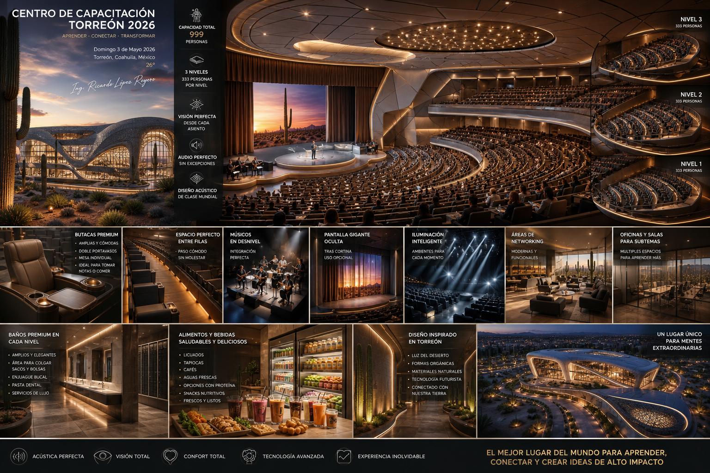
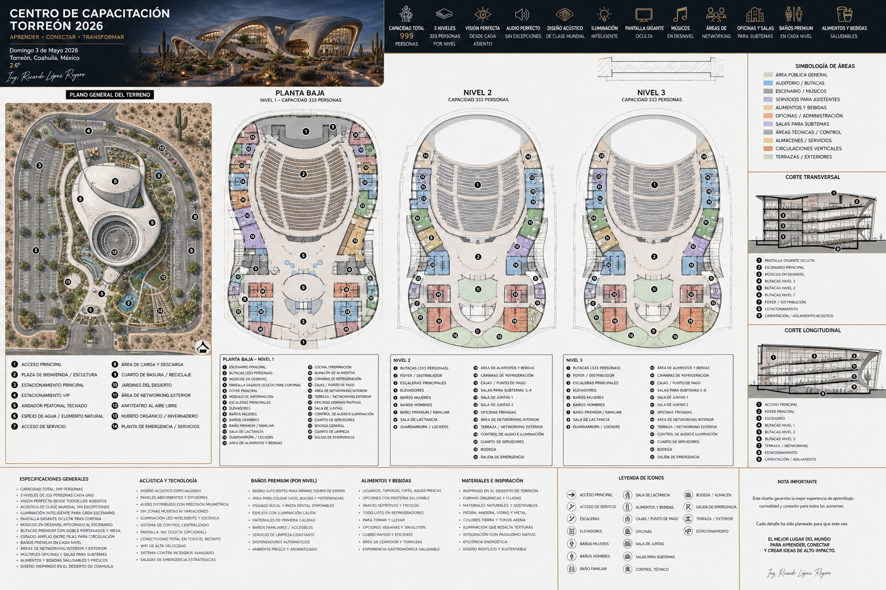

# Centro de Capacitación Premium Torreón

_Ing. Ricardo López Reyero · 2026-05-03 · escrito a mano, sin IA_

**Centro de Capacitación Premium Torreón**

Despúes de algunos Prompts en GPT

## CENTRO DE CAPACITACIÓN PREMIUM TORREÓN 2026

**Un activo icónico que convierte conocimiento en flujo constante de ingresos**

---

### PROBLEMA

El norte de México le faltan espacios diseñados específicamente para experiencias de aprendizaje de alto nivel.  
Los eventos se realizan en salones genéricos que limitan la atención, el impacto y el valor percibido.

---

### SOLUCIÓN

Un teatro de capacitación de clase mundial en Torreón, diseñado para:

- 999 personas con visibilidad y audio perfectos

- Experiencia inmersiva (iluminación, acústica, confort total)

- Espacios de networking y subeventos

- Servicios premium de alimentos y bebidas

Un lugar diseñado no para eventos… sino para **maximizar aprendizaje, conexión y valor por asistente**.

---

### MODELO DE NEGOCIO

Ingresos diversificados:

- Eventos masivos (principal fuente)

- Renta de salas privadas

- Alimentos y bebidas

- Experiencias premium y membresías corporativas

---

### TRACCIÓN ESPERADA

- 3 eventos por semana

- 140 eventos al año

- 700 asistentes promedio por evento

- Ticket promedio: $1,000 MXN

---

### INGRESOS

- Ingreso por evento: $700,000

- Ingreso anual por eventos: $100M MXN

- Ingreso adicional (F&B + extras): +30%

**Total anual estimado: $130M MXN**

---

### RENTABILIDAD

- Margen operativo estimado: 30%

- Utilidad anual: $40M MXN

---

### INVERSIÓN

**$400M MXN**

Incluye:

- Construcción icónica

- Tecnología (audio, iluminación, automatización)

- Equipamiento super premium

- Desarrollo de áreas comerciales

---

### RETORNO

- Payback estimado: **8 a 10 años**

- Activo inmobiliario de alto valor

- Flujo constante y escalable

---

### VENTAJA COMPETITIVA

- Primer recinto en la región diseñado 100% para capacitación premium

- Experiencia superior imposible de replicar en hoteles

- **Posicionamiento como sede obligada de eventos de alto nivel**

- Integración de negocio + comunidad + educación

---

__________________________________________

**Origen de la idea**

Para 999 personas

En tres niveles de 333 personas cada uno.

Con el audio perfecto en cada lugar sin exepciones

Las butacas comodas! amplias, con porta vasos doble a la izquierda y una mesita sumamete buena para que puedas tomar notas ó comer.

Debe de haber espacio suficiente entre filas para que una persona pueda pasar entre ellas.

Todos deben de ver perfecto, el angulo de la butaca debe estar exacto al centro del escenario, no exepciones.

Debe estar lleno de luces para poder hacer juegos de, drama, atención, apagado total, etc.

Debe de haber espacio para músicos en desnivel.

El lugar tiene espacio para networking y multiples oficinas para terminando el tema principal abrir subtemas.

Debe haber baños por niveles de forma que la persona pierda la menor cantidad de tiempo en ir y regresar, deben de ser suficientes y con todos los servicios posibles, con lugar para colgar saco, bolsas, bebidas. Enjuague bucal, pasta de dientes, baños premium equipados.

El servicio de bebidas, son licuados, tapiocas, cafes, aguas frescas, todo la opción de proteína. hay snacks nutrtivos y todos frescos y listos para llevar, Toda la comida la traen y la ponemos en refrigeradores lista para cobrar y servir.

Tiene una pantalla enorme que se puede usar, esta atrás de una cortina, es opcional.

El techo es perfecto para la aucustica y en todo momento del diseño se piensa en la aucustiuca.

Domingo 3 de Mayo 2026, Torreón, Coahuila, México, 26°

Ing. Ricardo López Reyero
