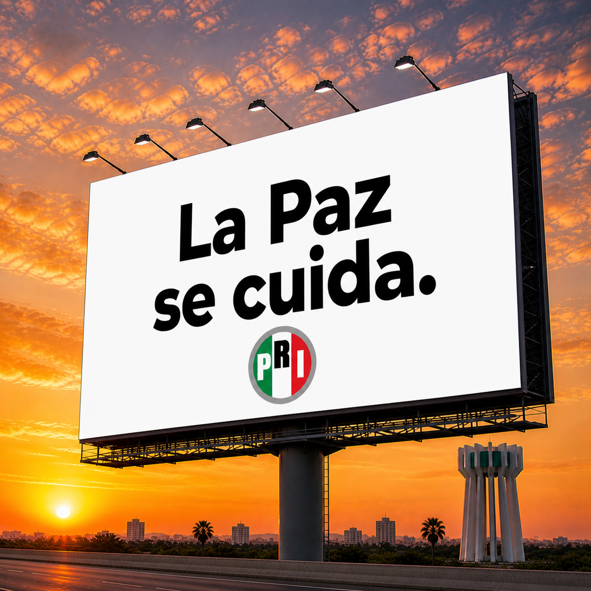
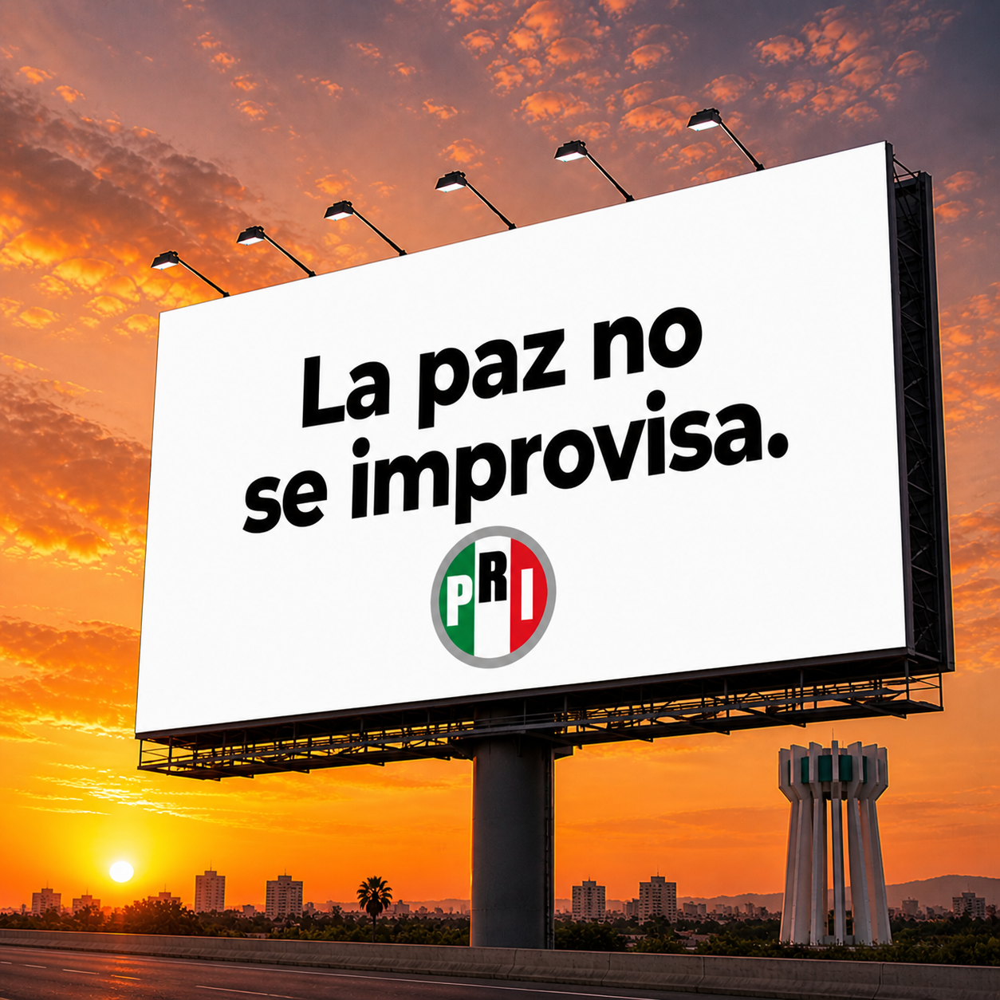
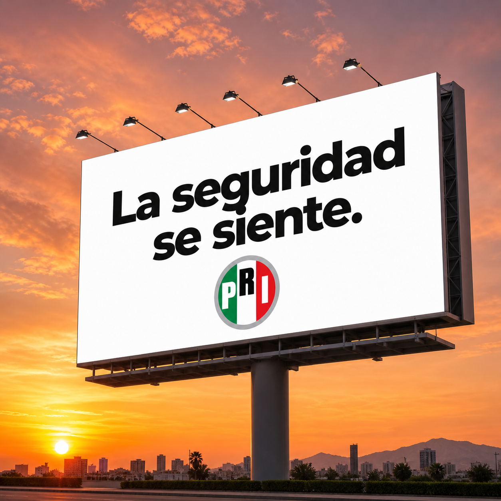
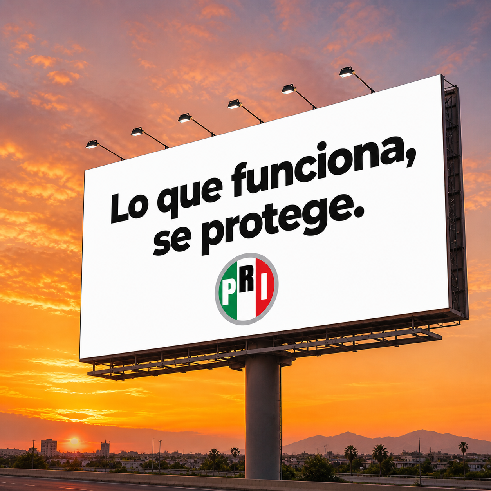
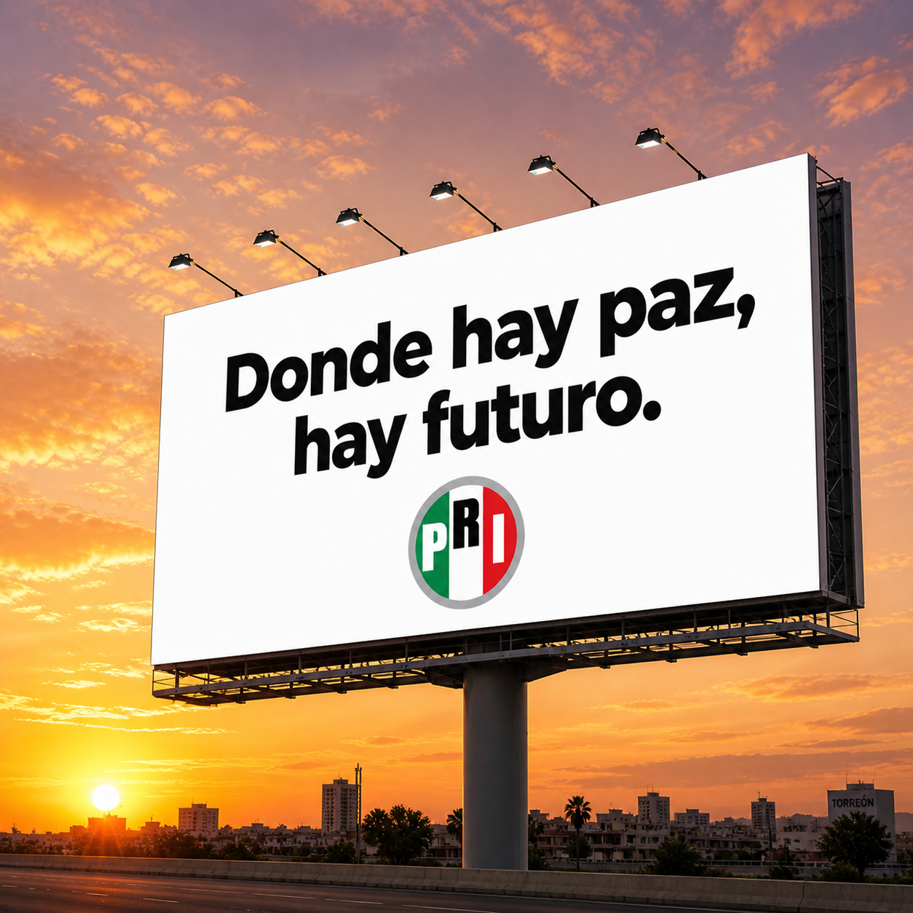
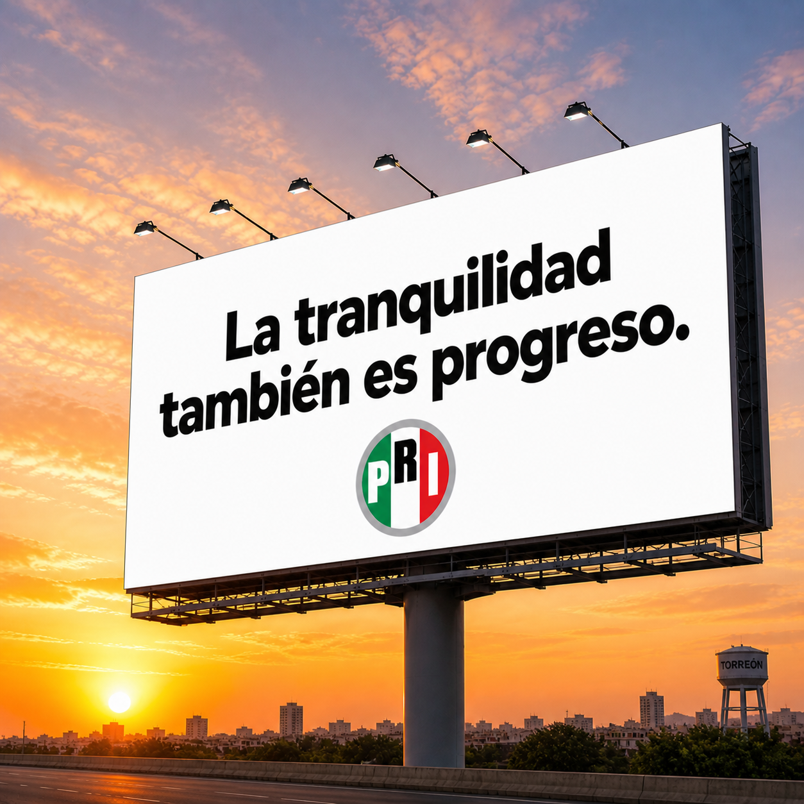
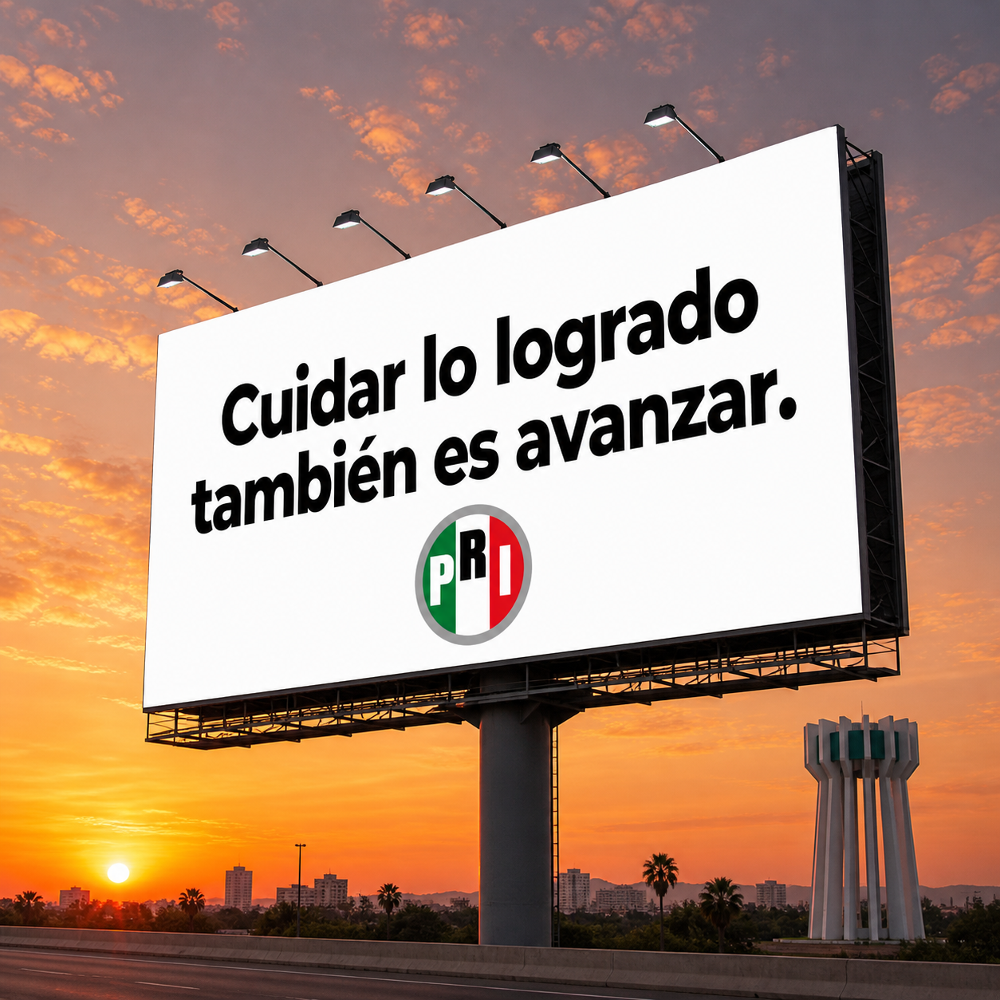
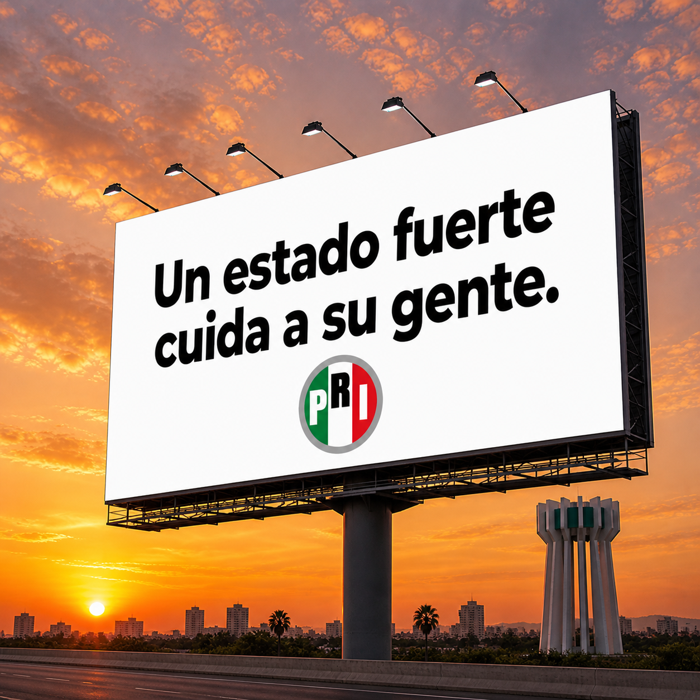
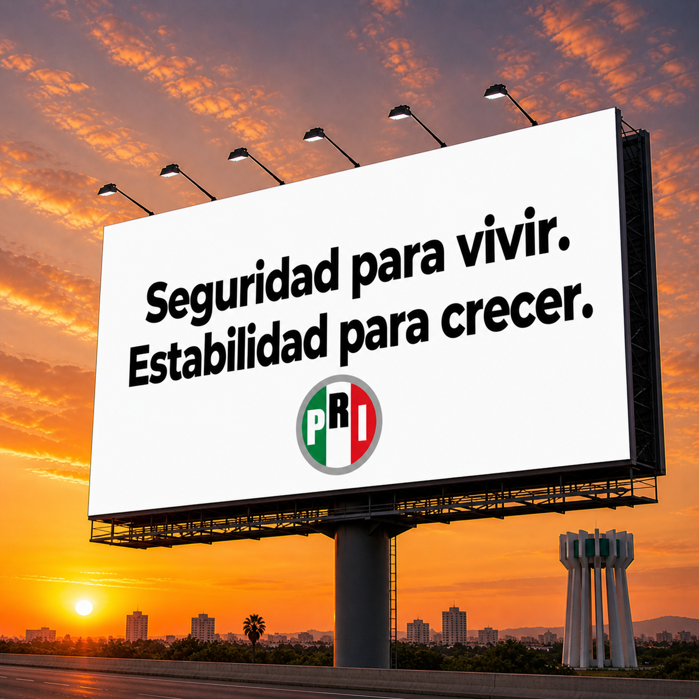
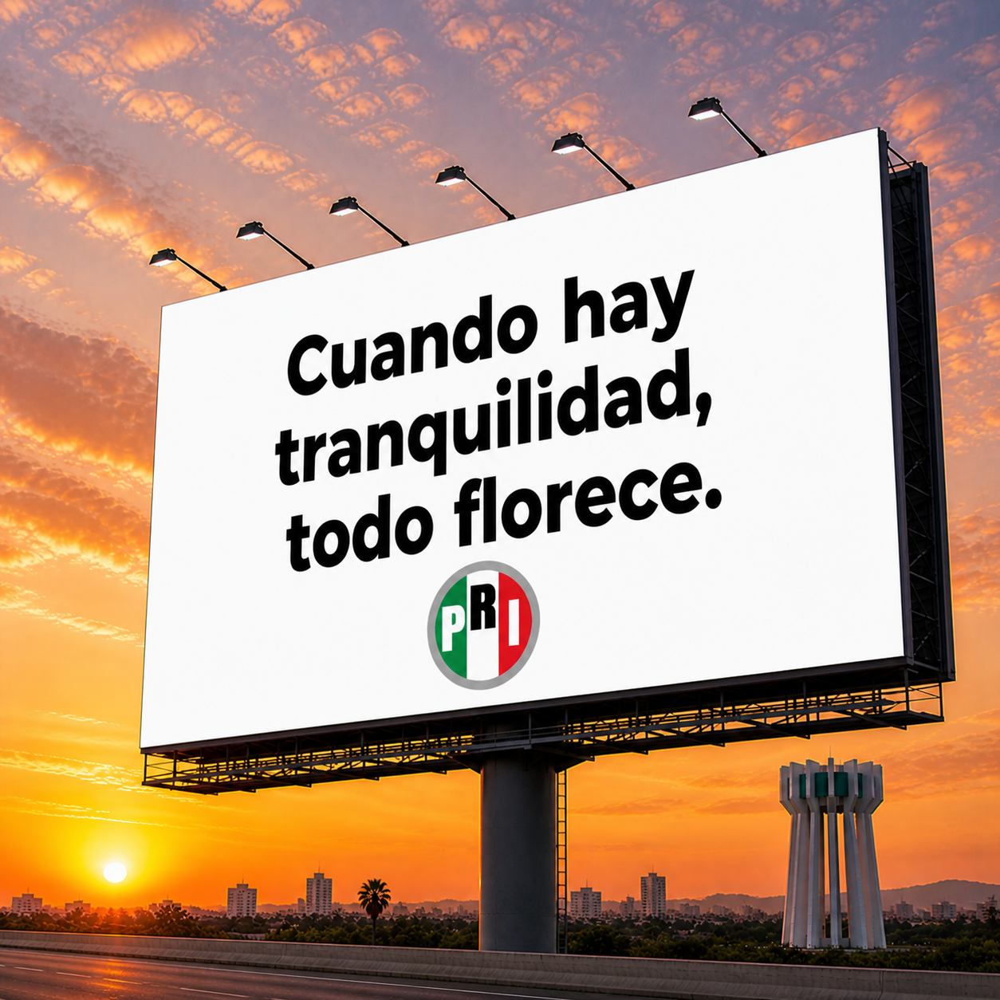

# Campaña PRI Coahuila

_Ing. Ricardo López Reyero · 2026-05-02 · escrito a mano, sin IA_

**Campaña PRI Coahuila**

### Las 10 frases que deberían regir la campaña

1. **La paz se cuida.**

1. **La seguridad se siente.**

1. **Lo que funciona, se protege.**

1. **Donde hay paz, hay futuro.**

1. **La tranquilidad también es progreso.**

1. **Cuidar lo logrado también es avanzar.**

1. **Un estado fuerte cuida a su gente.**

1. **La paz no se improvisa.**

1. **Seguridad para vivir. Estabilidad para crecer.**

1. **Cuando hay tranquilidad, todo florece.**

La más fuerte para espectaculares masivos sería:

## **La paz se cuida.**

**Indicaciones más detalladas.**

Fondo blanco, tipografía Montserrat en negro, mensajes limpios, directos y consistentes. El logotipo del PRI Coahuila debe mantenerse siempre en la misma posición para generar reconocimiento inmediato. El uso de acentos en colores brillantes aporta visibilidad sin perder sobriedad.

Si un espectacular carece de iluminación, se corrige: el PRI es luz y debe verse siempre.

La estrategia se divide en dos niveles claros. El 90% de los espectaculares utiliza frases simples, contundentes y homogéneas para maximizar recordación. El 10% restante incorpora de 2 a 4 candidatos en una misma pieza. Esto multiplica el rendimiento: ese 10% concentra hasta un 40% de exposición adicional, logrando un efecto total equivalente al 130% del impacto esperado.

Más allá de la eficiencia en el uso del espacio, el objetivo central es proyectar orden, disciplina y alineación. La comunicación debe percibirse uniforme, limpia y perfectamente coordinada, reforzando la imagen de un partido sólido y en control.

Redes sociales igual, que se vea lo alineados, se le mete dinero al 100% de las páginas de los candidatos. 50% estás imagenes y 50% Videos con propuestas ultra claras y simples de mejoras que van a hacer en los primeros 100 días de gobierno. Simples. Pero con valor.

Hacer encuestas dando algo de valor sin costo, ejemplo 1 multa gratis si votas por quien votarias estas elecciones y solo le hacemos campaña mega intensa a los que ponen por Morena, pero visita a casa diario hasta que cambie de opinión jaja.

Sábado, 1 mayo 2026, 9:04 - 10:41 pm. Torreón, Coahuila, México, 27°

Ing. Ricardo López Reyero

Orgullosamente de Torreón, Coahuila.
