# Los 33 posts de X

PDF de revisión: el archivo `Posts X · 33 posts de RLR · v1 · …pdf` de esta carpeta. Datos: [posts.json](posts.json). Visuales: [visuales/](visuales/). Ids de los artículos publicados en X: [publicados_x.json](publicados_x.json).

Estado al 28-oct-2026: los posts 1 al 9 están en Borradores de X sin fecha (pausados por Ricardo); los 10 al 33 son propuesta, no existen en X. Nada programado.

## Post 1 · 0 redes sociales por 1,171 días (gif)

Del 20.01.2023 al 05.04.2026: 1,171 días sin redes sociales.  
  
No podía volver a ninguna. Instagram me conocía mejor que yo: 45 minutos diarios ahí, 20 en TikTok, y la concentración se me iba.  
  
X tiene algo diferente. Aquí vengo a pensar y a escribir.  
  
Gracias por hacerla y por manejarla así. Felicidades, @elonmusk y a todo el equipo de @X.  
  
Lo escribí completo aquí: https://x.com/ricardolopezrey/status/2115482215496786197

## Post 2 · El Fin de la Democracia: Gracias Claudia (imagen)

Ford necesitó 14 iteraciones para llegar a la F-150.  
Apple, 19 para el iPhone 17.  
México lleva 43 presidentes… y la iteración actual sale peor que las anteriores.  
  
No es la persona. Es el sistema que la elige.  
  
Gracias, @Claudiashein: contigo dejé de creer en la democracia como la conocemos.  
  
Lo escribí completo aquí: https://x.com/ricardolopezrey/status/2115482524679815623

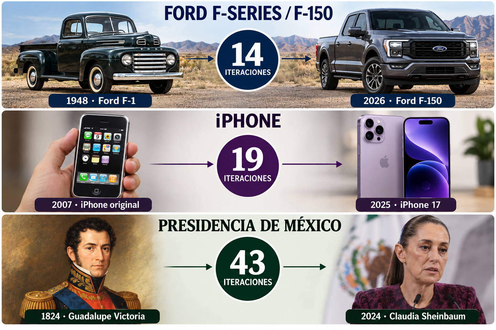

## Post 3 · El error de 1943, Reforma sistema de salud México (imagen)

«El IMSS no tiene dinero.» «Se lo roban.»  
Las dos conclusiones están mal.  
  
Hice la cuenta con Torreón: aportamos unos $5 mil millones al año. Unos $500 millones no compran ni una consulta ni una medicina: pagan pensiones del régimen de 1966.  
  
No es el piso. Es la arquitectura. @Tu_IMSS  
  
Lo escribí completo aquí: https://x.com/ricardolopezrey/status/2115482438692393225

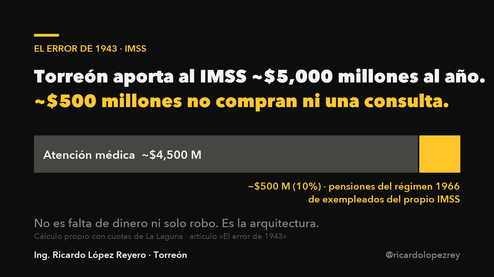

## Post 4 · Estar en el 1% más rico en México no es como esperas (imagen)

Mi esposa y yo llevábamos días discutiendo por dinero. Le pregunté a la IA en qué lugar estamos si ganamos $250,000 al mes.  
  
Respuesta: en el 0.3% más alto de México.  
  
Me quedé helado. Llegar costó muchísimo trabajo y mucha suerte. Si así se siente el 0.3%, el problema no es la gente: es el ritmo del país.  
  
Lo escribí completo aquí: https://x.com/ricardolopezrey/status/2115482499606340087

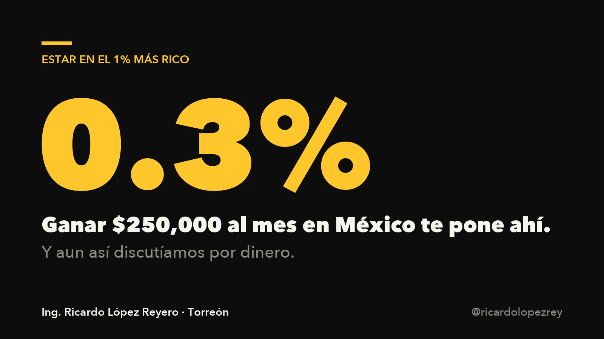

## Post 5 · Cobranza de impuestos 2.0 (imagen)

Cobrar impuestos hoy se siente feudal: multa, amenaza, fila.  
  
Propongo cambiarle el nombre y el trato. No son impuestos, son aportaciones. Y quien aporta es un donador, no un sospechoso.  
  
Gracias a esas aportaciones existe la calle por la que pasaste hoy.  
  
@SATMX, ¿y si empezamos por dar las gracias?  
  
Lo escribí completo aquí: https://x.com/ricardolopezrey/status/2115482024383303743

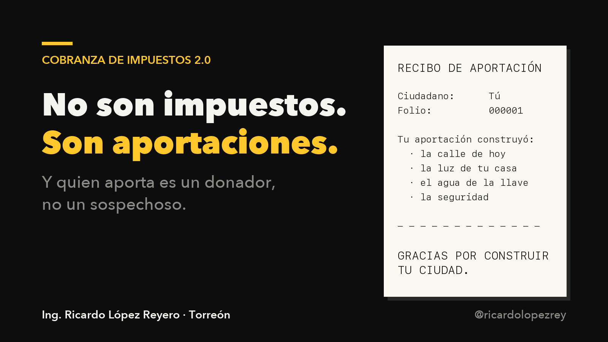

## Post 6 · Presos y cárceles 2.0 (imagen)

Nadie llega a la cárcel con toda la información que necesitaba para vivir bien.  
  
Si el sistema no se la dio afuera, que se la dé adentro:  
· manejo de emociones, todos los días  
· un oficio: bancas, paradas y señalética para la ciudad  
· la biblioteca más grande de la ciudad  
  
Presos 2.0. @SSPCMexico  
  
Lo escribí completo aquí: https://x.com/ricardolopezrey/status/2115481629724488068

## Post 7 · El pavimento ideal para las calles Formula V1 (imagen)

Una sola instrucción cambia una ciudad entera: con qué pavimentamos.  
  
Para Torreón: concreto hidráulico claro. Refleja el sol, se calienta menos que el asfalto, hace menos ruido y dura décadas.  
  
Hice 3 iteraciones de la fórmula y la dejo abierta.  
  
@mrikelme, ¿la probamos en una avenida?  
  
Lo escribí completo aquí: https://x.com/ricardolopezrey/status/2115482375673033147

## Post 8 · Presientes selecionados vs Presidente Políticos (imagen)

Propuesta: se acaban las campañas.  
  
Candidatos a presidente = los 6 gobernadores que más subieron el ingreso por persona en su estado. Medido cada año, público, sin opiniones.  
  
¿Quieres ser presidente? Demuéstralo gobernando.  
  
@INEMexico, ¿qué haría falta para medirlo?  
  
Lo escribí completo aquí: https://x.com/ricardolopezrey/status/2115482186123981045

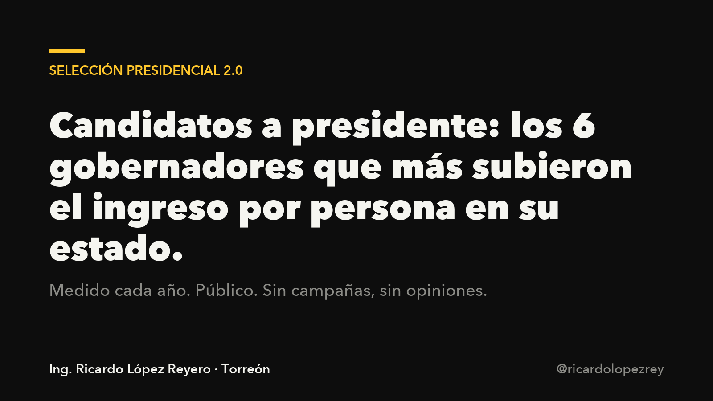

## Post 9 · Gobiernos sueldos super competitivos (imagen)

Queremos al mejor talento en el gobierno… pagando como si no importara.  
  
Un Player A no deja la iniciativa privada por amor al arte. Lo mejor se paga, con bonos atados a resultados.  
  
Gobierno barato = gobierno lento.  
  
@manolojim, ¿Coahuila se anima a probarlo primero?  
  
Lo escribí completo aquí: https://x.com/ricardolopezrey/status/2115480187685027929

## Post 10 · La presidenta más estúpida de todos los tiempos en México (imagen)

Lo titulé así en mi blog: «La presidenta más estúpida de todos los tiempos en México».  
  
No es un insulto, es un cálculo. Tiene TODO el poder que su movimiento pidió durante 20 años. Resultado: +0.8 % de PIB en 2025, cientos de muertos al día y hospitales sin medicina.  
  
Mujer, ingeniera, mayoría absoluta. Tenía todo para ser la mejor iteración. ¿Entonces? El filtro que la puso ahí no busca al mejor: busca al más leal.  
  
Lo escribí completo aquí: https://x.com/ricardolopezrey/status/2115482481340100803

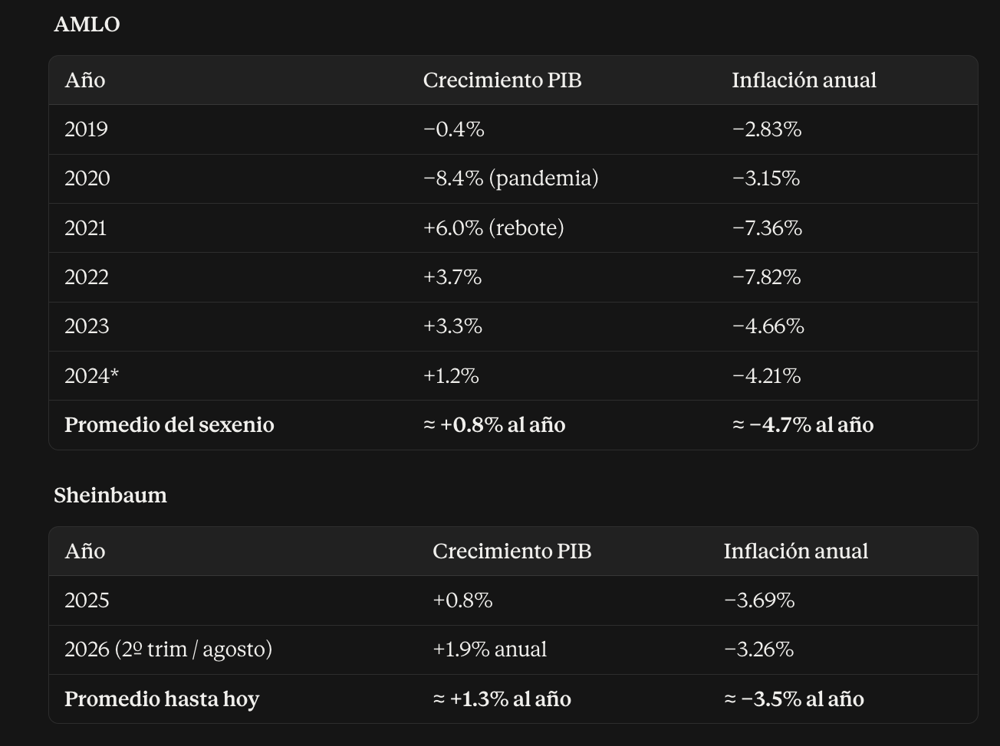

## Post 11 · Ciudadanos con voto (imagen)

Propuesta incómoda: que no todos los votos valgan lo mismo.  
  
Top 1 % de aportadores: su voto vale 100.  
Siguiente 9 %: vale 10.  
Quien más ayuda recibe del Estado: vale 0.1, y su apoyo queda garantizado gane quien gane.  
  
Sigue siendo democracia, todos votan. Lo que cambia es que ya nadie puede comprar un voto con miedo.  
  
¿Prefieres la ilusión de igualdad o un gobierno alineado con quien lo paga?  
  
Lo escribí completo aquí: https://x.com/ricardolopezrey/status/2115481607205208477

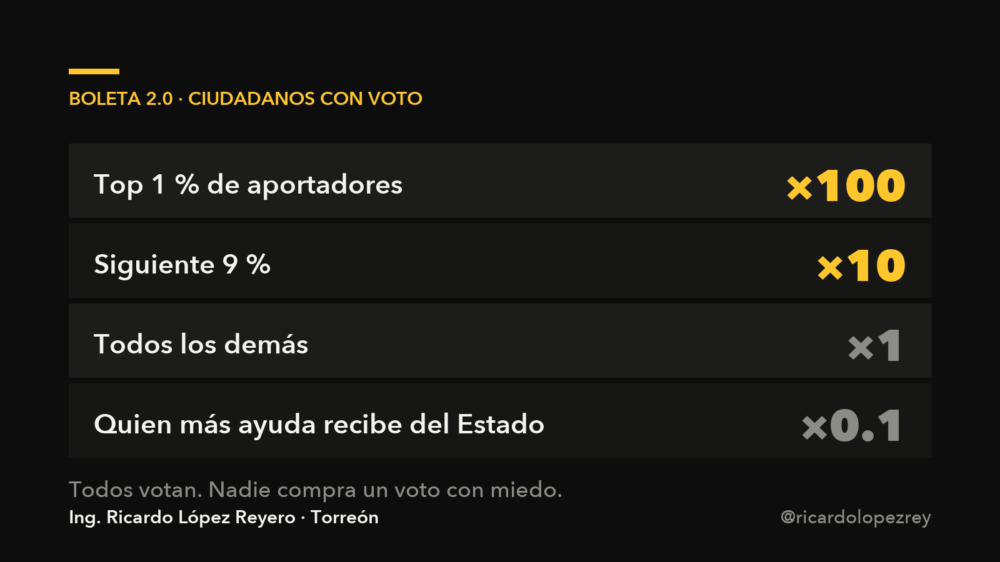

## Post 12 · Pólitica 100% vivos (texto)

Política 100 % vivos.  
  
El objetivo no es «bajar los homicidios». El objetivo es que el 100 % de los mexicanos sigan vivos. Mismo número, otra dirección.  
  
Y una sola regla: si matas a una persona, prisión hasta tu muerte biológica.  
  
Simple. Sin matices. Sin «contexto».  
  
Hoy en México se mata gratis. Se acaba el día que deje de serlo.  
  
Lo escribí completo aquí: https://x.com/ricardolopezrey/status/2115481427089265105

## Post 13 · Ley: Pared Limpia (imagen)

Rayar una pared ajena no es arte. Es un insulto a quien la pagó.  
  
Mi ley: 5 años de servicio comunitario pintando TODO lo vandalizado de la ciudad. Si te gusta pintar, pinta para todos.  
  
Así quiero las paredes de Torreón: con un mensaje que valga la pena leer.  
  
«Eres mucho más listo de lo que crees, confía.»  
  
Esa es la diferencia entre rayar y aportar.  
  
Lo escribí completo aquí: https://x.com/ricardolopezrey/status/2115480729928790455

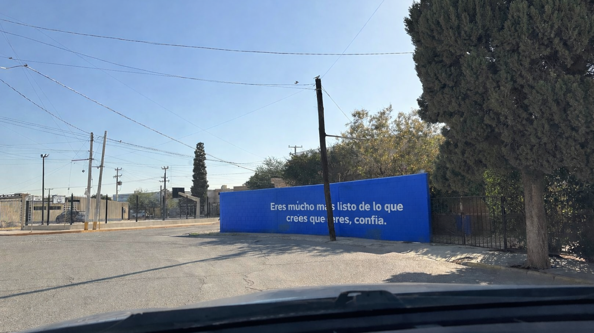

## Post 14 · México sin dirección (texto)

Nadie quiere decir esto:  
  
México está como está por el nivel de conciencia promedio de quien vota.  
  
Una población que piensa desde la escasez elige líderes que gobiernan desde la escasez. Y luego nos sorprende el resultado.  
  
No es culpa del ciudadano ni del político. Es el sistema de selección, que premia hablar bonito en vez de dar resultados.  
  
Los recursos están. El talento está. La geografía está. Falta poner a las personas correctas en los puestos correctos. Así de simple y así de complejo.  
  
Lo escribí completo aquí: https://x.com/ricardolopezrey/status/2115480499938357731

## Post 15 · Cobranza express de impuestos (gif)

México tiene más de 60 impuestos: ISR, IVA, IEPS, ISN, tenencia, nómina…  
  
El SAT tiene 26,000 empleados. Las empresas contratan contadores solo para cumplir. Y nadie entiende lo que paga.  
  
Mi propuesta: UN impuesto. 1–2 % por transacción, retenido por el banco en el mismo segundo. Sin declaración, sin contador, sin evasión posible.  
  
El dinero que tienes en el banco sería 100 % tuyo por primera vez.  
  
@GobiernoMX, ¿cuánto nos cuesta cobrar 60 impuestos?  
  
Lo escribí completo aquí: https://x.com/ricardolopezrey/status/2115480704142147739

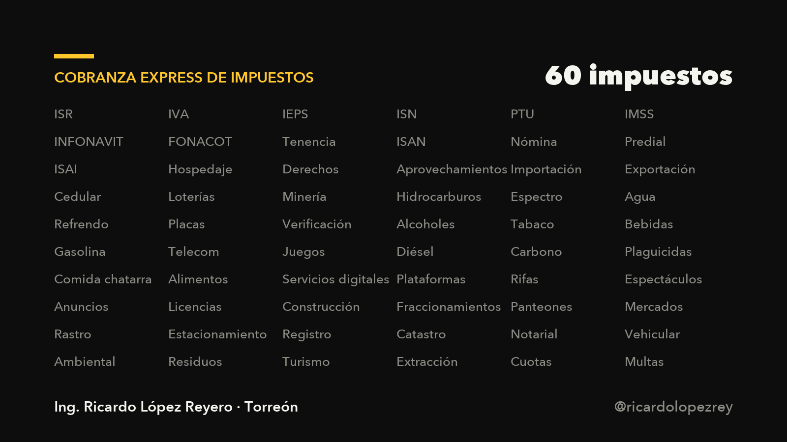

## Post 16 · La corrupción se acaba al sistematizar (texto)

No acabes con la corrupción. Sistematízala.  
  
La mordida es retroalimentación: el ciudadano te está diciendo «este trámite me importa y pago por que sea rápido». El sistema no lo escucha; el funcionario sí.  
  
Cuando llegó Spotify, la piratería no se prohibió: se volvió lenta e incómoda. Lo legal ganó por eficiencia.  
  
Trámites en el celular, con cita o a domicilio. El día que lo correcto sea lo más rápido, la corrupción se queda sin clientes.  
  
Es más fácil mejorar procesos que corregir personas.  
  
Lo escribí completo aquí: https://x.com/ricardolopezrey/status/2115480376051146897

## Post 17 · Organigrama Gobierno 2.0 (imagen)

Diseñé el gobierno de México desde cero: 552 puestos, cada uno con su KPI.  
  
El presidente se mide con 3 números y nada más:  
· Muertes → 0  
· PIB por persona  
· kWh por persona  
  
Un co-presidente se mide con uno: felicidad ciudadana.  
  
Cero lealtad política: se contrata al mejor perfil para cada puesto, como en cualquier empresa que quiere ganar.  
  
Seis años, tres indicadores. ¿Quién no podría evaluar eso?  
  
Lo escribí completo aquí: https://x.com/ricardolopezrey/status/2115480406589890796

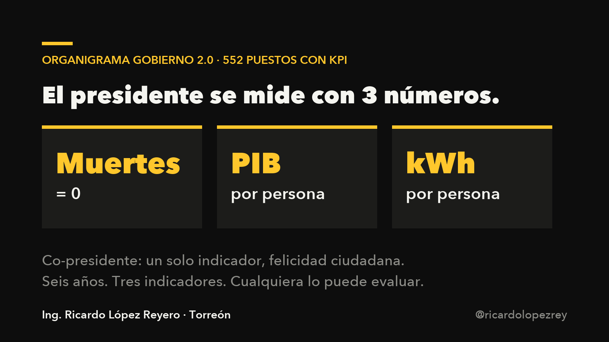

## Post 18 · Constitución simplificada en valores (imagen)

La Constitución la escribieron abogados de otro siglo. Nos trajo hasta aquí; no nos lleva a donde queremos ir.  
  
Propongo una de 2 hojas. Máximo. Para que esté pegada en cada salón de cada escuela y un niño de 10 años la entienda.  
  
Valores, no artículos: dignidad, Estado y ciudadano aliados, abundancia compartida, ley igual para todos, salud, movimiento.  
  
Si no cabe en 2 hojas, no es un pacto. Es un laberinto.  
  
Lo escribí completo aquí: https://x.com/ricardolopezrey/status/2115481525688910134

## Post 19 · Evolución en la selección de funcionarios (imagen)

Hoy: los seleccionamos por sus palabras.  
Propuesta: por sus resultados.  
  
Lo único con campaña es presidente municipal. Los 3 alcaldes con mayor crecimiento aparecen en la boleta para gobernador. Los 3 gobernadores con mayor crecimiento, en la boleta para presidente.  
  
Sin partidos. Sin INE. Sin discursos: números públicos cada año.  
  
Hay gente que habla espectacular y sus acciones no la siguen. Está bien que existan. No en puestos que nos afectan a todos.  
  
Lo escribí completo aquí: https://x.com/ricardolopezrey/status/2115480154667368521

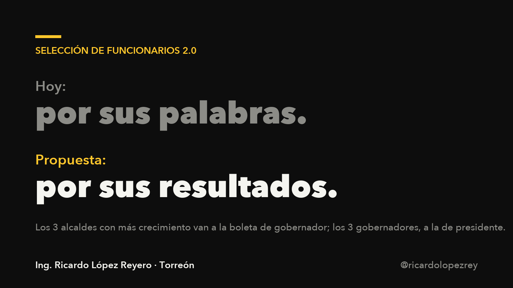

## Post 20 · Cómo México Podría Unir a Todo el Continente Bajo un Solo Nombre — América (texto)

Ejercicio de estrategia, no de política:  
  
¿Y si México uniera al continente bajo un solo nombre? Siempre fue América.  
  
No con fuerza. Con resultados. Año 5 de un gobierno que funciona: violencia a la baja, superávit, regiones creciendo. En ese momento México deja de ser vecino y se vuelve modelo.  
  
Luego Centroamérica, que ya depende de nosotros y no tiene formalidad. Cada país entra por lo que más necesita y nadie le ha dado.  
  
Lo escribí fase por fase, hasta el año 40.  
  
Lo escribí completo aquí: https://x.com/ricardolopezrey/status/2115480359806615638

## Post 21 · Toma de protesta México Año Desconocido (gif)

Así imagino la toma de protesta del primer presidente de Gobierno 2.0.  
  
Pantalla negra. Letras blancas. 20 minutos en los que todo México ve lo mismo.  
  
«Gracias, gracias, gracias.  
Hoy tenemos un México frustrado, ansioso, enojado. Sabemos que la política no funcionó.  
De político a empresario. De caer bien a seguir un indicador.  
Por 6 años, dos números: muertos y PIB por persona.»  
  
Y se apaga la pantalla. A trabajar.  
  
Lo escribí completo aquí: https://x.com/ricardolopezrey/status/2115480442061099059

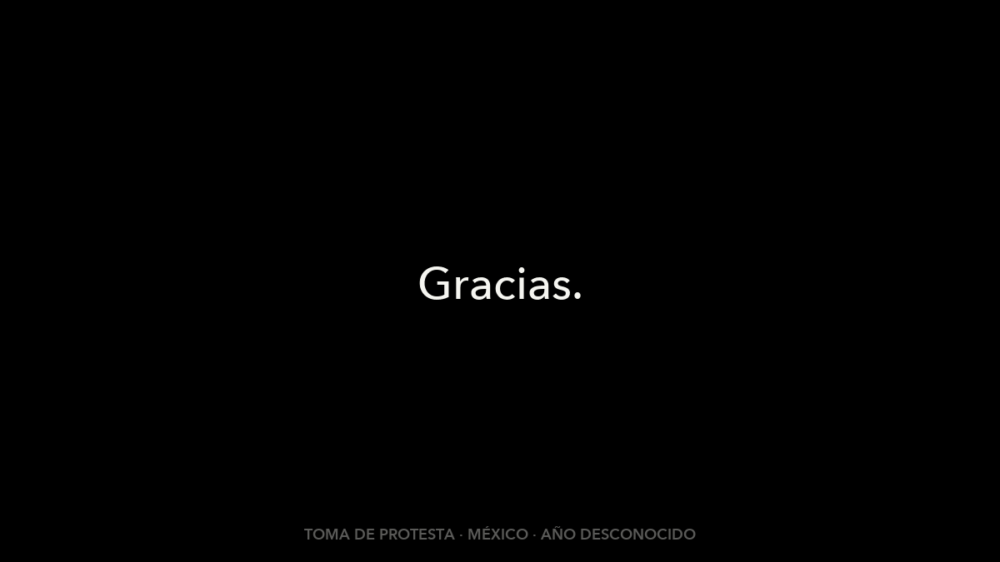

## Post 22 · Energía por ciudadanos (imagen)

Impopular: el país más avanzado es el que más energía consume por persona.  
  
No el que la ahorra. El que la usa para crear más valor.  
  
El fuego nos sacó de la cueva. La electricidad, del campo. Lo que sigue también va a ser energía.  
  
Propongo que el gobierno mida kWh por ciudadano y lo suba todos los años como indicador principal.  
  
Entre más energía uses, más apalancado estás. Úsala bien.  
  
Lo escribí completo aquí: https://x.com/ricardolopezrey/status/2115480763537707519

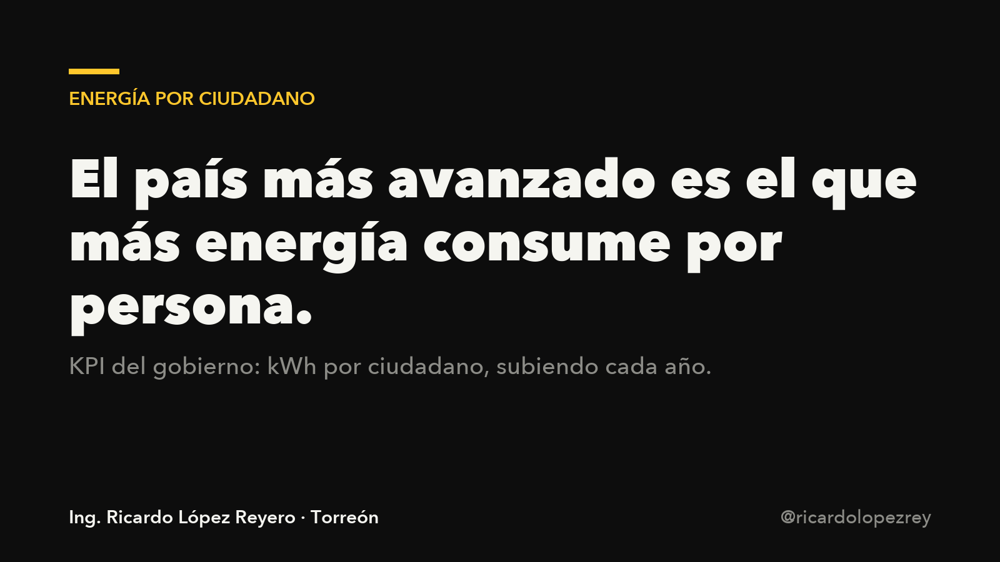

## Post 23 · La sincronización de semafóros (imagen)

Hice la cuenta para Torreón:  
  
1 minuto menos por trayecto × 600,000 habitantes × 2 trayectos al día = 1,200,000 minutos diarios.  
  
Son 20,000 horas. 1,666 días laborales. CADA DÍA.  
  
Eso cuesta no sincronizar los semáforos.  
  
Cámaras que ajustan en vivo, verde total al que va solo a las 2 am, y un solo KPI: segundos promedio de traslado.  
  
Es la obra más barata y de mayor retorno que tiene una ciudad.  
  
Lo escribí completo aquí: https://x.com/ricardolopezrey/status/2115480834102759541

## Post 24 · Miles de árboles nuevos en la ciudad Torreon (imagen)

Torreón necesita miles de árboles, no cientos.  
  
Busqué el correcto para una ciudad desértica con vista al año 2100: que tire poca hoja, tome poca agua, dé sombra real y tenga tronco alto para no estorbar. Respuesta: ébano (Ebenopsis ebano).  
  
Regla simple: semáforo + árbol. Donde hay un semáforo, hay un ébano.  
  
Cada árbol sembrado mejora la ciudad el mismo día. El gobierno hace su parte, pero el ciudadano también. ¿Cuántos has sembrado tú?  
  
Lo escribí completo aquí: https://x.com/ricardolopezrey/status/2115481705981104602

## Post 25 · Crédito al Trabajo Formal (imagen)

Le pedí a la IA la pregunta más inteligente para agregar valor a México. 14 rondas, 2 agentes, 28 iteraciones.  
  
La respuesta no es otro programa social. Es pagarle al trabajador formal.  
  
54.8 % de México es informal. Propuesta: crédito mensual automático a quien esté en el IMSS con salario bajo, cero trámites, y un año de descuento en cuotas a la microempresa que formalice por primera vez.  
  
Un solo indicador: ingreso disponible del 40 % más pobre. Si sube, funcionó. Si no, se apaga.  
  
Lo escribí completo aquí: https://x.com/ricardolopezrey/status/2115481899665600734

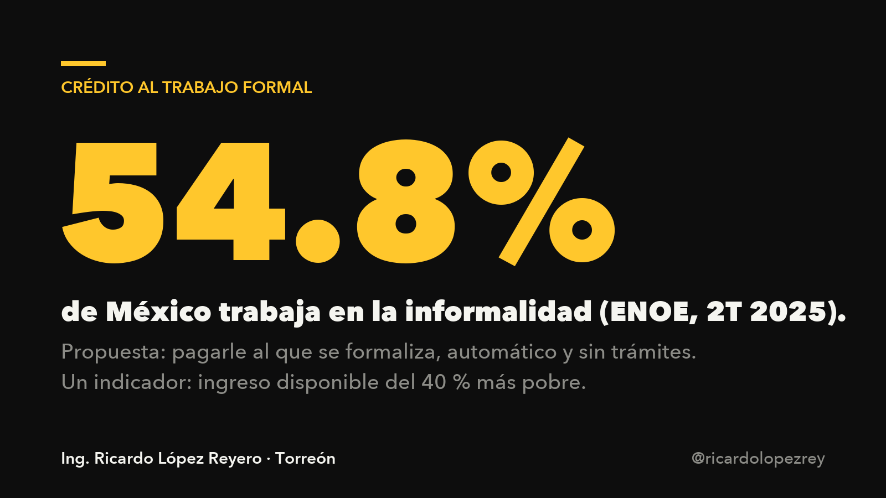

## Post 26 · Crédito productivo para el Colegios Universidades (texto)

Mi esposa recorrió 15 bancos buscando crédito para crecer su colegio. Ninguno le prestó.  
  
Los bancos no le prestan a colegios: si no pagan, embargar una escuela con toda su comunidad se ve mal. Y el mercado les parece chico.  
  
Hoy ese grupo pasó de 300 a 3,300 alumnos. Sin ellos.  
  
La SEP no apoya a la escuela privada, el banco no presta y el gobierno cobra. Y aun así esa gente forma a los líderes del México que viene.  
  
El dinero debería fluir hacia quien construye el futuro, no alejarse de él.  
  
Lo escribí completo aquí: https://x.com/ricardolopezrey/status/2115480276071846102

## Post 27 · Hay 3 tipos de socios en una sociedad (imagen)

Hay 3 tipos de socios:  
  
1) Operadores: ponen la energía en crear valor y hacer crecer la empresa.  
2) Capitalistas: ponen dinero y recomiendan el producto todos los días.  
3) Bultos de cemento: materia prima que decidió quedarse inanimada. Ven crecer la empresa sin mover un dedo.  
  
Pueden ser muy buena gente. Quédatelos de amigos, no de socios: le están quitando el lugar a alguien que sí empuja.  
  
Primero intenta activarlos. Si no, eliminación activa. Un bulto pesa.  
  
Lo escribí completo aquí: https://x.com/ricardolopezrey/status/2115479856318198216

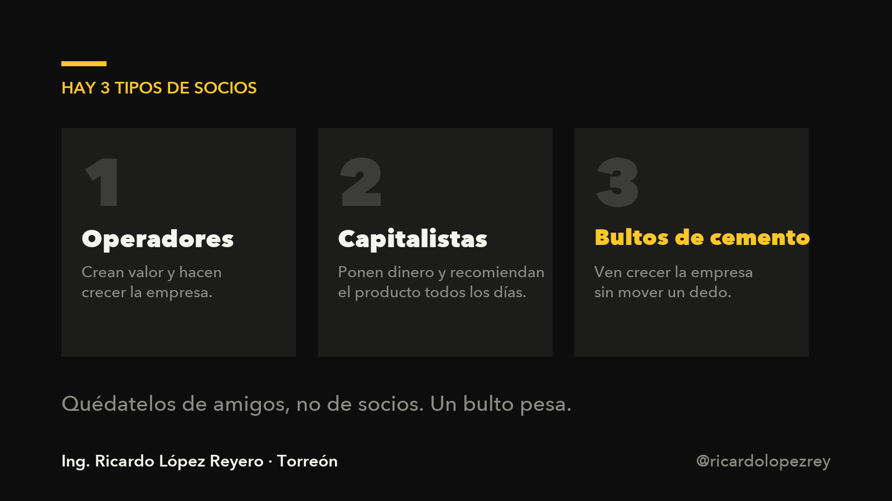

## Post 28 · Primero la pasión, luego la monetización (texto)

El capitalismo (que me encanta) tiene el orden al revés: primero monetizar, luego ver si hay valor.  
  
Resultado: riqueza superficial, baja calidad, gente rica e insatisfecha.  
  
El orden correcto: pasión → valor → distribución → entrega → monetización. El dinero llega como consecuencia.  
  
El acelerador: crea mucho más valor del que cobras. La gente siente que ganó, queda en deuda emocional y te recomienda.  
  
Y un dato de mi experiencia: después de la iteración 40 es cuando despegas. Antes, estás aprendiendo.  
  
Lo escribí completo aquí: https://x.com/ricardolopezrey/status/2115479934848098382

## Post 29 · De $0 a $1M USD Anuales Recurrentes (gif)

Estamos a 5 clientes del primer millón de dólares recurrente al año.  
  
Lo que aprendí de 0 a 1:  
  
· Las primeras ventas las hace el founder. Hice más de 300 videollamadas 1:1; las primeras, un desastre que me da pena recordar.  
· Vendí algo que no podíamos cumplir. Regresé el dinero y seguí iterando.  
· Vamos en la versión 41 del producto. Si crees que con 3 iteraciones llegas, es ego.  
  
Delegar la venta en esta etapa es alargar el ciclo del producto. Aquí no hay dinero: hay tiempo, y se cuida.  
  
Lo escribí completo aquí: https://x.com/ricardolopezrey/status/2115479997058072582

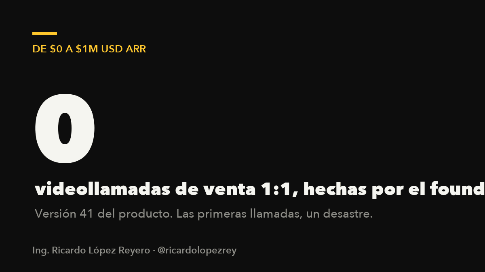

## Post 30 · Ensayo Todo es mi culpa (texto)

Todo es mi culpa.  
  
Yo escogí este mundo, a mis padres, mi cuerpo, mi casa.  
Yo escojo cómo me siento hoy y en qué pongo la atención.  
Yo soy responsable de mi pasado, mi presente y mi futuro.  
  
Suena duro. Es lo contrario: si todo es mi culpa por elección propia, queda perdonado todo el dolor que me autoinfligí por lo que creí que me hicieron.  
  
La culpa total es la libertad total.  
  
Lo escribí completo aquí: https://x.com/ricardolopezrey/status/2115480667374907884

## Post 31 · Libros que tienes que leer (imagen)

150 libros leídos. Lo importante no es el número.  
  
Es cuántas frases entraron y pegaron tan duro adentro que cambiaron la perspectiva. Cuando eso pasa, cambia el exterior.  
  
Las que más me han pegado:  
· Autobiografía de un yogui  
· Thinking in Systems  
· The Road Less Stupid (me enojó tanto que lo castigué 6 meses)  
· Meditaciones, de Marco Aurelio  
  
Hay una página esperándote hoy con la frase exacta que necesitas. Abre el libro.  
  
Lo escribí completo aquí: https://x.com/ricardolopezrey/status/2115480311752528055

## Post 32 · Los SuperPoderes que da la IA (gif)

Lo que antes me tardaba meses en código, hoy lo hago en minutos.  
  
No es 10 % mejor. Es 100X el impacto que iba a tener en el mundo.  
  
La IA no se cansa, se acuerda de todo y siempre da su mejor esfuerzo. El que la usa para entretenerse, ok. El que la usa para producir tiene una joya.  
  
Hoy el mejor uso de la energía del planeta es producir y consumir tokens.  
  
Gracias a todos los humanos que la construyeron.  
  
Lo escribí completo aquí: https://x.com/ricardolopezrey/status/2115482399689548040

## Post 33 · Inicio de los escritos (imagen)

88 artículos publicados en X. 0 % escritos con inteligencia artificial.  
  
Tengo 40 años. Los primeros 39 recibí ideas sin parar y no escribí ninguna; cambiaba de proyecto cada pocos meses creyendo que cada idea era mía para ejecutarla.  
  
A los 39 abrí un espacio para escribirlas. Hoy entiendo que me llegan para compartirlas, no para hacerlas todas.  
  
Escribo lo mínimo, como ingeniero: lo necesario para transmitir la idea completa.  
  
Si algo te sirve, agárralo. Si no, continúa.  
  
Lo escribí completo aquí: https://x.com/ricardolopezrey/status/2115480626010767757

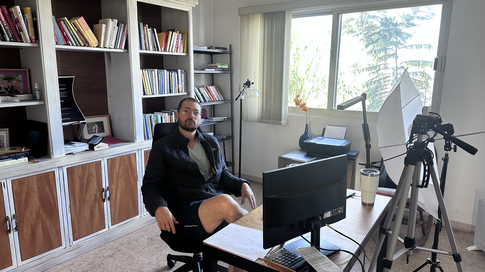

