# Hay más familias queriendo inscribirse en tu colegio de las que tu proceso alcanza a inscribir

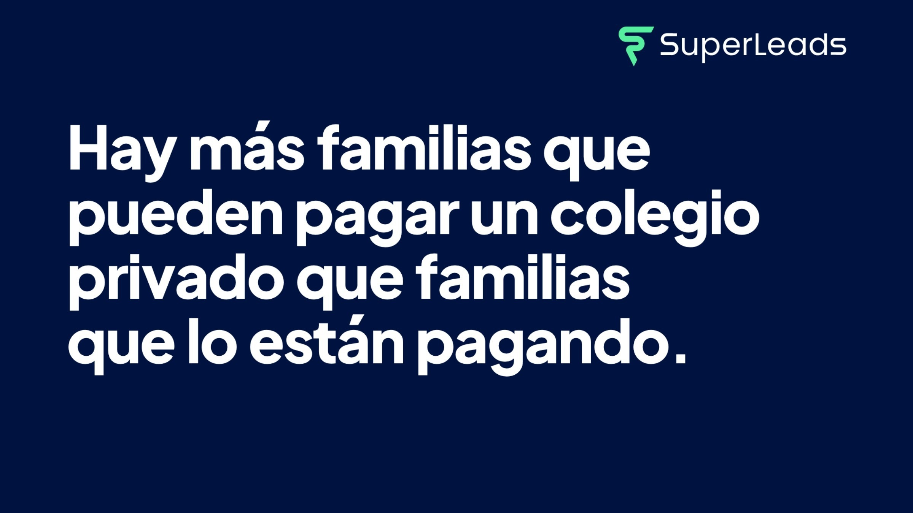

Hay una frase que escucho en casi todas mis juntas con dueños y directores de colegios: «ya no hay niños». A veces cambia: «la demanda se acabó», «las familias ya no pueden pagar».

Los datos dicen otra cosa. En América Latina, y sobre todo en México, hay más familias que pueden pagar un colegio privado, y que escriben para pedir informes, de las que la educación privada está logrando inscribir.

El problema no es la demanda. Es el proceso.

Te lo explico con las láminas de la charla que di hace unos días frente a dueños y directores de colegios. Al final te dejo el video completo.

## México está al final de la lista

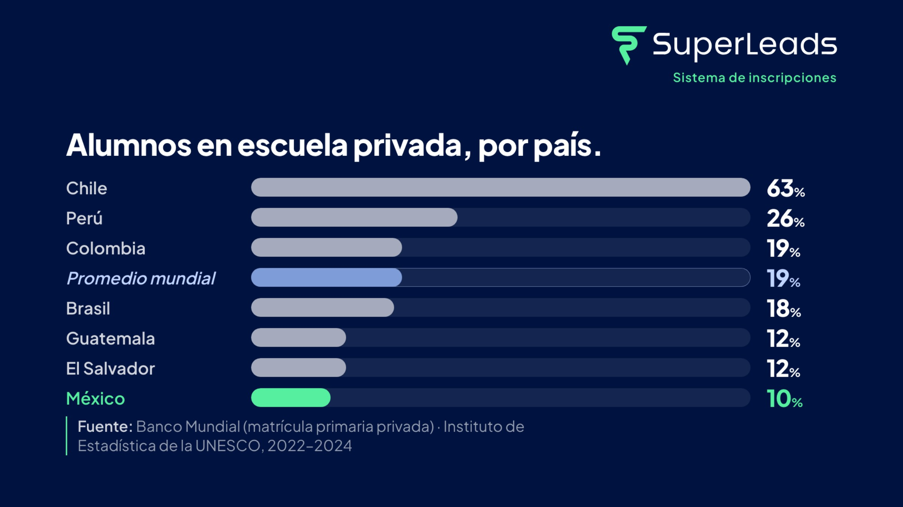

De cada 100 alumnos de primaria en Chile, 63 están en una escuela privada. En Perú, 26. El promedio mundial es 19. En México, 10.

México tiene una de las proporciones de educación privada más bajas de la región.

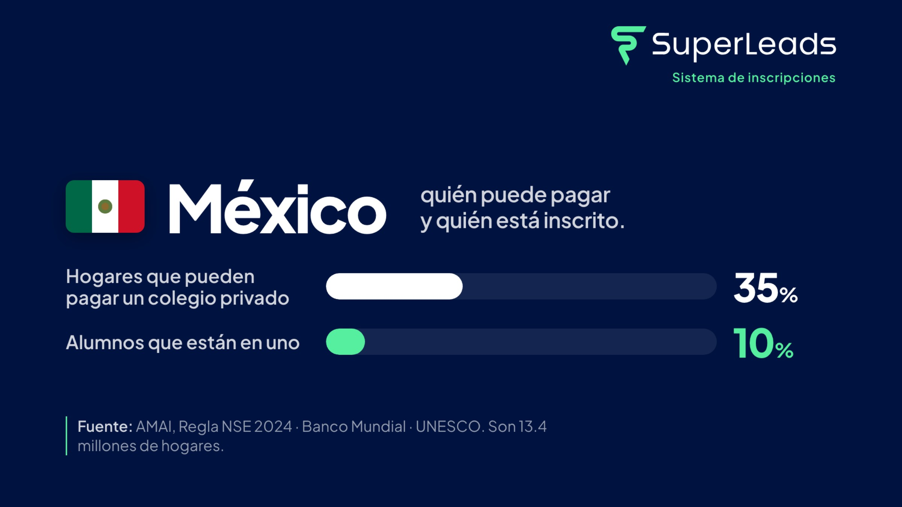

Y no es porque las familias no puedan pagar. El 35 % de los hogares mexicanos tiene el nivel socioeconómico para pagar un colegio privado: son 13.4 millones de hogares. Solo el 10 % de los alumnos está en uno.

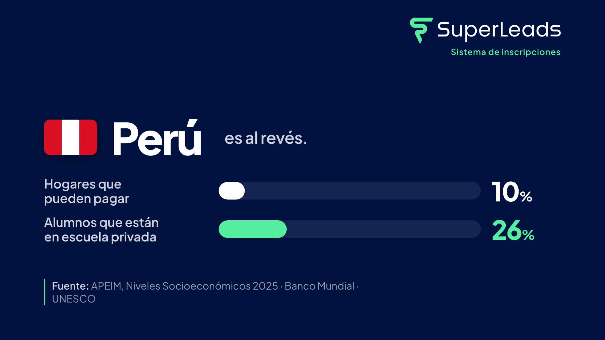

Perú es el espejo. Allá solo el 10 % de los hogares podría pagar, y aun así el 26 % de los alumnos está en escuela privada. Las familias peruanas hacen un esfuerzo enorme por la educación privada. Aquí, con mucha más capacidad de pago, se inscriben menos.

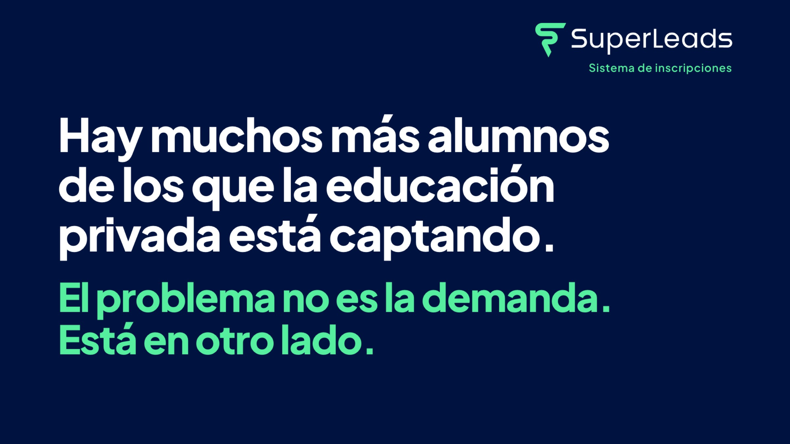

Hay muchos más alumnos de los que la educación privada está captando. El problema no es la demanda. Está en otro lado.

## Los colegios tienen lugares vacíos

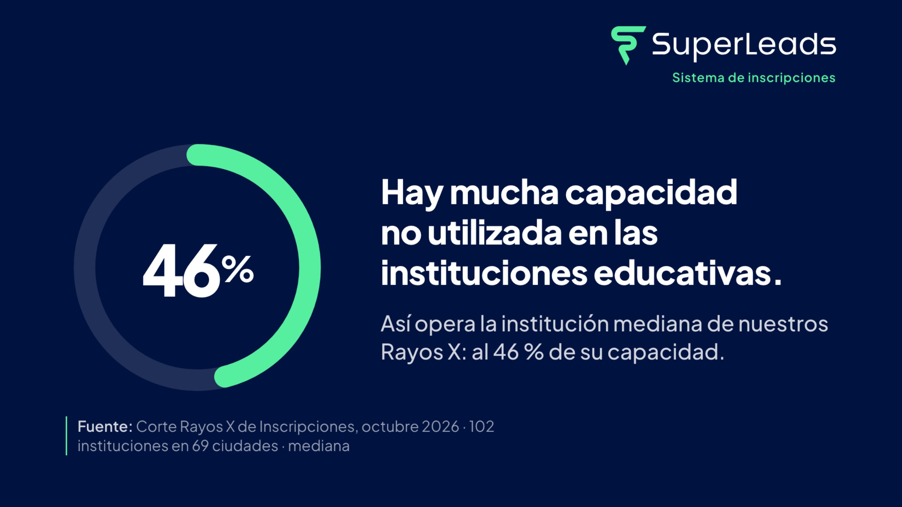

Lo vemos en los Rayos X de Inscripciones que hacemos con cada institución. En el corte de octubre de 2026, con 102 instituciones en 69 ciudades, la institución mediana opera al 46 % de su capacidad.

Más de la mitad de los lugares está vacía. Y en la educación privada no existe algo más costoso que una silla vacía.

## Las familias sí escriben

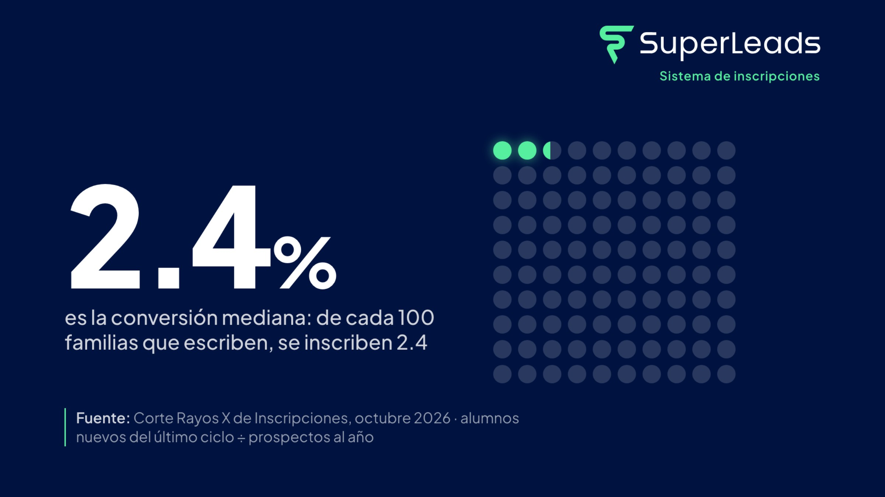

La conversión mediana es de 2.4 %: de cada 100 familias que escriben para pedir informes, se inscriben 2.4.

Las familias sí están llegando. Escriben por WhatsApp, por Messenger, por Instagram; llaman, mandan correos, llenan formularios. Lo que no está llegando es la respuesta.

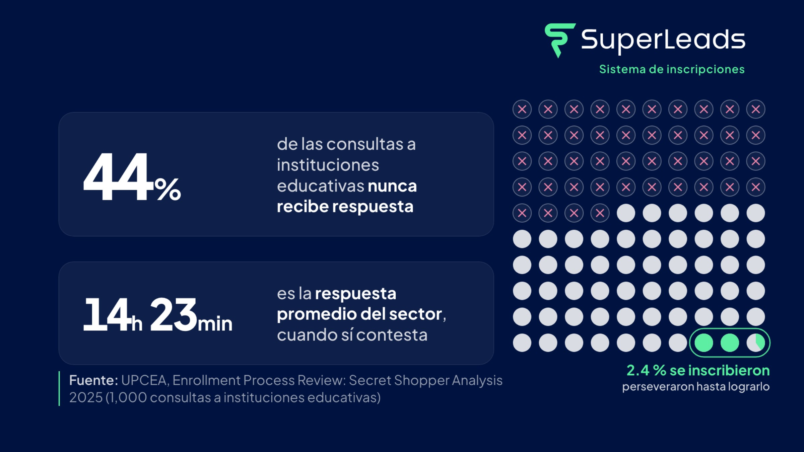

Un estudio de UPCEA con 1,000 consultas a instituciones educativas encontró que el 44 % nunca recibió respuesta. Y cuando sí contestan, la respuesta promedio tarda 14 horas con 23 minutos.

Catorce horas es una eternidad para una mamá que está decidiendo dónde va a estudiar su hijo. En ese tiempo ya le contestó otro colegio.

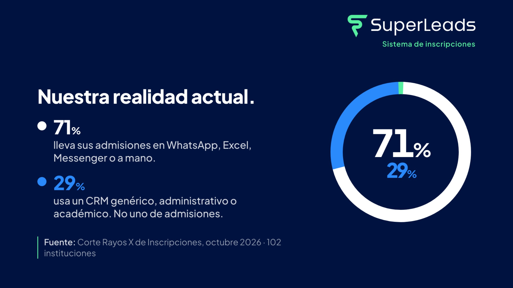

¿Por qué pasa? Porque el 71 % de las instituciones lleva sus admisiones en WhatsApp, Excel, Messenger o a mano. El otro 29 % usa un CRM genérico, administrativo o académico. Ninguno fue hecho para admisiones.

Por eso lo digo así: hay más familias queriendo inscribirse en tu colegio que las que tus procesos de inscripción alcanzan a captar.

## No es falta de esfuerzo

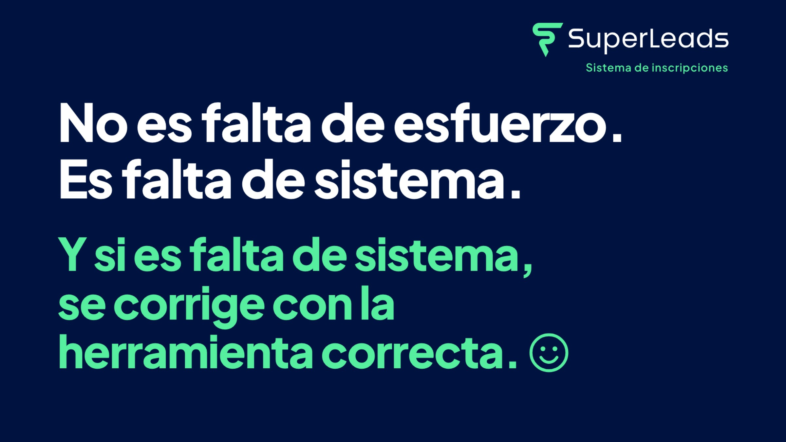

Conozco a muchos equipos de admisiones. Trabajan muchísimo. Contestan desde su celular en la noche, en fin de semana, en vacaciones.

No es falta de esfuerzo. Es falta de sistema. Y si es falta de sistema, se corrige con la herramienta correcta.

La matemática de las inscripciones es simple: prospectos por tasa de conversión es igual a alumnos. Solo hay dos palancas. Subir cualquiera de las dos sube los alumnos, y mejorar la conversión es la más barata, porque esas familias ya te escribieron.

## Por eso creamos a Constanza

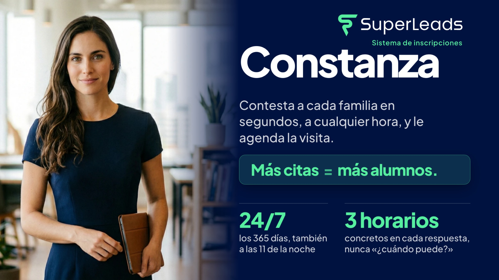

Constanza es una inteligencia artificial hecha solo para admisiones. Contesta a cada familia en segundos, a cualquier hora, los 365 días del año. También a las 11 de la noche, que es cuando muchos papás por fin se sientan a buscar colegio.

Y nunca pregunta «¿cuándo puede?». Propone tres horarios concretos, porque así es como una familia sí agenda.

Todos los días filtra el spam, recaba la información de cada familia, resuelve sus dudas, da seguimiento por su cuenta y agenda citas con alta probabilidad de inscripción.

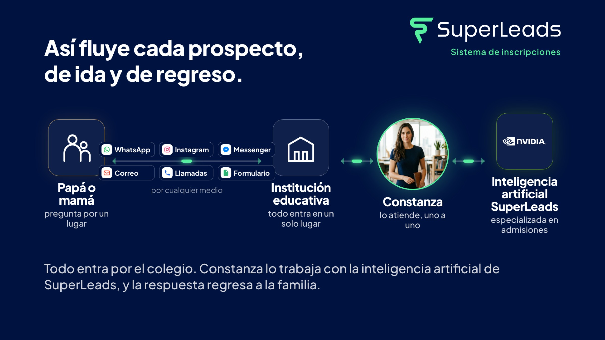

Así fluye cada prospecto: la familia escribe por el medio que quiera, todo entra por el colegio, Constanza lo atiende uno a uno con la inteligencia artificial de SuperLeads especializada en admisiones, y la respuesta regresa a la familia. Cien familias preguntando a la vez, y ninguna esperando.

La estamos iterando todo el tiempo. Vemos en directo lo que pasa en más de 100 instituciones, aprendemos qué funciona y qué no, y la ajustamos cada día para que genere más citas y de mejor calidad.

Constanza no sustituye a tu equipo. Le quita lo que no le toca para que haga lo que mejor sabe hacer: recibir a la familia y cerrar la inscripción.

## Un sistema se instala

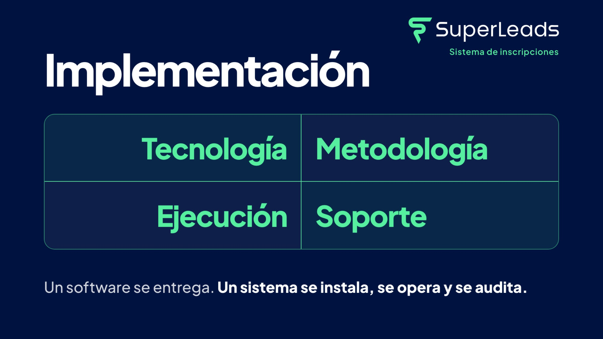

Un software se entrega. Un sistema se instala, se opera y se audita. Por eso implementamos cuatro cosas juntas: tecnología, metodología, ejecución y soporte. Si quitas una, se cae todo.

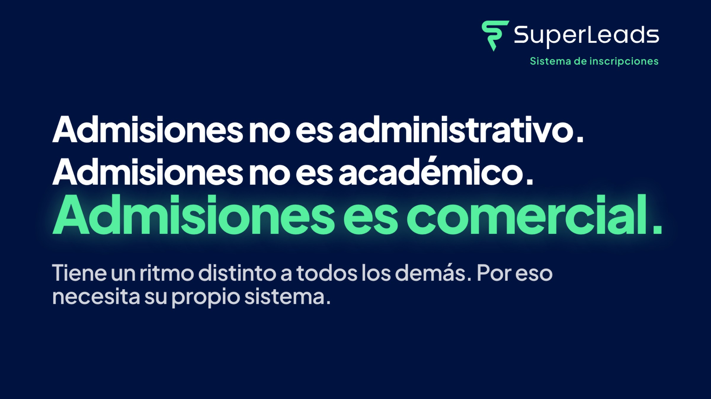

Admisiones no es administrativo. Admisiones no es académico. Admisiones es comercial, y tiene un ritmo distinto al de todas las demás áreas del colegio. Por eso necesita su propio sistema.

## La oportunidad

México tiene millones de familias que pueden pagar un colegio privado y colegios con la mitad de sus lugares vacíos. Entre unas y otros hay un puente roto: el proceso de inscripción.

Arreglarlo no le quita alumnos a nadie. Hace que lleguen al final las familias que ya querían llegar.

Si quieres ver los números de tu colegio con esta perspectiva, agenda un Rayos X de Inscripciones: https://rayosx.superleads.mx/rayos_x

Aquí está el video completo de la charla, seis minutos: https://youtu.be/op95KKuYzms

## Fuentes

- Banco Mundial e Instituto de Estadística de la UNESCO: matrícula de primaria en escuela privada, 2022–2024.
- AMAI, Regla NSE 2024; Banco Mundial; UNESCO: hogares que pueden pagar un colegio privado en México.
- APEIM, Niveles Socioeconómicos 2025: Perú.
- Corte Rayos X de Inscripciones de SuperLeads, octubre de 2026: 102 instituciones en 69 ciudades, valores medianos.
- UPCEA, Enrollment Process Review: Secret Shopper Analysis, 2025: 1,000 consultas a instituciones educativas.

Lunes 9 de noviembre de 2026, 3:55 pm · Torreón, Coahuila, México · 22°.

Ing. Ricardo López Reyero · Founder Comercial · SuperLeads · ricardo@superleads.mx
