# Cómo está el mercado educativo privado en México: conclusiones del corte Rayos X de octubre de 2026

*102 instituciones, 69 ciudades, ocho meses de diagnósticos. Lo que miden los dueños de colegios, no lo que creen.*

Por Ricardo López Reyero

Entre marzo y octubre de 2026 me senté, con mi equipo, frente a 102 dueños y directores de instituciones educativas privadas en 69 ciudades de México. Con cada uno hicimos lo mismo: un Rayos X de Inscripciones. Una sesión para acomodar los números de admisiones de su institución como tienen que estar: capacidad, matrícula, prospectos, citas, inscritos, colegiatura, permanencia, publicidad, equipo.

Este artículo es el primer corte de esos números. Lo publico porque creo que el sector necesita un punto de referencia que hoy no existe: cuando un director quiere saber si su colegio va bien o va mal, no tiene con quién compararse. Compara con el ciclo pasado y con lo que escucha en el pasillo. Aquí tiene algo mejor: la mediana de 102 instituciones que se midieron con la misma regla.

Dos advertencias antes de empezar, porque me importa que esto sea citable. La primera: es nuestra muestra, no el país. Son instituciones que pidieron un diagnóstico, 35 colegios con primaria, 14 con preparatoria y 42 universidades y posgrados, más academias y escuelas en línea. La segunda: publico medianas, no promedios. Un colegio de 7,000 alumnos mueve el promedio y miente. La mediana dice dónde está el colegio típico, y eso es lo que te sirve para ubicarte.

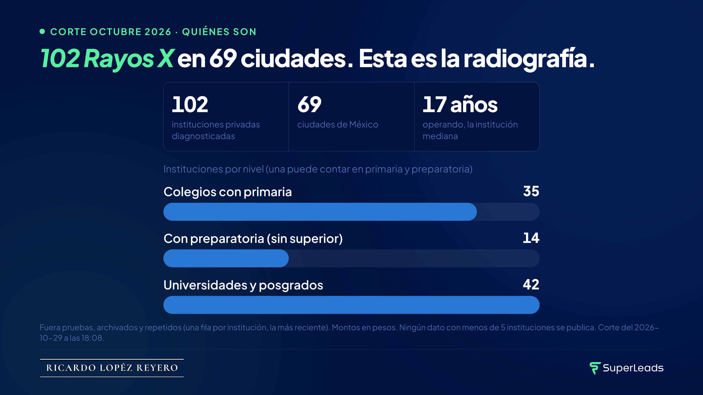

*Figura 1. 102 Rayos X en 69 ciudades. Esta es la radiografía. Fuente: SuperLeads, corte Rayos X de Inscripciones del 29 de octubre de 2026 (102 instituciones privadas en 69 ciudades de México; mediana, no promedio).*

## 1. La mitad del colegio está vacía

El primer dato es el que más me cuesta decir en voz alta: la institución privada mediana en México opera al 46 % de su capacidad instalada. No es un colegio en crisis. Es la mitad de la muestra. De cada 100 lugares que construyó, usa 46.

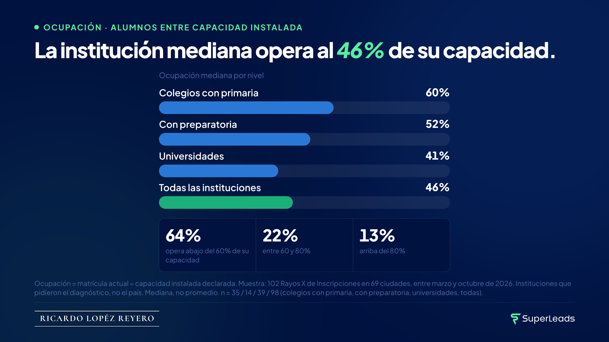

*Figura 2. La institución mediana opera al 46% de su capacidad. Fuente: SuperLeads, corte Rayos X de Inscripciones del 29 de octubre de 2026 (102 instituciones privadas en 69 ciudades de México; mediana, no promedio).*

Por nivel, la foto cambia poco. Los colegios con primaria operan al 60 % en la mediana, los que tienen preparatoria al 52 % y las universidades al 41 %. Seis de cada diez instituciones de la muestra están abajo del 60 % de ocupación; solo 13 % está arriba del 80 %.

Puesto en lugares, la institución mediana tiene 267 sillas vacías. Sumando las 98 instituciones que reportaron el dato, son 59,507 lugares sin alumno. Y puesto en pesos, la capacidad sin usar de la institución mediana vale $794,625 MXN al año; entre todas, $279.6 millones MXN al año. Es infraestructura ya pagada: el aula existe, el maestro existe, el lugar existe. Lo único que falta es el alumno.

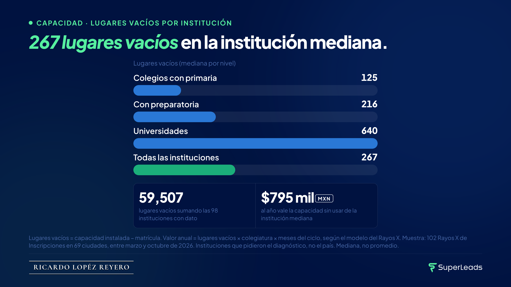

*Figura 3. 267 lugares vacíos en la institución mediana. Fuente: SuperLeads, corte Rayos X de Inscripciones del 29 de octubre de 2026 (102 instituciones privadas en 69 ciudades de México; mediana, no promedio).*

Lo que más me llama la atención no es el número, sino la normalidad con la que se vive. Nadie abre un colegio para llenarlo a la mitad. Se llega ahí un ciclo a la vez, con una familia que no contestó y otra que llegó tarde a la cita. Y como el deterioro es lento, nadie lo ve como emergencia.

## 2. El embudo: dónde se pierde la inscripción

La institución mediana recibe 8 prospectos nuevos al día. El colegio con primaria recibe 3, el de preparatoria 5 y la universidad 15. No es poca demanda: son entre 60 y 400 familias al mes que levantan la mano.

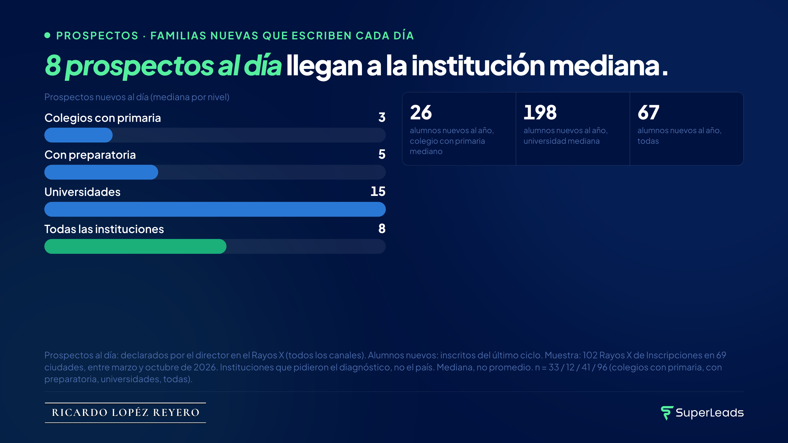

*Figura 4. 8 prospectos al día llegan a la institución mediana. Fuente: SuperLeads, corte Rayos X de Inscripciones del 29 de octubre de 2026 (102 instituciones privadas en 69 ciudades de México; mediana, no promedio).*

De cada 100 familias que preguntan, 2.4 se inscriben. Esa es la conversión mediana de prospecto a inscrito. Cuatro de cada diez instituciones convierten menos del 2 %. Solo 9 % convierte más del 10 %.

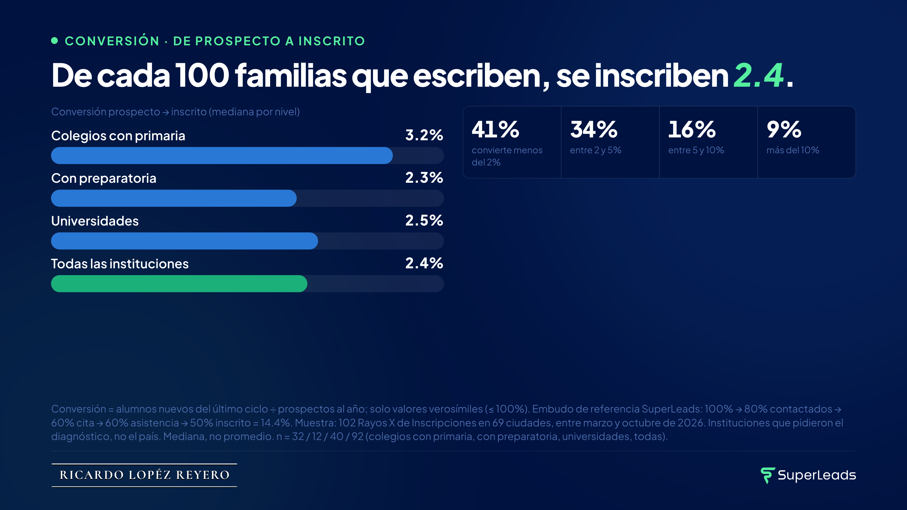

*Figura 5. De cada 100 familias que escriben, se inscriben 2.4. Fuente: SuperLeads, corte Rayos X de Inscripciones del 29 de octubre de 2026 (102 instituciones privadas en 69 ciudades de México; mediana, no promedio).*

Y aquí viene el dato que cambia el diagnóstico. De las familias que sí llegan a la cita o al recorrido, 40 % se inscribe. Es decir: cuando el colegio tiene a la familia enfrente, vende. Lo que no sabe hacer es llevarla hasta ahí.

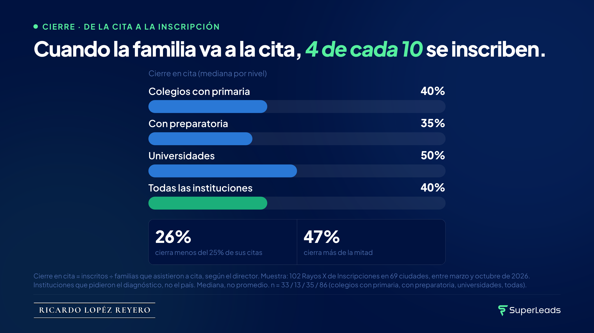

*Figura 6. Cuando la familia va a la cita, 4 de cada 10 se inscriben. Fuente: SuperLeads, corte Rayos X de Inscripciones del 29 de octubre de 2026 (102 instituciones privadas en 69 ciudades de México; mediana, no promedio).*

Esas tres cifras juntas dicen algo incómodo y muy útil. El problema del colegio privado mexicano no está en la cita. Está antes de la cita: en el tiempo de respuesta al primer mensaje, en el seguimiento del segundo día, en el «ahorita le contesto» que se volvió nunca. Entre el primer WhatsApp y el recorrido se evapora la mayor parte de la demanda, y casi nunca por precio.

## 3. El dinero: cuánto vale un alumno y cuánto cuesta

La colegiatura mensual mediana es de $3,300 MXN. La mitad de las instituciones cobra entre $2,150 y $5,000 MXN al mes. Los colegios con primaria cobran $3,825 MXN en la mediana, los de preparatoria $4,000 MXN y las universidades $2,994 MXN. La cuota de inscripción mediana es de $3,750 MXN.

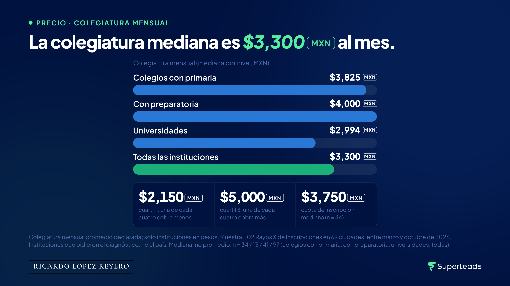

*Figura 7. La colegiatura mediana es $3,300 MXN al mes. Fuente: SuperLeads, corte Rayos X de Inscripciones del 29 de octubre de 2026 (102 instituciones privadas en 69 ciudades de México; mediana, no promedio).*

Un alumno permanece 48 meses en la institución mediana: 60 meses en el colegio con primaria, 60 en preparatoria, 36 en la universidad. Colegiatura por meses de permanencia da el valor de vida: $144,000 MXN por alumno en la mediana general, y $222,670 MXN en el colegio con primaria. Cada familia que se inscribe vale eso. Cada familia que se enfría, también.

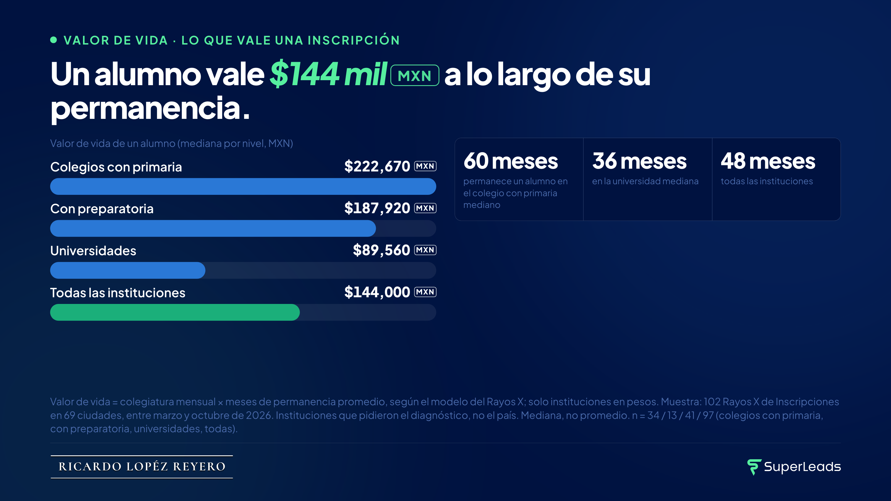

*Figura 8. Un alumno vale $144 mil MXN a lo largo de su permanencia. Fuente: SuperLeads, corte Rayos X de Inscripciones del 29 de octubre de 2026 (102 instituciones privadas en 69 ciudades de México; mediana, no promedio).*

Del otro lado está el costo. La institución mediana invierte $8,000 MXN al mes en publicidad: $3,250 MXN el colegio con primaria, $6,083 MXN el de preparatoria, $14,000 MXN la universidad. Cada prospecto le cuesta $41 MXN y cada alumno inscrito, $1,381 MXN.

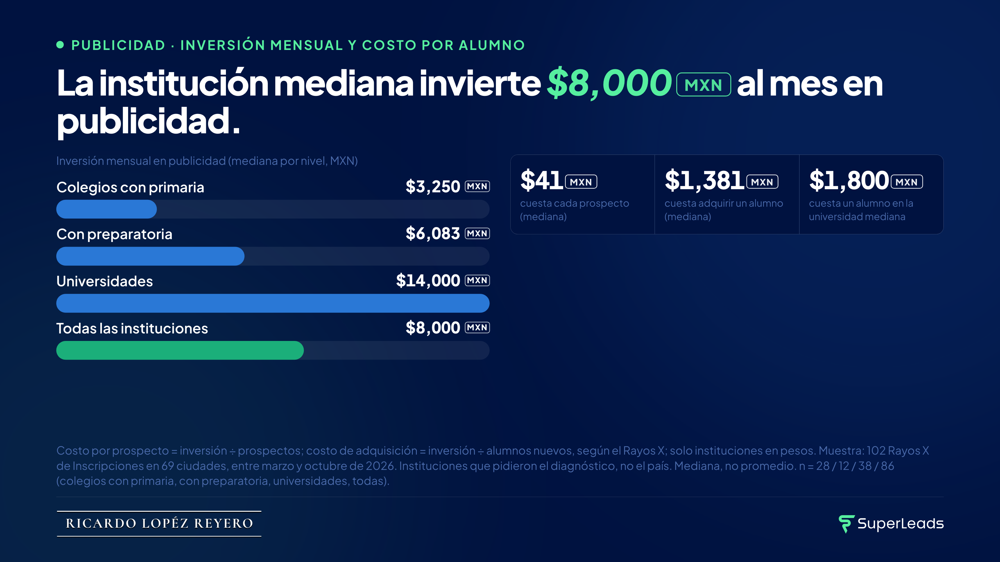

*Figura 9. La institución mediana invierte $8,000 MXN al mes en publicidad. Fuente: SuperLeads, corte Rayos X de Inscripciones del 29 de octubre de 2026 (102 instituciones privadas en 69 ciudades de México; mediana, no promedio).*

Léelo junto: un alumno cuesta $1,381 MXN y vale $144,000 MXN. La publicidad educativa es de las inversiones más rentables que conozco. El problema nunca ha sido cuánto se invierte, sino cuánto de lo que se compra con esa inversión se evapora después, sin que nadie lo vea.

Por eso la cifra que más repito en cada Rayos X es esta: subir un solo punto porcentual la conversión vale $109,500 MXN al año para la institución mediana. $39,420 MXN para el colegio con primaria mediano, $101,324 MXN para el de preparatoria y $158,629 MXN para la universidad mediana. Sin un peso más de anuncios. Es el mismo número de familias interesadas, atendidas mejor.

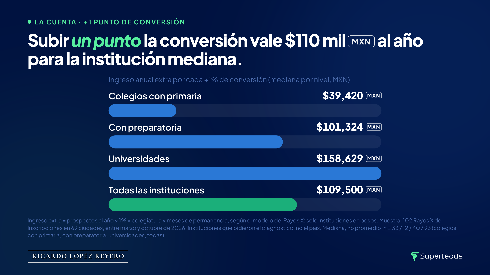

*Figura 10. Subir un punto la conversión vale $110 mil MXN al año para la institución mediana. Fuente: SuperLeads, corte Rayos X de Inscripciones del 29 de octubre de 2026 (102 instituciones privadas en 69 ciudades de México; mediana, no promedio).*

## 4. Cómo está armada la operación de admisiones

Aquí está la explicación de casi todo lo anterior. 71 % de las instituciones lleva sus admisiones en WhatsApp o en Excel. Solo 29 % tiene un CRM. En los colegios con primaria, el 88 % trabaja con WhatsApp y Excel y apenas 12 % tiene CRM.

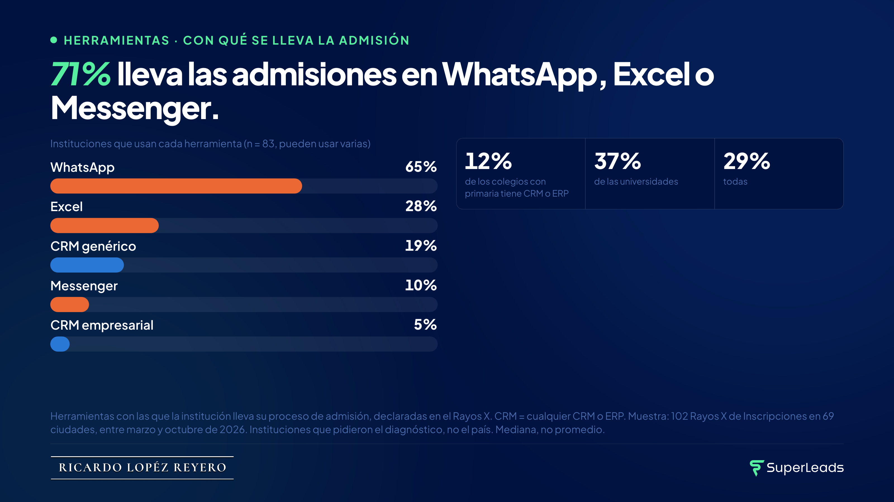

*Figura 11. 71% lleva las admisiones en WhatsApp, Excel o Messenger. Fuente: SuperLeads, corte Rayos X de Inscripciones del 29 de octubre de 2026 (102 instituciones privadas en 69 ciudades de México; mediana, no promedio).*

El equipo de admisiones y marketing de la institución mediana es de 3 personas; en el colegio con primaria, 1.1 persona. La mediana de asesores de admisiones dedicados es 1; en el colegio con primaria, cero. Solo 55 % de las instituciones tiene alguien con el cargo de director de admisiones, y 24 % trabaja con una agencia externa.

48 % de las instituciones no tiene un plan de compensación para su equipo de admisiones. En colegios con primaria, 61 %. Es decir: la persona que decide si la familia se inscribe o no, casi nunca tiene un incentivo ligado a inscribir.

Y todo eso ocurre en una temporada muy corta. Julio y agosto concentran la inscripción para la mitad de las instituciones, y febrero para cuatro de cada diez. Una operación de temporada alta, atendida por una persona, con la memoria en un teléfono y sin incentivo. No es falta de talento. Es falta de sistema.

## 5. Las palancas que casi nadie trabaja

68 % de las instituciones da becas y la mediana tiene 40 % de alumnos becados, con una beca promedio de 25 %. La beca dejó de ser una excepción: es una herramienta comercial, y conviene administrarla como tal.

40 % de los alumnos llega por recomendación de otra familia; 50 % llega por anuncios. Y sin embargo, 70 % de las instituciones no tiene un programa de recomendados. El canal más barato y más confiable del colegio es el que nadie trabaja.

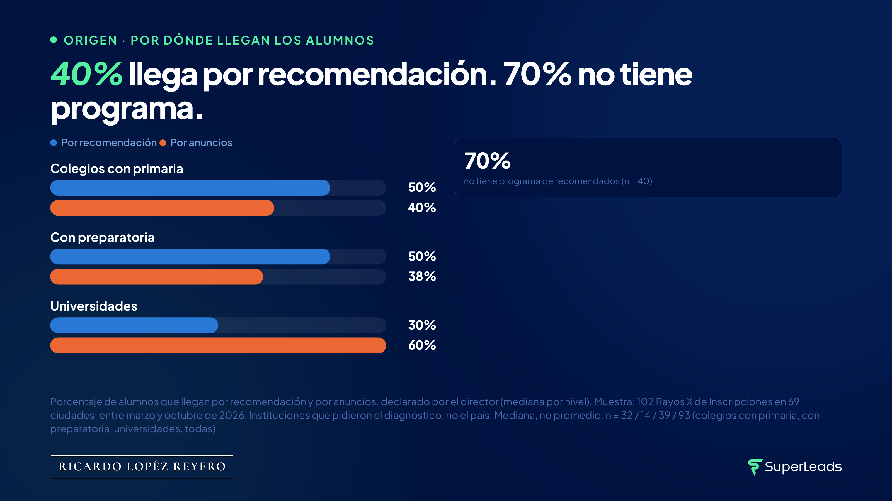

*Figura 12. 40% llega por recomendación. 70% no tiene programa. Fuente: SuperLeads, corte Rayos X de Inscripciones del 29 de octubre de 2026 (102 instituciones privadas en 69 ciudades de México; mediana, no promedio).*

En ingresos además de la colegiatura, la cafetería (69 %) y las graduaciones (60 %) son casi universales; uniformes y libros los cobra 57 %; el transporte, 17 %. Lo que ya tienes vale más que lo que falta por comprar.

## 6. Lo que el director cree

En el Rayos X también preguntamos qué cree el director. Lo digo así, «cree», porque aquí no hay mediciones: hay percepciones, y conviene no confundirlas.

Cuando preguntamos por qué no se inscribieron las familias que no se inscribieron, la causa más mencionada es el precio (62 %). La segunda, la falta de seguimiento (38 %). Después, con 17 % cada una, el cupo u horario, la competencia y la distancia. Fíjate en el orden: la primera causa no depende de nadie; la segunda está completamente bajo el control del colegio.

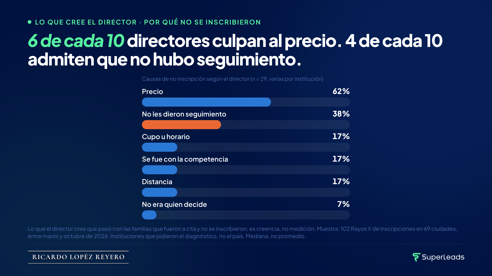

*Figura 13. 6 de cada 10 directores culpan al precio. 4 de cada 10 admiten que no hubo seguimiento. Fuente: SuperLeads, corte Rayos X de Inscripciones del 29 de octubre de 2026 (102 instituciones privadas en 69 ciudades de México; mediana, no promedio).*

Y cuando preguntamos cómo califica su marketing, 44 % lo califica de muy bueno o excelente. Al mismo tiempo, 64 % de las instituciones opera abajo del 60 % de su capacidad. Esa distancia entre percepción y realidad es, probablemente, la gráfica más importante de todo el corte. No se arregla lo que no se ve.

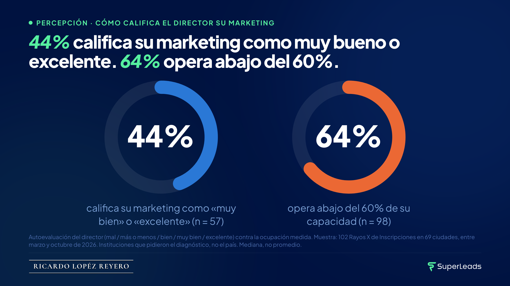

*Figura 14. 44% califica su marketing como muy bueno o excelente. 64% opera abajo del 60%. Fuente: SuperLeads, corte Rayos X de Inscripciones del 29 de octubre de 2026 (102 instituciones privadas en 69 ciudades de México; mediana, no promedio).*

## Conclusiones del corte

1. La institución privada mediana en México opera al 46 % de su capacidad. Hay demanda disponible, hay lugares disponibles y hay infraestructura pagada. Lo que falta no es mercado: es proceso.
2. El colegio sabe cerrar: 40 % de las familias que llegan a la cita se inscribe. Pero solo 2.4 % de las que preguntan llega a inscribirse. La inscripción se pierde entre el primer mensaje y la cita, no en la cita.
3. Un alumno cuesta $1,381 MXN en publicidad y vale $144,000 MXN. La publicidad no es el problema. Lo que se compra con ella se pierde después, en el seguimiento.
4. Un punto de conversión vale $109,500 MXN al año para la institución mediana. Es el crecimiento más barato que existe: las familias ya llegaron.
5. Siete de cada diez instituciones operan sus admisiones en WhatsApp y Excel, con una persona y sin plan de compensación. El resultado no es casualidad: es el sistema que se tiene.
6. El director culpa al precio. Los datos culpan al silencio. Con una colegiatura mediana de $3,300 MXN y 13.4 millones de hogares mexicanos que pueden pagarla, el precio rara vez es el motivo.

## Para qué sirve esto

Sirve para que te ubiques. Toma tu ocupación, tu conversión, tu cierre en cita, tu costo por alumno y tu valor de vida, y ponlos junto a estas medianas. Si estás arriba, ya tienes un sistema y este corte te confirma el tamaño de lo que estás capturando. Si estás abajo, no estás solo: estás con la mayoría, y la buena noticia es que ninguna de estas cifras depende del mercado. Todas dependen del proceso.

Estos números salen de los Rayos X de Inscripciones que hacemos en SuperLeads. Es una sesión de trabajo con el dueño o el director en la que ordenamos los números de su institución exactamente como aparecen aquí, con sus datos, y salen con un PDF con lo más importante. Volveremos a publicar el corte cada seis meses, con los datos acumulados, para que el sector tenga por fin una referencia que no sea el pasillo.

La próxima edición es en abril de 2027. Si quieres que tu institución esté en ella, el Rayos X es el camino: superleads.mx/rayos_x. Y si quieres comentar estos números conmigo, escríbeme directo: ricardo@superleads.mx.

## Nota metodológica

Corte del 29 de octubre de 2026 a las 18:08. 110 Rayos X exportados; fuera pruebas, archivados y repetidos (una fila por institución, la más reciente): 102 instituciones en 69 ciudades, finalizados entre el 6 de marzo y el 28 de octubre de 2026. Montos en pesos mexicanos; las instituciones en dólares quedan fuera de los montos. Ningún dato con menos de cinco instituciones se publica. Medianas, con cuartiles y n por métrica, disponibles a solicitud: ricardo@superleads.mx.

---

Viernes 30 de octubre de 2026, 9:24 am · Torreón, Coahuila, México · 19°.

**Ing. Ricardo López Reyero**  
Founder Comercial · SuperLeads  
ricardo@superleads.mx  
